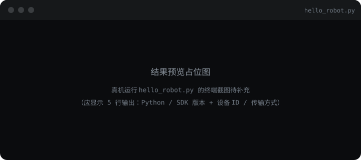

## 跑完你会看到

跑完一条命令，终端打印 Python 版本、SDK 版本（SDK——控制机器人用的程序库），以及机器人的设备编号和传输方式。设备编号是这台机器人在网络里的"身份证"，后面所有命令都是发给它。

前提只有两件事：机器人已上电；电脑和机器人连的是同一个 Wi-Fi。

## 关键函数

| 新增 | 说明 |
| --- | --- |
| `pm.lite.connect(transport, timeout)` | 建立连接，返回机器人对象；配 `with` 用完自动断开 |
| `robot.connection.device_id` / `.transport` | 连接信息：设备编号、传输方式 |
| `pm.lite.LiteError` | SDK 的统一异常类型，本模块所有 except 都接它 |
| `pm.lite.__version__` | SDK 版本号 |

print、f-string、`sys.version` 是纯展示手段，直接看下面代码，不进表。

## 完整示例

<Tabs>
  <Tab title="代码">
    <CodeFold
      title="hello_robot.py"
      code={'import sys\nfrom pathlib import Path\n\nimport pymotion as pm\n\nTRANSPORT = "wifi"   # 连接方式：本手册全程用 Wi-Fi\nTIMEOUT = 15.0       # 连接最多等 15 秒\n\n\ndef main():\n    # 打印环境 → 连接 → 读设备信息；with 块结束自动断开\n    print(f"Python: {sys.version.split()[0]} ({sys.executable})")\n    print(f"SDK:    {pm.lite.__version__} ({Path(pm.__file__).resolve()})")\n    print()\n\n    try:\n        with pm.lite.connect(transport=TRANSPORT, timeout=TIMEOUT) as robot:\n            print(f"设备  ID: {robot.connection.device_id}")   # 机器人的网络身份证\n            print(f"传输方式: {robot.connection.transport}")   # 实际用的连接方式\n    except pm.lite.LiteError as exc:\n        # LiteError 是 SDK 的统一报错类型，本模块所有失败都由它报告\n        print(f"连接失败（{exc}）")\n\n\nif __name__ == "__main__":\n    main()'}
    />
  </Tab>
  <Tab title="运行逻辑">

    1. 先打印 Python 版本和 SDK 版本——环境就绪才有下一步
    2. 尝试连接：等机器人应答，最多 15 秒
    3. 连上后打印设备 ID 和传输方式，`with` 块结束自动断开
    4. 没连上时，LiteError 报出失败原因

  </Tab>
  <Tab title="结果预览">

    

  </Tab>
</Tabs>

## 参数说明

| 名称 | 类型 | 默认值或范围 | 作用 |
| --- | --- | --- | --- |
| `transport` | str | `"wifi"` / `"usb"` | 连接方式，本手册全程 `wifi` |
| `timeout` | float | `15.0`（秒） | 连接最长等待时间，局域网内 10～20 秒足够 |
| `robot.connection.device_id` | str | 由设备决定 | 设备唯一编号，多台机器人同网时靠它区分 |
| `robot.connection.transport` | str | `"wifi"` / `"usb"` | 实际生效的连接方式，以它为准不以前面常量为准 |

想改连接等待时间，只调 `TIMEOUT` 一个常量；`TRANSPORT` 保持 `"wifi"` 不动。
