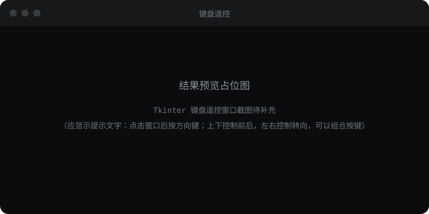

import { CodeFold } from "/cn/ai-vision-robot/components/code-fold.jsx"

## 前置条件

- 完成 [2.4 差速驱动](../11-differential-drive/index)
- 把 2.4 的产出 `differential_drive.py` 复制到本页目录（和主文件同一层，否则 `import` 报错）
- **车轮架空**

## 关键函数

| 函数 / 语法 | 说明 |
| --- | --- |
| `from differential_drive import vw_to_rpm` | 直接用 2.4 的换算函数，不重写 |
| `window.bind("<KeyPress>", …)` / `<KeyRelease>` | 按键按下与松开，配合 `keys` 集合记录「现在按着哪些键」 |
| `commands.motor_speeds.write({…}, valid_for=0.35)` | 每隔 0.1 秒重发；`valid_for` 比发送周期长，程序卡死最多再跑 0.35 秒 |
| `<FocusOut>` / 关窗回调 | 窗口失焦或关闭 → 立刻停 |

## 完整示例

本模块唯一的多文件页——主文件 + 附属文件 + 结果预览。

<Tabs>
  <Tab title="keyboard_control.py">

        <CodeFold
      title="keyboard_control.py"
      docs=[
        { label: "drive", doc: "调 2.4 的函数\n→ 发双轮速度" },
        { label: "run_window", doc: "建窗口、绑键\n按 0.1 秒节拍刷新" },
        { label: "valid_for", doc: "心跳式重发\n断供就自动停" },
        { label: "main", doc: "控制权 → 会话\n→ 开窗" },
      ]
      folds=[
        { label: "def drive(commands, v, w):", from: 15, to: 21 },
        { label: "def run_window(commands):", from: 24, to: 82 },
        { label: "def main():", from: 85, to: 95, defaultOpen: true },
      ]
      code='import tkinter as tk                       # Tkinter 用来创建键盘控制窗口\n\nimport pymotion as pm\n\nfrom differential_drive import vw_to_rpm                   # 引用 2.4 演示的 V/W 转轮速函数\n\n# --- 本例程可调整的参数 ---\nV = 106                                    # 前后方向的线速度，单位毫米/秒\nW = 40                                     # 左右方向的角速度，单位度/秒\n\n# --- 共用配置（一般不用动）---\nPORT_LEFT, PORT_RIGHT = 3, 4               # 左轮接 M3，右轮接 M4\n\n\ndef drive(commands, v, w):\n    """用实时命令入口把线速度和角速度设为左右主动轮转速。"""\n    left, right = vw_to_rpm(v, w)                           # 调用 2.4 的函数，得到左右轮转速\n    commands.motor_speeds.write(                            # 选择其中的电机速度命令\n        {PORT_LEFT: left, PORT_RIGHT: right},               # 设定左右主动轮的目标转速\n        valid_for=0.35,                                     # 大于 0.1 秒发送周期；定时发送中断后会自动停机\n    )\n\n\ndef run_window(commands):\n    """用实时命令入口打开键盘窗口，并持续刷新双轮速度。"""\n    window = tk.Tk()                                        # 创建一个窗口\n    window.title("键盘遥控")                                # 设置窗口标题\n    window.keys = set()                                     # 集合可以同时记录多个按键\n\n    tip = tk.Label(                                         # 创建一段窗口提示文字\n        window,\n        text="点击窗口后按方向键；上下控制前后，左右控制转向，可以组合按键",\n        padx=24,                                            # 文字左右各留 24 像素空白\n        pady=24,                                            # 文字上下各留 24 像素空白\n    )\n    tip.pack()                                              # 把提示文字放进窗口\n\n    # 在 run_window 内部定义 tick，供后面的 window.after() 定时调用\n    def tick():\n        """把按键合成当前目标，并按固定周期发送。"""\n        v = 0                                                # 每轮从零重算，不会越按越快\n        w = 0\n        if "Up" in window.keys:\n            v += V                                          # 上键提供 +V 的前进速度\n        if "Down" in window.keys:\n            v -= V                                          # 下键提供 -V 的后退速度\n        if "Left" in window.keys:\n            w += W                                          # 左键提供 +W 的左转速度\n        if "Right" in window.keys:\n            w -= W                                          # 右键提供 -W 的右转速度\n\n        drive(commands, v, w)                               # 即使没有按键，也持续发送左右轮 0 RPM\n        window.after(100, tick)                             # 100 毫秒后再次执行 tick\n\n    # 在 run_window 内部定义 on_press，供按键按下时调用\n    def on_press(event):\n        """记录按下的方向键；空格和 Esc 清空全部按键。"""\n        if event.keysym in ("space", "Escape"):             # event.keysym 是本次按下的按键名称\n            window.keys.clear()\n            drive(commands, 0, 0)                           # 立即把左右轮目标改为 0 RPM\n        elif event.keysym in ("Up", "Down", "Left", "Right"):\n            window.keys.add(event.keysym)                   # 把刚按下的键加入集合\n\n    # 在 run_window 内部定义 on_release，供按键松开时调用\n    def on_release(event):\n        """只移除已经松开的键，其他仍按住的键继续生效。"""\n        window.keys.discard(event.keysym)                   # 把刚松开的键移出集合\n\n    # 在 run_window 内部定义 on_focus_out，供窗口失去焦点时调用\n    def on_focus_out(_event):\n        """窗口失去焦点时清空全部按键。"""\n        window.keys.clear()\n        drive(commands, 0, 0)                               # 失去焦点时立即把左右轮目标改为 0 RPM\n\n    window.bind("<KeyPress>", on_press)                     # 将按下事件绑定到 on_press\n    window.bind("<KeyRelease>", on_release)                 # 将松开事件绑定到 on_release\n    window.bind("<FocusOut>", on_focus_out)                 # 将失焦事件绑定到 on_focus_out\n    window.after(100, tick)                                 # 100 毫秒后首次检查按键\n    try:\n        window.mainloop()                                   # 保持窗口运行并接收事件\n    finally:\n        commands.motor_speeds.stop()                        # 关窗退出实时控制前，最后主动停机一次\n\n\ndef main():\n    """连接 → 拿控制权 → 开双轮通道 → 开窗口"""\n    try:\n        with pm.lite.connect(transport="wifi", timeout=15.0) as robot:\n\n            with robot.control():                           # 拿控制权，退出时自动停止\n                # 打开实时控制会话\n                with robot.realtime.open(command_targets={"motor_speeds": (PORT_LEFT, PORT_RIGHT)}) as session:\n                    run_window(session.commands)            # 传入实时会话的命令入口\n    except Exception as exc:\n        print(f"出错: {type(exc).__name__}: {exc}")\n\n\nif __name__ == "__main__":\n    main()'
    />

  </Tab>
  <Tab title="differential_drive.py">

    与 2.4 本页产出相同，复制到本页目录即可。

        <CodeFold
      title="differential_drive.py"
      docs={[]}
      folds=[
        { label: "def limit_rpm(left, right):", from: 11, to: 18 },
        { label: "def vw_to_rpm(v, w):", from: 21, to: 33, defaultOpen: true },
      ]
      code='import math\n\n# --- Robot 尺寸 ---\nR = 33.75                                  # 轮子半径，毫米（直径 67.5）\nD = 160.0                                  # 左右轮间距，毫米\n\n# --- 共用配置（一般不用动）---\nMAX_RPM = 60                               # 单轮转速上限\n\n\ndef limit_rpm(left, right):\n    """同尺度限幅：超过单轮上限就两边一起缩小，弯道形状不变；返回值已取整"""\n    fast = max(abs(left), abs(right))                       # 两轮里转得最快的那个\n    if fast > MAX_RPM:                                      # 超过上限才需要缩\n        scale = MAX_RPM / fast                              # 缩小的比例\n        left = left * scale                                 # 左轮按同一比例缩小\n        right = right * scale                               # 右轮按同一比例缩小\n    return round(left), round(right)                        # 电机只收整数，四舍五入\n\n\ndef vw_to_rpm(v, w):\n    """差速映射：前进速度和转弯快慢 → 左右轮的转速（RPM）\n\n    左轮线速度 = 前进速度 - 角速度 × 轮间距 ÷ 2\n    右轮线速度 = 前进速度 + 角速度 × 轮间距 ÷ 2\n    轮转速 = 轮线速度 × 60 ÷ (2 × π × 轮子半径)\n    算完先限幅、再取整，然后返回\n    """\n    w = math.radians(w)                                     # 重点：度/秒 → 弧度/秒\n    c = 2 * math.pi * R                                     # 轮子转一圈走多远，毫米\n    left_v = v - w * D / 2                                  # 左轮线速度，毫米/秒\n    right_v = v + w * D / 2                                 # 右轮线速度，毫米/秒\n    return limit_rpm(left_v * 60 / c, right_v * 60 / c)     # 线速度换成转速，再限幅'
    />

  </Tab>
  <Tab title="结果预览">

    

    按 ↑ 前进，松开停住；↑+← 边走边左转；点掉窗口车立刻停。

  </Tab>
</Tabs>

### 运行方式

```bash
python keyboard_control.py
```

## 参数说明

| 名称 | 类型 | 默认值或范围 | 作用 |
| --- | --- | --- | --- |
| `V` | int | 106 毫米/秒 | 前后方向线速度 |
| `W` | int | 40 度/秒 | 左右方向角速度 |
| `valid_for` | float | 0.35 | 必须大于发送周期 0.1，断供自动停 |
| `PORT_LEFT` / `PORT_RIGHT` | int | 3 / 4 | 左轮 M3、右轮 M4 |
| `keys` | set | 集合 | 同时记多个按下的键 |
