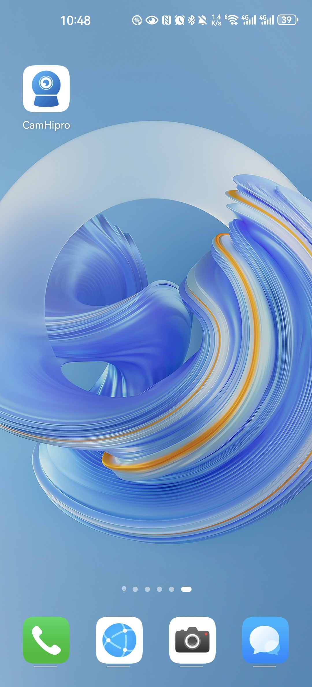
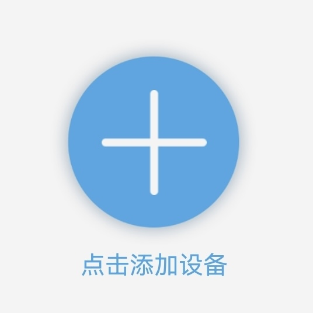
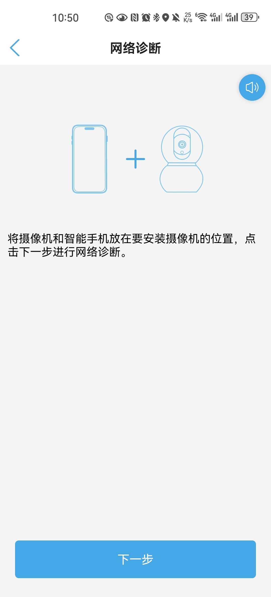
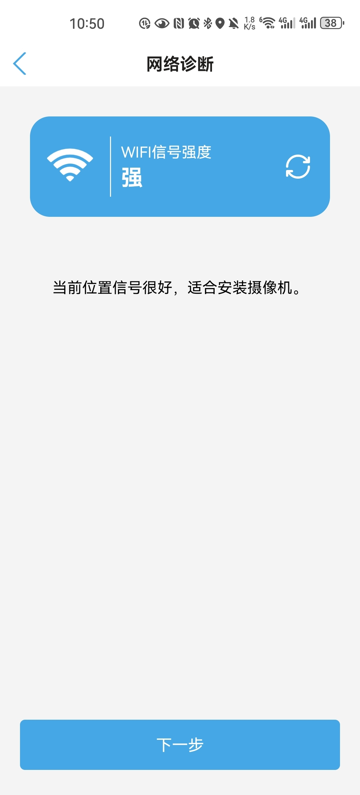
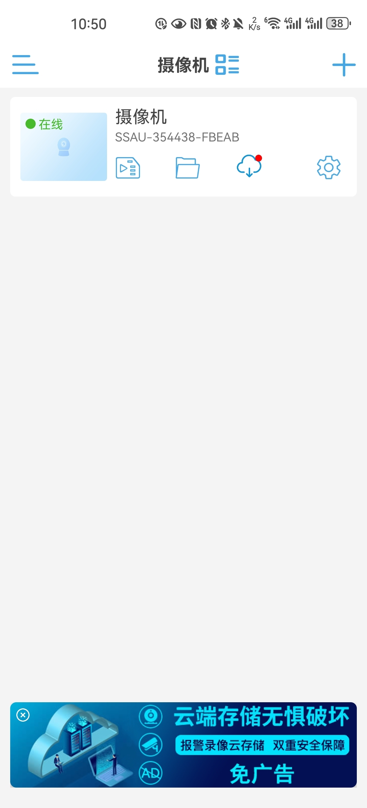
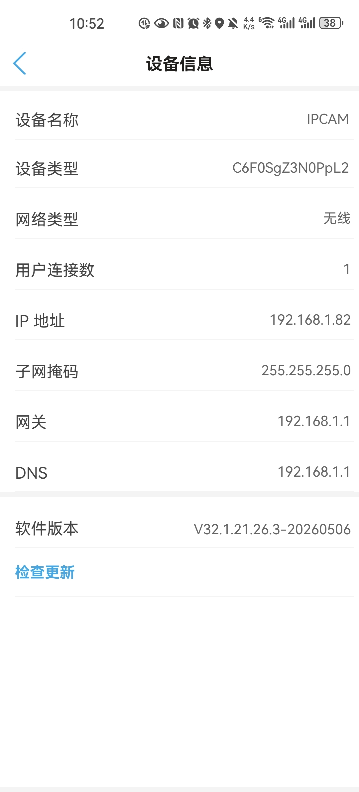
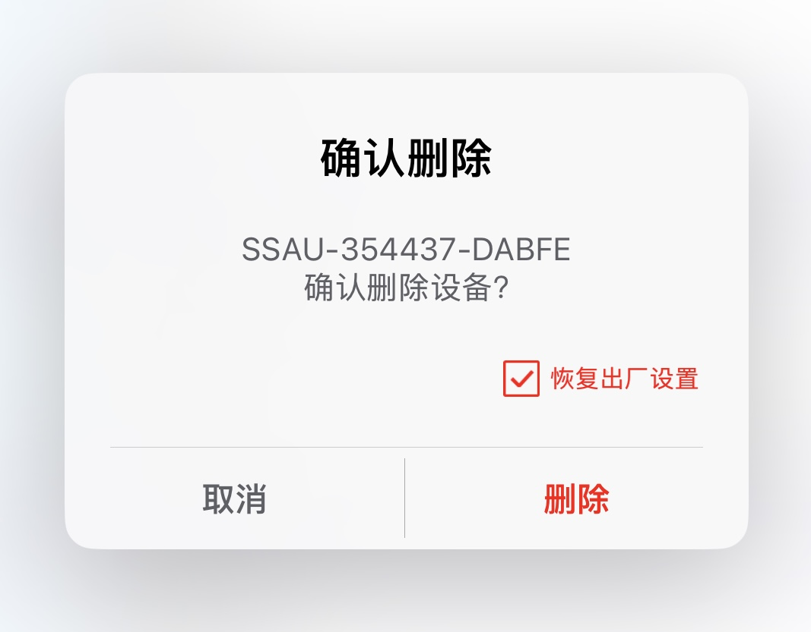

## 前置条件

- 机器人电量充足
- 一台手机（Android / iPhone 皆可），能装下方链接里的摄像头软件
- 手机与机器人放在同一张桌上，蓝牙和 Wi-Fi 都打开

## 操作步骤

### 准备

1. 按下 robot 的上电按钮，等指示灯亮起。
2. 点击下载[ 摄像头软件 CamHipro ](https://pan.baidu.com/s/1UBkmZM4WJaBiSIhRww6ttg?pwd=lite)，下载后安装到手机，桌面上出现对应图标。

   

### 添加设备

3. 开启手机蓝牙，点开软件，点击首页的加号按钮添加设备。

   

4. 软件搜索附近的蓝牙摄像机，搜到后点击「添加」。

   

5. 进入无线配置，名称与密码按照实际当前 Wi-Fi 信息填入，完成后点击「配置无线并添加」。

   

6. 按网络诊断的提示，把摄像机和手机放到要安装摄像机的位置，完成后点击屏幕下方的「下一步」。

   

7. 确认当前 Wi-Fi 信号强度良好后点击「下一步」；信号弱时调整手机与摄像机的距离再检测。

   

8. 进入名称设置，填写设备名称（默认为「摄像机」），点击「确认」。

   

9. 设备添加成功后，设备列表中显示状态为「在线」，点击设备右下齿轮图标即可进入设置页。

   

### 查看设备信息

10. 设备页下可查看分享、云存储、无线设置、修改密码、视频遮挡、小窗口直播、报警管理与通知，以及视频设置、音频设置、TF 卡录像与容量、设备时间与设备信息等配置项。

    

    

11. 点击「设备信息」，即可查看 IP 地址。

    

### 解绑摄像机（可选）

12. 需要解绑摄像机时，在设置页底部点击「解绑并删除摄像机」，进入确认删除对话框。核对设备 UID 后，按需勾选「恢复出厂设置」，再点击「删除」即可完成解绑。

    

## 预期结果

连接成功后软件里能看到实时画面，用设备信息页的 IP 地址拼出 RTSP 地址，下一页取图要用。
