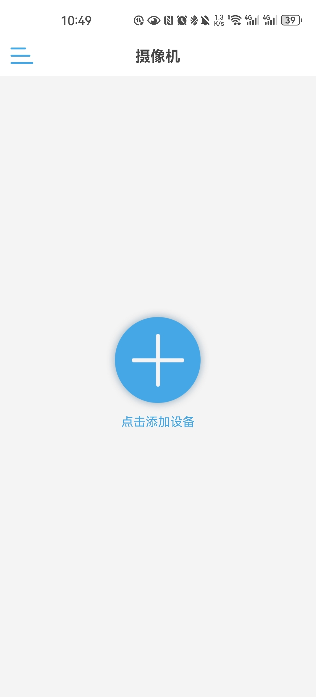
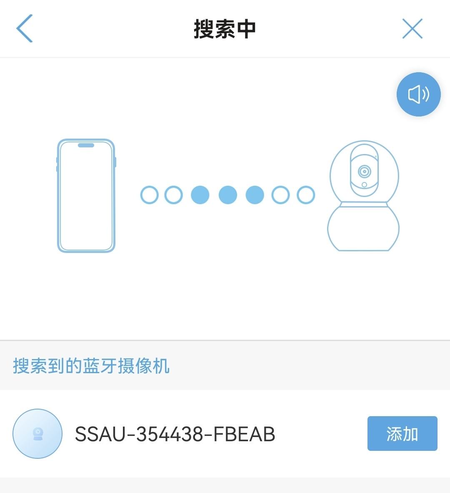
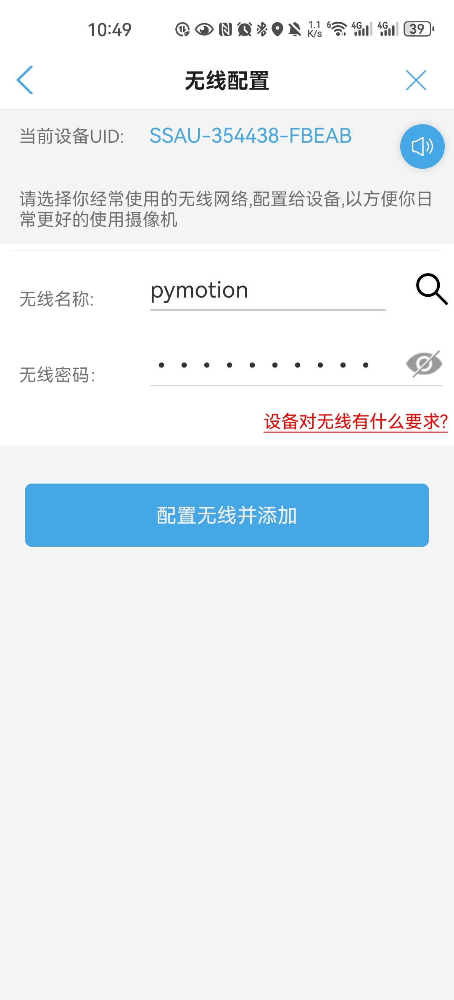
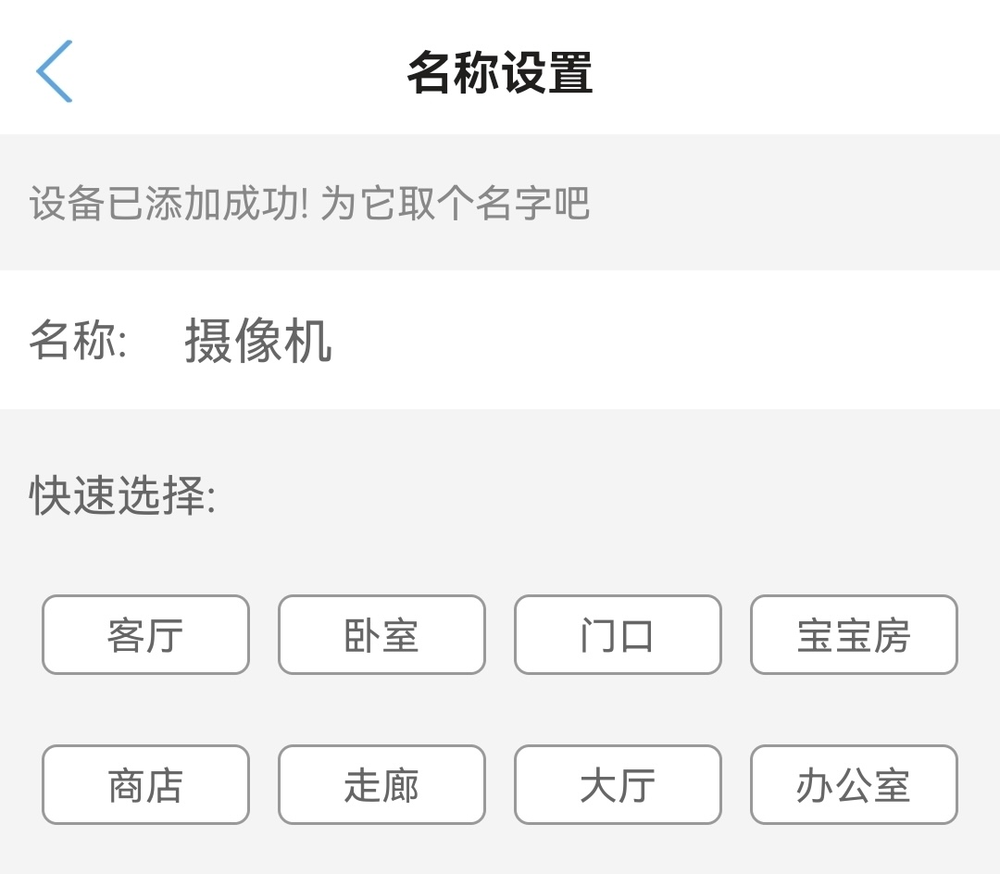
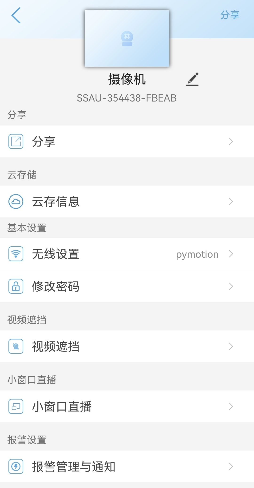
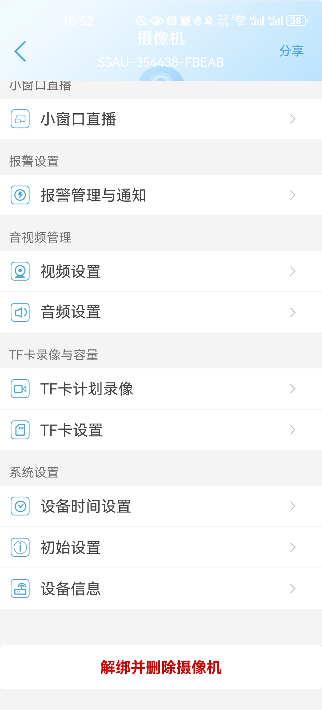

## 前置条件

- 机器人电量充足
- 一台手机（Android / iPhone 皆可），能装下方链接里的摄像头软件
- 手机与机器人放在同一张桌上，蓝牙和 Wi-Fi 都打开

## 操作步骤

1. 按下 robot 的上电按钮，等指示灯亮起。
2. 点击下载[摄像头软件](https://pan.baidu.com/s/1UBkmZM4WJaBiSIhRww6ttg?pwd=lite)，下载后安装到手机。

   

3. 开启手机蓝牙，再点开软件，进入首页。

   

4. 点击首页的加号按钮，软件搜索附近的蓝牙摄像机，搜到后点击设备上的「添加」。

   

5. 进入无线配置，无线名称与密码按照实际当前 Wi-Fi 信息填入，完成后点击「配置无线并添加」。

   

6. 按网络诊断的提示，把摄像机和手机放到要安装摄像机的位置，点击「下一步」。

   

7. 确认当前 Wi-Fi 信号强度良好后点击「下一步」；信号弱时调整手机与摄像机的距离再重新检测。

   

8. 进入名称设置，填写设备名称（默认为「摄像机」），点击「确认」。

   

9. 设备添加成功后，设备列表中显示状态为「在线」。

   

10. 点击设备右下齿轮图标进入设置页，可查看分享、云存储、无线设置、修改密码等配置项。

    

11. 向下滚动设置页，可查看报警管理、音视频设置、TF 卡录像、设备时间等配置项。

    

12. 点击「设备信息」，可以查看 IP 地址。

    

## 预期结果

连接成功后软件里能看到实时画面，用设备信息页的 IP 地址拼出 RTSP 地址，下一页取图要用。
