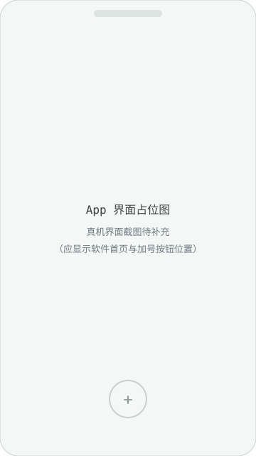

## 前置条件

- 机器人电量充足
- 一台手机（Android / iPhone 皆可），能装下方链接里的摄像头软件
- 手机与机器人放在同一张桌上，蓝牙和 Wi-Fi 都打开

## 操作步骤

1. 按下 robot 的上电按钮，等指示灯亮起。
2. 点击下载[摄像头软件](https://pan.baidu.com/s/1UBkmZM4WJaBiSIhRww6ttg?pwd=lite)，下载后安装到手机。
3. 开启手机蓝牙，再打开软件。

    

4. 点击加号按钮。

    （后续步骤与配图待补充）

## 预期结果

连接成功后软件里能看到实时画面，记下这路画面的 RTSP 地址，下一页取图要用。

> 本页内容仍在补充，步骤与配图补齐后再补运行说明。
