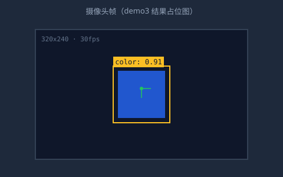

import { CodeRef } from "/cn/ai-vision-robot/components/code-ref.jsx";
import { CodeFold } from "/cn/ai-vision-robot/components/code-fold.jsx";
import { FnDoc } from "/cn/ai-vision-robot/components/fn-doc.jsx";

# UI Lab（内部）

本页只做验证，不属于正式手册内容。验证通过后，写法才会进正文（见 `docs/spec.md` 的两条硬约束）。
自定义组件统一"抄官方作业"：抓线上原生代码块的 SSR DOM + 官方 CSS，token 用 Shiki 双主题双值写法，暗色切换走官方规则。

---

## Demo 1 · 行标记

**问题**：`title` / `highlight` 参数生效？（`focus` 淡化按反馈砍掉，不进规范）
**结论**：✅ 可用 —— highlight 落点正确。

```python title="tracking.py" highlight={2,7} showLineNumbers
def target_offset(box, width):
    center = (box[0] + box[2]) / 2   # ← highlight 第 2 行
    return (center - width / 2) / width

def decide(offset, dead_zone):
    if abs(offset) < dead_zone:      # ← highlight 第 7 行
        return 0
    return 1 if offset > 0 else -1
```

---

## Demo 2 · 三态切换

**问题**：`<Tabs>` 在 代码 / 伪代码 / 结果图 之间切换，不闪、图能显示？
**结论**：✅ 可接受 —— 「伪代码先行」规范的呈现载体。

<Tabs>
<Tab title="代码">
```python title="qr_centering.py"
def run(data_queue, commands):
    qr = qr_observation.read(data_queue)
    if qr is None:
        servo_control.reset()
        return
    servo_control.turn(qr["yaw_offset"])
```
</Tab>

<Tab title="伪代码">
```text
读一帧二维码观测
├─ 没读到 → 舵机回中，结束
└─ 读到了 → 按水平偏角转动舵机
```
</Tab>

<Tab title="结果图">

</Tab>
</Tabs>

---

## Demo 3 · 联动高亮

**问题**：点说明区的函数名，下方代码块对应行亮起？（原生不支持，靠自定义组件）
**结论**：✅ 可用 —— 行选择器 `.line` 实测存在，点击切换正常。

<div id="demo-block">

```python title="line_following.py" showLineNumbers
def read_line_state(data_queue):
    lt = data_queue.read()["line_tracker"]
    if not lt["valid"]:
        return None
    return lt["is_detected"]

def run(data_queue, commands):
    state = read_line_state(data_queue)
    if state is None:
        commands.motors(0, 0)
        return
    left, right = motion(state)
    commands.motors(left, right)
```

</div>

<CodeRef
  target="demo-block"
  items={[
    { label: "read_line_state() → 第 1 行", line: 1 },
    { label: "读不到传感器 → 第 3 行", line: 3 },
    { label: "run() 主循环 → 第 8 行", line: 8 },
    { label: "停车分支 → 第 11 行", line: 11 },
  ]}
/>

---

## Demo 4 · 编辑器式折叠 + 代码内伪代码浮层（`code-fold.jsx` v6）

**问题**：① 收起时保留完整 `def` 签名？② 函数体缩进符合 Python 语法（复制出来可直接运行）？③ 折叠条无废话？
**结论**：待线上验证 —— v6：折叠条显示完整签名 `def motion(state):`；代码改用 `\n` 转义字符串传入（MDX 会剥掉 JSX 属性多行模板串的公共缩进，v5 因此函数体顶格，复制出来是非法 Python）；去掉「N 行已折叠」后缀。

<CodeFold
  title="line_following.py"
  folds={[
    { label: "def read_line_state(data_queue):", from: 1, to: 5 },
    { label: "def motion(state):", from: 7, to: 15 },
  ]}
  docs={[
    { label: "read_line_state", doc: "读一帧数据\n├─ valid 为假 → 返回 None\n└─ 返回 is_detected 五路布尔元组" },
    { label: "motion", doc: "两边都压线 → 直行 0.4\n只压左边 → 右转\n只压右边 → 左转\n都没压 → 慢速直行找线" },
    { label: "commands.motors", doc: "l / r：0～1 占空比\n负值 = 反转\n立即生效，下一帧覆盖" },
  ]}
  code={'def read_line_state(data_queue):\n    lt = data_queue.read()["line_tracker"]\n    if not lt["valid"]:\n        return None           # 数据过期 → 放弃本帧\n    return lt["is_detected"]\n\ndef motion(state):\n    SPEED = 0.4\n    if state[0] and state[4]:\n        return SPEED, SPEED   # 两边都压线 → 直行\n    if state[0]:\n        return 0, SPEED       # 只压左边 → 右转\n    if state[4]:\n        return SPEED, 0       # 只压右边 → 左转\n    return 0.3, 0.3           # 都没压 → 慢速找线\n\ndef run(data_queue, commands):\n    state = read_line_state(data_queue)\n    if state is None:\n        commands.motors(0, 0)\n        return\n    left, right = motion(state)\n    commands.motors(left, right)'}
/>

**验收点**：① 收起时折叠条是 `▸ def read_line_state(data_queue):`（def 红关键字 + 紫函数名）② 展开后函数体相对 `def` 缩进 4 格，复制粘贴到 Python 可直接运行 ③ 展开后 ▾ 在区域首行箭头列、行号 1～23 连续 ④ 注释灰绿色、浮层正常 ⑤ 复制按钮粘贴出 23 行完整代码。

---

## Demo 5 · 函数伪代码浮层（`fn-doc.jsx`）

**问题**：读代码时鼠标摸上去（或点击）函数名，浮出伪代码且不影响布局？
**结论**：待线上验证 —— hover 与点击双支持（触屏没 hover），absolute 定位不挤动正文。

这段说明里的函数名可以摸：循迹先读传感器状态 <FnDoc items={[{ label: "read_line_state()", doc: "读一帧数据\n├─ valid 为假 → 返回 None\n└─ 返回 is_detected 五路布尔元组" }]} />，
再按状态算左右轮速 <FnDoc items={[{ label: "motion(state)", doc: "两边都压线 → 直行 0.4\n只压左边 → 右转\n只压右边 → 左转\n都没压 → 慢速直行找线" }]} />，
最后发给电机 <FnDoc items={[{ label: "commands.motors(l, r)", doc: "l / r：0～1 占空比\n负值 = 反转\n立即生效，下一帧覆盖" }]} />。

---

## 验收清单（T1，v5）

- [x] 行标记：highlight 可用；focus 淡化砍掉，不进规范
- [x] 三态 Tabs：可接受
- [x] 联动高亮：可用
- [x] Accordion 折叠：弃用（切成多块，非编辑器形态），由 CodeFold 替代
- [ ] Demo 4 编辑器式折叠 v5：行号连续 / 折叠区间对齐 def 块 / 折叠条配色 / 代码内浮层 / 复制完整
- [ ] Demo 5 伪代码浮层：待线上验证
- [ ] 构建无报错
- [x] 正文 48 页零改动
