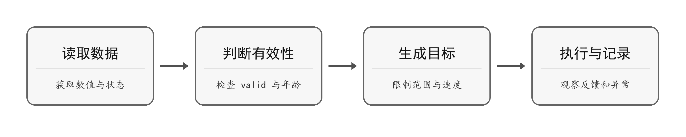

SDK 的公开例程分为 Quick Start 和完整学习课程。第一次使用时先运行 Quick Start，确认安装、连接和基本控制都正常，再按实际硬件选择学习课程。

  

    表 6-1 例程学习路线
  

  <table width="100%" style={{ borderCollapse: 'collapse', margin: '0 auto', width: '100%', minWidth: '100%', textAlign: 'left' }}>
    <thead>
      <tr>
        <th style={{ background: '#e2e8f0', border: '1px solid #cbd5e1', padding: '0.55rem 0.7rem' }}>学习阶段</th>
        <th style={{ background: '#e2e8f0', border: '1px solid #cbd5e1', padding: '0.55rem 0.7rem' }}>推荐例程</th>
        <th style={{ background: '#e2e8f0', border: '1px solid #cbd5e1', padding: '0.55rem 0.7rem' }}>学习目标</th>
      </tr>
    </thead>

    <tbody>
      <tr>
        <td style={{ border: '1px solid #cbd5e1', padding: '0.5rem 0.7rem', verticalAlign: 'top' }}>认识 SDK</td>
        <td style={{ border: '1px solid #cbd5e1', padding: '0.5rem 0.7rem', verticalAlign: 'top' }}>examples/quick-start/01-pymotion-lite.py</td>
        <td style={{ border: '1px solid #cbd5e1', padding: '0.5rem 0.7rem', verticalAlign: 'top' }}>确认 Python 能导入 SDK，并了解程序入口</td>
      </tr>

      <tr>
        <td style={{ border: '1px solid #cbd5e1', padding: '0.5rem 0.7rem', verticalAlign: 'top' }}>建立连接</td>
        <td style={{ border: '1px solid #cbd5e1', padding: '0.5rem 0.7rem', verticalAlign: 'top' }}>examples/quick-start/02-connection.py</td>
        <td style={{ border: '1px solid #cbd5e1', padding: '0.5rem 0.7rem', verticalAlign: 'top' }}>完成 Token、USB 和 Wi-Fi 连接</td>
      </tr>

      <tr>
        <td style={{ border: '1px solid #cbd5e1', padding: '0.5rem 0.7rem', verticalAlign: 'top' }}>第一次控制</td>
        <td style={{ border: '1px solid #cbd5e1', padding: '0.5rem 0.7rem', verticalAlign: 'top' }}>examples/quick-start/03-motor.py</td>
        <td style={{ border: '1px solid #cbd5e1', padding: '0.5rem 0.7rem', verticalAlign: 'top' }}>在安全条件下控制电机并可靠停止</td>
      </tr>

      <tr>
        <td style={{ border: '1px solid #cbd5e1', padding: '0.5rem 0.7rem', verticalAlign: 'top' }}>传感与显示</td>
        <td style={{ border: '1px solid #cbd5e1', padding: '0.5rem 0.7rem', verticalAlign: 'top' }}>examples/quick-start/04-ultrasonic-oled.py</td>
        <td style={{ border: '1px solid #cbd5e1', padding: '0.5rem 0.7rem', verticalAlign: 'top' }}>读取超声波并在 OLED 上显示</td>
      </tr>

      <tr>
        <td style={{ border: '1px solid #cbd5e1', padding: '0.5rem 0.7rem', verticalAlign: 'top' }}>单项功能</td>
        <td style={{ border: '1px solid #cbd5e1', padding: '0.5rem 0.7rem', verticalAlign: 'top' }}>examples\lite-learning-course\03 至 22</td>
        <td style={{ border: '1px solid #cbd5e1', padding: '0.5rem 0.7rem', verticalAlign: 'top' }}>按硬件类型学习执行器、传感器、状态和安全接口</td>
      </tr>

      <tr>
        <td style={{ border: '1px solid #cbd5e1', padding: '0.5rem 0.7rem', verticalAlign: 'top' }}>实时功能</td>
        <td style={{ border: '1px solid #cbd5e1', padding: '0.5rem 0.7rem', verticalAlign: 'top' }}>examples\lite-learning-course\23 至 26</td>
        <td style={{ border: '1px solid #cbd5e1', padding: '0.5rem 0.7rem', verticalAlign: 'top' }}>连续接收数据、发送实时命令并制作仪表盘</td>
      </tr>

      <tr>
        <td style={{ border: '1px solid #cbd5e1', padding: '0.5rem 0.7rem', verticalAlign: 'top' }}>多设备连接与控制</td>
        <td style={{ border: '1px solid #cbd5e1', padding: '0.5rem 0.7rem', verticalAlign: 'top' }}>examples/lite-learning-course/27-multi-device.py</td>
        <td style={{ border: '1px solid #cbd5e1', padding: '0.5rem 0.7rem', verticalAlign: 'top' }}>同时连接并控制多台 PyMotion Lite 设备</td>
      </tr>
    </tbody>
  </table>

运行涉及电机或舵机的例程前，应架空车轮或固定机构，清空运动范围，并准备能够立即切断执行器电源。先阅读文件开头的说明，再修改端口、方向、速度或舵机 ID。

## 6.1 从单项功能到完整任务

按“连接 → 读取 → 单路动作 → 组合任务 → 数据验证”的顺序学习。每一步满足验证条件后再进入下一步，避免在硬件或连接尚未确认时调试复杂算法。

  

    表 6-2 分阶段学习任务
  

  <table width="100%" style={{ borderCollapse: 'collapse', margin: '0 auto', width: '100%', minWidth: '100%', textAlign: 'left' }}>
    <thead>
      <tr>
        <th style={{ background: '#e2e8f0', border: '1px solid #cbd5e1', padding: '0.55rem 0.7rem' }}>阶段</th>
        <th style={{ background: '#e2e8f0', border: '1px solid #cbd5e1', padding: '0.55rem 0.7rem' }}>完成任务</th>
        <th style={{ background: '#e2e8f0', border: '1px solid #cbd5e1', padding: '0.55rem 0.7rem' }}>进入下一阶段的条件</th>
      </tr>
    </thead>

    <tbody>
      <tr>
        <td style={{ border: '1px solid #cbd5e1', padding: '0.5rem 0.7rem', verticalAlign: 'top' }}>1 连接</td>
        <td style={{ border: '1px solid #cbd5e1', padding: '0.5rem 0.7rem', verticalAlign: 'top' }}>安装 SDK，使用 USB 读取设备 ID 和连接方式。</td>
        <td style={{ border: '1px solid #cbd5e1', padding: '0.5rem 0.7rem', verticalAlign: 'top' }}>可重复连接和正常关闭；Token 与环境设置正确。</td>
      </tr>

      <tr>
        <td style={{ border: '1px solid #cbd5e1', padding: '0.5rem 0.7rem', verticalAlign: 'top' }}>2 读取</td>
        <td style={{ border: '1px solid #cbd5e1', padding: '0.5rem 0.7rem', verticalAlign: 'top' }}>连接一种传感器，读取数值及 valid、state、age。</td>
        <td style={{ border: '1px solid #cbd5e1', padding: '0.5rem 0.7rem', verticalAlign: 'top' }}>能识别有效、失效和过期数据，不把失效值当作 0。</td>
      </tr>

      <tr>
        <td style={{ border: '1px solid #cbd5e1', padding: '0.5rem 0.7rem', verticalAlign: 'top' }}>3 单路动作</td>
        <td style={{ border: '1px solid #cbd5e1', padding: '0.5rem 0.7rem', verticalAlign: 'top' }}>固定机构，以低输出、短时长验证一个电机或舵机。</td>
        <td style={{ border: '1px solid #cbd5e1', padding: '0.5rem 0.7rem', verticalAlign: 'top' }}>方向、端口、模式和停止行为均符合预期。</td>
      </tr>

      <tr>
        <td style={{ border: '1px solid #cbd5e1', padding: '0.5rem 0.7rem', verticalAlign: 'top' }}>4 组合任务</td>
        <td style={{ border: '1px solid #cbd5e1', padding: '0.5rem 0.7rem', verticalAlign: 'top' }}>把有效读数用于判断，再执行动作或更新 OLED。</td>
        <td style={{ border: '1px solid #cbd5e1', padding: '0.5rem 0.7rem', verticalAlign: 'top' }}>数据失效、通信异常或程序退出时，不会继续发出危险目标。</td>
      </tr>

      <tr>
        <td style={{ border: '1px solid #cbd5e1', padding: '0.5rem 0.7rem', verticalAlign: 'top' }}>5 数据验证</td>
        <td style={{ border: '1px solid #cbd5e1', padding: '0.5rem 0.7rem', verticalAlign: 'top' }}>记录目标、反馈和实验条件，比较多次运行。</td>
        <td style={{ border: '1px solid #cbd5e1', padding: '0.5rem 0.7rem', verticalAlign: 'top' }}>能解释误差与停止原因；修改参数后可以重复验证。</td>
      </tr>
    </tbody>
  </table>

### 组合程序的基本顺序

图 6-1 数据驱动控制的基本顺序

仅在数据有效且满足任务条件时生成运动目标。数据不可用、过期或读取异常时，不继续沿用旧目标，应停止受影响的运动。具体停止方式见第 1.4 节；实时命令还须设置并持续更新 `valid_for`。

### 每次调试只改变一个条件

先固定硬件、供电和连接方式，再调整速度、角度或判断阈值。更换电机、轮胎、舵机或传感器安装位置后，重新核对方向、零位和尺寸参数。保留能稳定运行的程序副本，再进行下一轮修改。

## 6.2 典型应用与开发边界

  

    表 6-3 典型应用与开发分工
  

  <table width="100%" style={{ borderCollapse: 'collapse', margin: '0 auto', width: '100%', minWidth: '100%', textAlign: 'left' }}>
    <thead>
      <tr>
        <th style={{ background: '#e2e8f0', border: '1px solid #cbd5e1', padding: '0.55rem 0.7rem' }}>应用方向</th>
        <th style={{ background: '#e2e8f0', border: '1px solid #cbd5e1', padding: '0.55rem 0.7rem' }}>Lite 侧使用的能力</th>
        <th style={{ background: '#e2e8f0', border: '1px solid #cbd5e1', padding: '0.55rem 0.7rem' }}>上位机程序需要完成</th>
      </tr>
    </thead>

    <tbody>
      <tr>
        <td style={{ border: '1px solid #cbd5e1', padding: '0.5rem 0.7rem', verticalAlign: 'top' }}>差速轮式底盘</td>
        <td style={{ border: '1px solid #cbd5e1', padding: '0.5rem 0.7rem', verticalAlign: 'top' }}>电机控制、编码器反馈、差速里程计。</td>
        <td style={{ border: '1px solid #cbd5e1', padding: '0.5rem 0.7rem', verticalAlign: 'top' }}>设置实际轮径与轮距，检查方向，再实现任务逻辑；里程计不等于全局定位。</td>
      </tr>

      <tr>
        <td style={{ border: '1px solid #cbd5e1', padding: '0.5rem 0.7rem', verticalAlign: 'top' }}>麦克纳姆轮等多轮底盘</td>
        <td style={{ border: '1px solid #cbd5e1', padding: '0.5rem 0.7rem', verticalAlign: 'top' }}>多路电机速度目标与反馈。</td>
        <td style={{ border: '1px solid #cbd5e1', padding: '0.5rem 0.7rem', verticalAlign: 'top' }}>按机械构型计算各轮目标，完成运动学转换、方向标定与限制。</td>
      </tr>

      <tr>
        <td style={{ border: '1px solid #cbd5e1', padding: '0.5rem 0.7rem', verticalAlign: 'top' }}>机械臂与云台</td>
        <td style={{ border: '1px solid #cbd5e1', padding: '0.5rem 0.7rem', verticalAlign: 'top' }}>PWM 或配套 TTL 舵机控制。</td>
        <td style={{ border: '1px solid #cbd5e1', padding: '0.5rem 0.7rem', verticalAlign: 'top' }}>完成关节映射、零位标定、行程约束和动作规划；不用 PWM 目标冒充实际反馈。</td>
      </tr>

      <tr>
        <td style={{ border: '1px solid #cbd5e1', padding: '0.5rem 0.7rem', verticalAlign: 'top' }}>测距、循迹与状态显示</td>
        <td style={{ border: '1px solid #cbd5e1', padding: '0.5rem 0.7rem', verticalAlign: 'top' }}>传感器读取、OLED 显示与执行器输出。</td>
        <td style={{ border: '1px solid #cbd5e1', padding: '0.5rem 0.7rem', verticalAlign: 'top' }}>设置判断阈值、有效性检查、停止条件及显示内容。</td>
      </tr>
    </tbody>
  </table>

应用构型不是额外的单一控制 API。按本手册已列出的接口组合程序；视觉识别、路径规划和其他应用算法由上位机程序负责。配件数量与接口能力不能直接推导整机载重、续航或定位精度。
