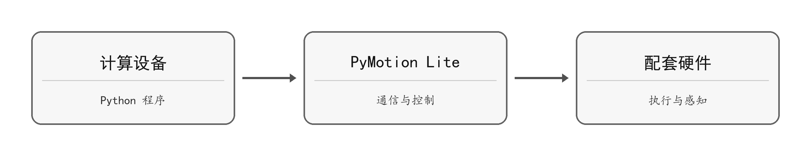
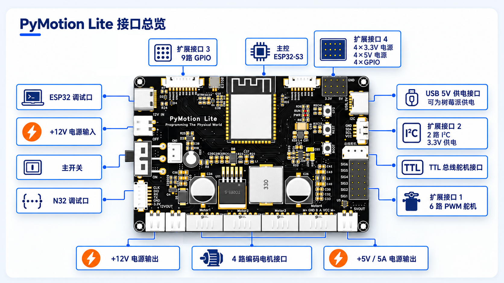

PyMotion Lite 连接上位计算设备与机器人配件，通过 Python API 完成电机和舵机控制、传感器采集、状态显示与通信管理。连接方式包括 USB 和 2.4 GHz Wi-Fi；两种方式使用相同的设备 Token。

图 1-1 软件与硬件功能关系

图 1-2 PyMotion Lite 接口总览

接线前先核对板上丝印。电机、PWM 舵机、TTL 舵机和传感器不可仅凭插头外形互换。
