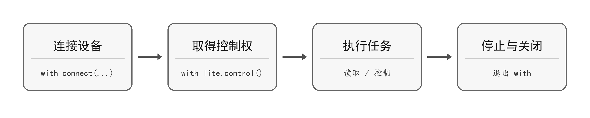

建立连接不等于取得执行器控制权。运动控制、数字输出及需要写入设备配置的操作，应在 with `lite.control()`: 范围内执行。退出该范围时，SDK 执行停止与资源清理。

图 1-3 控制权取得与停止流程

程序正常退出或抛出异常时，应允许 with 完成清理。进程被强制终止、电脑断电或通信中断时，不能仅依赖 Python 清理逻辑，应使用现场物理停止措施。

  

    表 1-4 控制与停止操作
  

  <table width="100%" style={{ borderCollapse: 'collapse', margin: '0 auto', width: '100%', minWidth: '100%', textAlign: 'left' }}>
    <thead>
      <tr>
        <th style={{ background: '#e2e8f0', border: '1px solid #cbd5e1', padding: '0.55rem 0.7rem' }}>操作</th>
        <th style={{ background: '#e2e8f0', border: '1px solid #cbd5e1', padding: '0.55rem 0.7rem' }}>用途</th>
      </tr>
    </thead>

    <tbody>
      <tr>
        <td style={{ border: '1px solid #cbd5e1', padding: '0.5rem 0.7rem', verticalAlign: 'top' }}>motor.stop() / servo.stop()</td>
        <td style={{ border: '1px solid #cbd5e1', padding: '0.5rem 0.7rem', verticalAlign: 'top' }}>停止对应对象；PWM 舵机为关闭信号输出</td>
      </tr>

      <tr>
        <td style={{ border: '1px solid #cbd5e1', padding: '0.5rem 0.7rem', verticalAlign: 'top' }}>lite.stop()</td>
        <td style={{ border: '1px solid #cbd5e1', padding: '0.5rem 0.7rem', verticalAlign: 'top' }}>正常停止设备执行器</td>
      </tr>

      <tr>
        <td style={{ border: '1px solid #cbd5e1', padding: '0.5rem 0.7rem', verticalAlign: 'top' }}>lite.emergency_stop() / lite.estop()</td>
        <td style={{ border: '1px solid #cbd5e1', padding: '0.5rem 0.7rem', verticalAlign: 'top' }}>触发软件急停并锁存；estop() 是 emergency_stop() 的等价别名</td>
      </tr>

      <tr>
        <td style={{ border: '1px solid #cbd5e1', padding: '0.5rem 0.7rem', verticalAlign: 'top' }}>lite.reset_estop()</td>
        <td style={{ border: '1px solid #cbd5e1', padding: '0.5rem 0.7rem', verticalAlign: 'top' }}>确认现场安全、急停原因已解除后，解除急停锁存</td>
      </tr>
    </tbody>
  </table>

设备发生故障时，应先停止操作、排除故障原因，并通过设备状态确认故障情况。

停止 PWM 信号不等于机械制动，也不保证舵机继续保持载荷。软件急停不应作为人员安全保护的唯一措施。
