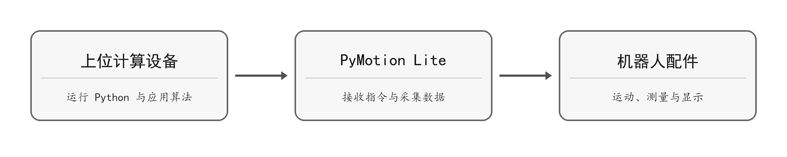

Python 程序运行在电脑或受支持的上位计算设备上。PyMotion Lite 负责连接执行器和传感器，接收控制指令并返回数据。不要将电脑端的 Python 例程当作需要烧录到控制板的固件。

图 1-4 系统分工。控制指令由上位机传向配件，反馈数据经控制器返回上位机。

  

    表 1-5 系统组成与职责
  

  <table width="100%" style={{ borderCollapse: 'collapse', margin: '0 auto', width: '100%', minWidth: '100%', textAlign: 'left' }}>
    <thead>
      <tr>
        <th style={{ background: '#e2e8f0', border: '1px solid #cbd5e1', padding: '0.55rem 0.7rem' }}>层级</th>
        <th style={{ background: '#e2e8f0', border: '1px solid #cbd5e1', padding: '0.55rem 0.7rem' }}>主要职责</th>
        <th style={{ background: '#e2e8f0', border: '1px solid #cbd5e1', padding: '0.55rem 0.7rem' }}>使用时需要明确</th>
      </tr>
    </thead>

    <tbody>
      <tr>
        <td style={{ border: '1px solid #cbd5e1', padding: '0.5rem 0.7rem', verticalAlign: 'top' }}>上位计算设备</td>
        <td style={{ border: '1px solid #cbd5e1', padding: '0.5rem 0.7rem', verticalAlign: 'top' }}>运行 SDK、任务逻辑、数据记录及应用算法。</td>
        <td style={{ border: '1px solid #cbd5e1', padding: '0.5rem 0.7rem', verticalAlign: 'top' }}>使用第 1.2 节和第 2 章列出的操作系统与 Python 版本。</td>
      </tr>

      <tr>
        <td style={{ border: '1px solid #cbd5e1', padding: '0.5rem 0.7rem', verticalAlign: 'top' }}>控制器</td>
        <td style={{ border: '1px solid #cbd5e1', padding: '0.5rem 0.7rem', verticalAlign: 'top' }}>通信管理、运动控制、编码器反馈及传感器数据采集。</td>
        <td style={{ border: '1px solid #cbd5e1', padding: '0.5rem 0.7rem', verticalAlign: 'top' }}>连接成功后，仍需取得控制权才能执行需要控制权的操作。</td>
      </tr>

      <tr>
        <td style={{ border: '1px solid #cbd5e1', padding: '0.5rem 0.7rem', verticalAlign: 'top' }}>执行器与传感器</td>
        <td style={{ border: '1px solid #cbd5e1', padding: '0.5rem 0.7rem', verticalAlign: 'top' }}>执行机械动作，或测量距离、姿态等物理量。</td>
        <td style={{ border: '1px solid #cbd5e1', padding: '0.5rem 0.7rem', verticalAlign: 'top' }}>接口、电压、协议及机械行程必须匹配，不能只看插头外形。</td>
      </tr>
    </tbody>
  </table>

### 双控制器分工

板载 ESP32-S3 侧重通信与服务，N32 侧重电机、编码器和 PWM 等底层控制。使用本手册的 SDK 时，通过统一 Python API 操作，无需分别为两颗芯片编写程序。

### 从程序对象找到实际接口

  

    表 1-6 程序对象与硬件接口对照
  

  <table width="100%" style={{ borderCollapse: 'collapse', margin: '0 auto', width: '100%', minWidth: '100%', textAlign: 'left' }}>
    <thead>
      <tr>
        <th style={{ background: '#e2e8f0', border: '1px solid #cbd5e1', padding: '0.55rem 0.7rem' }}>Python 对象或接口</th>
        <th style={{ background: '#e2e8f0', border: '1px solid #cbd5e1', padding: '0.55rem 0.7rem' }}>对应硬件</th>
        <th style={{ background: '#e2e8f0', border: '1px solid #cbd5e1', padding: '0.55rem 0.7rem' }}>核对方式</th>
      </tr>
    </thead>

    <tbody>
      <tr>
        <td style={{ border: '1px solid #cbd5e1', padding: '0.5rem 0.7rem', verticalAlign: 'top' }}>lite.motor(1)</td>
        <td style={{ border: '1px solid #cbd5e1', padding: '0.5rem 0.7rem', verticalAlign: 'top' }}>M1 电机接口</td>
        <td style={{ border: '1px solid #cbd5e1', padding: '0.5rem 0.7rem', verticalAlign: 'top' }}>按第 3.1 节接线图确认接口与编码器连接。</td>
      </tr>

      <tr>
        <td style={{ border: '1px solid #cbd5e1', padding: '0.5rem 0.7rem', verticalAlign: 'top' }}>lite.pwm_servo(1, mode="position")</td>
        <td style={{ border: '1px solid #cbd5e1', padding: '0.5rem 0.7rem', verticalAlign: 'top' }}>PWM 舵机接口 S1</td>
        <td style={{ border: '1px solid #cbd5e1', padding: '0.5rem 0.7rem', verticalAlign: 'top' }}>端口号从 1 开始，分别对应 S1～S6。</td>
      </tr>

      <tr>
        <td style={{ border: '1px solid #cbd5e1', padding: '0.5rem 0.7rem', verticalAlign: 'top' }}>lite.ttl_servo(1, mode="position")</td>
        <td style={{ border: '1px solid #cbd5e1', padding: '0.5rem 0.7rem', verticalAlign: 'top' }}>TTL 总线上 ID 为 1 的舵机</td>
        <td style={{ border: '1px solid #cbd5e1', padding: '0.5rem 0.7rem', verticalAlign: 'top' }}>ID 标识舵机，不表示串接顺序；创建对象需要控制权。</td>
      </tr>

      <tr>
        <td style={{ border: '1px solid #cbd5e1', padding: '0.5rem 0.7rem', verticalAlign: 'top' }}>lite.ultrasonic()</td>
        <td style={{ border: '1px solid #cbd5e1', padding: '0.5rem 0.7rem', verticalAlign: 'top' }}>配套超声波模块</td>
        <td style={{ border: '1px solid #cbd5e1', padding: '0.5rem 0.7rem', verticalAlign: 'top' }}>读取后检查 valid，再使用距离数值。</td>
      </tr>
    </tbody>
  </table>

