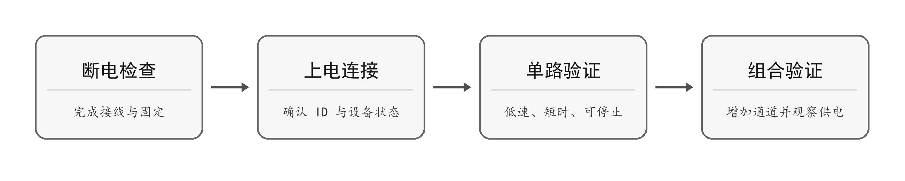

### 机械安装

将控制板固定在稳定底座上，使用合适的支撑件，避免电路板背面接触金属底盘。安装孔、外形及净空以实际硬件为准，不按手册中照片的显示比例加工安装件。

  

    表 1-8 首次上电检查
  

  <table width="100%" style={{ borderCollapse: 'collapse', margin: '0 auto', width: '100%', minWidth: '100%', textAlign: 'left' }}>
    <thead>
      <tr>
        <th style={{ background: '#e2e8f0', border: '1px solid #cbd5e1', padding: '0.55rem 0.7rem' }}>检查项</th>
        <th style={{ background: '#e2e8f0', border: '1px solid #cbd5e1', padding: '0.55rem 0.7rem' }}>通过条件</th>
      </tr>
    </thead>

    <tbody>
      <tr>
        <td style={{ border: '1px solid #cbd5e1', padding: '0.5rem 0.7rem', verticalAlign: 'top' }}>固定与绝缘</td>
        <td style={{ border: '1px solid #cbd5e1', padding: '0.5rem 0.7rem', verticalAlign: 'top' }}>控制板不晃动；紧固件不接触焊点、线路或裸露器件。</td>
      </tr>

      <tr>
        <td style={{ border: '1px solid #cbd5e1', padding: '0.5rem 0.7rem', verticalAlign: 'top' }}>布线与插接</td>
        <td style={{ border: '1px solid #cbd5e1', padding: '0.5rem 0.7rem', verticalAlign: 'top' }}>按丝印和接线图逐一核对；插头插牢，线缆不被拉紧或夹住。</td>
      </tr>

      <tr>
        <td style={{ border: '1px solid #cbd5e1', padding: '0.5rem 0.7rem', verticalAlign: 'top' }}>运动与维护空间</td>
        <td style={{ border: '1px solid #cbd5e1', padding: '0.5rem 0.7rem', verticalAlign: 'top' }}>线缆远离齿轮、车轮和舵臂；电源开关和断电位置随时可操作。</td>
      </tr>

      <tr>
        <td style={{ border: '1px solid #cbd5e1', padding: '0.5rem 0.7rem', verticalAlign: 'top' }}>无线使用环境</td>
        <td style={{ border: '1px solid #cbd5e1', padding: '0.5rem 0.7rem', verticalAlign: 'top' }}>Wi-Fi 使用时，避免天线区域被金属紧贴或包围；组装后重新验证通信。</td>
      </tr>

      <tr>
        <td style={{ border: '1px solid #cbd5e1', padding: '0.5rem 0.7rem', verticalAlign: 'top' }}>配件与编号</td>
        <td style={{ border: '1px solid #cbd5e1', padding: '0.5rem 0.7rem', verticalAlign: 'top' }}>确认电机端口、PWM 端口对应关系、TTL 舵机 ID 和配件工作模式。</td>
      </tr>

      <tr>
        <td style={{ border: '1px solid #cbd5e1', padding: '0.5rem 0.7rem', verticalAlign: 'top' }}>计算设备</td>
        <td style={{ border: '1px solid #cbd5e1', padding: '0.5rem 0.7rem', verticalAlign: 'top' }}>操作系统和 Python 版本符合要求，SDK 安装完整。</td>
      </tr>

      <tr>
        <td style={{ border: '1px solid #cbd5e1', padding: '0.5rem 0.7rem', verticalAlign: 'top' }}>供电与安全</td>
        <td style={{ border: '1px solid #cbd5e1', padding: '0.5rem 0.7rem', verticalAlign: 'top' }}>电源电压和极性正确；机构固定、车轮架空，运动范围内无人和杂物。</td>
      </tr>
    </tbody>
  </table>

### 首次上电顺序

图 1-5 首次上电与验证顺序

每增加一种配件，先验证该配件的单项例程，再加入组合程序。仅连接必需的配件有助于定位故障。出现异常时停止试验，按第 5 章排查，不连续重试动作。
