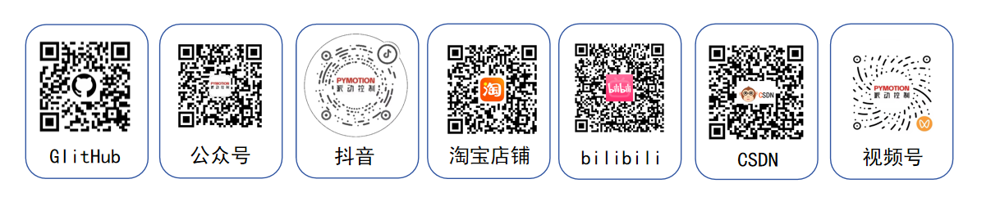

## B.1 常用术语

  

    表 B-1 常用术语说明
  

  <table width="100%" style={{ borderCollapse: 'collapse', margin: '0 auto', width: '100%', minWidth: '100%', textAlign: 'left' }}>
    <thead>
      <tr>
        <th style={{ background: '#e2e8f0', border: '1px solid #cbd5e1', padding: '0.55rem 0.7rem' }}>术语</th>
        <th style={{ background: '#e2e8f0', border: '1px solid #cbd5e1', padding: '0.55rem 0.7rem' }}>含义</th>
      </tr>
    </thead>

    <tbody>
      <tr>
        <td style={{ border: '1px solid #cbd5e1', padding: '0.5rem 0.7rem', verticalAlign: 'top' }}>Token</td>
        <td style={{ border: '1px solid #cbd5e1', padding: '0.5rem 0.7rem', verticalAlign: 'top' }}>设备访问口令。USB 与 Wi-Fi 共用；必须与设备保存值一致。</td>
      </tr>

      <tr>
        <td style={{ border: '1px solid #cbd5e1', padding: '0.5rem 0.7rem', verticalAlign: 'top' }}>PWM</td>
        <td style={{ border: '1px solid #cbd5e1', padding: '0.5rem 0.7rem', verticalAlign: 'top' }}>脉冲宽度调制。用于直流电机开环输出和 PWM 舵机控制；两者接口不可混接。</td>
      </tr>

      <tr>
        <td style={{ border: '1px solid #cbd5e1', padding: '0.5rem 0.7rem', verticalAlign: 'top' }}>TTL 总线</td>
        <td style={{ border: '1px solid #cbd5e1', padding: '0.5rem 0.7rem', verticalAlign: 'top' }}>用于配套总线舵机通信的接口。通过 ID 区分同一总线上的舵机。</td>
      </tr>

      <tr>
        <td style={{ border: '1px solid #cbd5e1', padding: '0.5rem 0.7rem', verticalAlign: 'top' }}>RPM</td>
        <td style={{ border: '1px solid #cbd5e1', padding: '0.5rem 0.7rem', verticalAlign: 'top' }}>每分钟转数，用于直流电机闭环转速。</td>
      </tr>

      <tr>
        <td style={{ border: '1px solid #cbd5e1', padding: '0.5rem 0.7rem', verticalAlign: 'top' }}>age / max_age</td>
        <td style={{ border: '1px solid #cbd5e1', padding: '0.5rem 0.7rem', verticalAlign: 'top' }}>数据已经过的时间 / 程序允许的最大数据年龄。</td>
      </tr>

      <tr>
        <td style={{ border: '1px solid #cbd5e1', padding: '0.5rem 0.7rem', verticalAlign: 'top' }}>duration</td>
        <td style={{ border: '1px solid #cbd5e1', padding: '0.5rem 0.7rem', verticalAlign: 'top' }}>普通动作的时长参数；位置 TTL 舵机中表示目标运动时间。</td>
      </tr>

      <tr>
        <td style={{ border: '1px solid #cbd5e1', padding: '0.5rem 0.7rem', verticalAlign: 'top' }}>valid_for</td>
        <td style={{ border: '1px solid #cbd5e1', padding: '0.5rem 0.7rem', verticalAlign: 'top' }}>实时命令有效期；持续运动时必须在到期前更新目标。</td>
      </tr>

      <tr>
        <td style={{ border: '1px solid #cbd5e1', padding: '0.5rem 0.7rem', verticalAlign: 'top' }}>ESTOP / FAULT</td>
        <td style={{ border: '1px solid #cbd5e1', padding: '0.5rem 0.7rem', verticalAlign: 'top' }}>急停锁存 / 故障状态。排除原因并确认安全后再复位。</td>
      </tr>
    </tbody>
  </table>

## B.2 联系我们

公司名称：深圳市派动控制技术有限公司

联系方式：13316911950、13319616460

邮箱：[pythontech@126.com](mailto:pythontech@126.com)

公司地址：深圳市宝安区石岩街道水田社区捷家宝路9号厂房6栋三层

网址：`www.pymotion.ai`

联系技术支持时，请提供操作系统、SDK 版本、设备 ID、连接方式、配件型号、接线照片和完整错误信息。请勿公开设备 Token、Wi-Fi 密码或其他访问口令。
