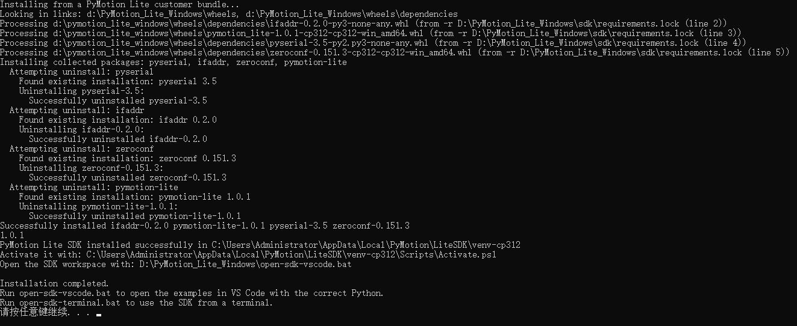
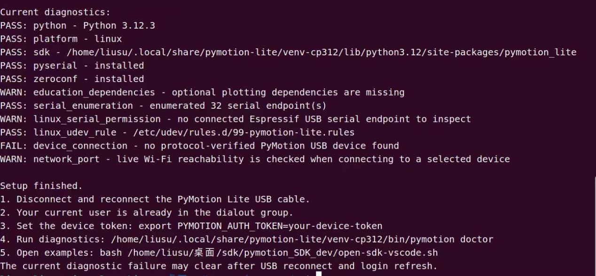
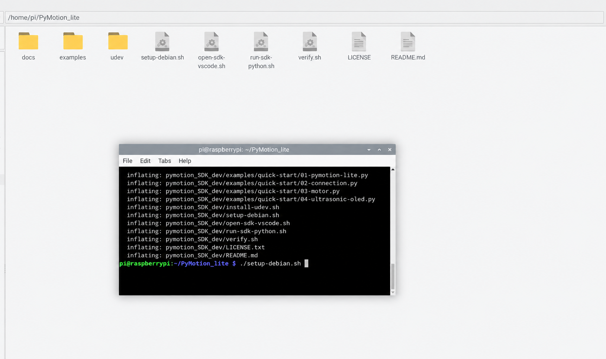
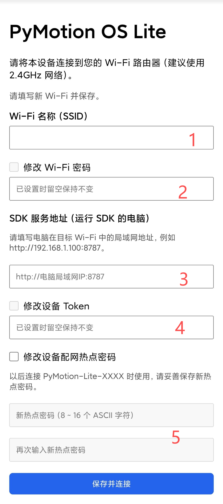

按操作系统选择对应 SDK 包，不要混用不同平台的文件。从下载仓库取得 ZIP 后，完整解压一次即可使用，不需要再查找或解压第二个 SDK 压缩包。安装完成后，先验证本机环境，再连接控制器。

### 2.1.1 开发环境要求

- Windows SDK 适用于 Windows 10/11 x64，包内已经包含 CPython 3.12，不要求预先安装系统 Python。
- Ubuntu SDK 适用于 Ubuntu 24.04 LTS amd64，使用系统 CPython 3.12。Ubuntu 22.04 和 Ubuntu arm64 不受支持。
- 树莓派专用 SDK 适用于运行 64 位 Debian 13（Trixie）的 ARM64 主机，使用系统 CPython 3.13。
- 使用 USB 时，需要电脑能够识别设备串口。
- 使用 Wi-Fi 时，需要电脑和 PyMotion Lite 位于同一个局域网。

### 2.1.2 Windows 环境搭建

Windows 用户使用 Windows 版 SDK 包。不要把 Ubuntu 包中的文件和 Windows 包混在同一个目录，也不要只复制 `install.bat`；安装程序需要 SDK 包中的完整文件结构。

第一步：下载 Windows SDK 代码和例程

打开 [PyMotion Lite Windows SDK 下载页面](https://github.com/PyMotion-OS/PyMotion_Lite_Windows)。在页面中选择 Code，再选择 Download ZIP，下载整个 Windows SDK 仓库。

下载完成后，将仓库 ZIP 完整解压到路径较短且不含中文字符的位置，并确保当前用户有写权限，例如 `D:\PyMotion_Lite_Windows`。只需解压这一个 ZIP，不需要进行第二次解压。

确认解压后的 SDK 根目录中包含 `install.bat`、`open-sdk-vscode.bat`、`open-sdk-terminal.bat`、`examples`、`runtime`、`sdk` 和 `wheels`。不要只复制 `install.bat`，也不要移动、删除或修改这些配套目录。

第二步：下载并安装 VS Code

从 [Visual Studio Code 官网](https://code.visualstudio.com/) 下载并安装与当前系统匹配的 VS Code。

第三步：安装 Python 相关扩展

在 VS Code 左侧打开“扩展”，搜索并安装 Microsoft 发布的 Python、Python Debugger、Pylance、Python Environments。通过 SDK 专用启动脚本打开工程后，按提示安装工作区推荐扩展，无需自行修改 Python 路径。

第四步：运行安装脚本

打开解压得到的 Windows SDK 根目录，双击 `install.bat`，一键完成 SDK 安装。也可以在该目录打开 PowerShell 后运行如下命令：

```powershell
.\install.bat
```

安装程序会校验 SDK 包，使用包内的 Python 3.12，并从本地 wheel 离线安装 SDK 及其依赖。默认隔离环境位于 `%LOCALAPPDATA%\PyMotion\LiteSDK\venv-cp312`；安装过程不会修改系统 Python，也不要求配置 `PATH`。等待窗口显示 `Installation completed.` 后再关闭窗口。重复运行该脚本可以检查并更新同一套 SDK 环境。



<div style={{ color: '#475569', fontSize: '0.92rem', margin: '0.35rem 0 1rem', textAlign: 'center' }}>图 2-1 Windows 安装完成后的终端提示</div>

如果窗口一闪而过，可在文件夹地址栏输入 cmd 并回车，再运行 `install.bat`，这样可以保留完整错误信息。

第五步：打开 SDK 工程

安装完成后，双击 `open-sdk-vscode.bat`。启动器会检查已经安装的 SDK 环境，在当前 Windows 用户目录中准备独立的可编辑工作区，将例程复制到该工作区，并绑定正确的 SDK Python 解释器后用新窗口打开 VS Code。这样运行和修改例程时不会直接改动发布包中的原始文件。

没有安装 VS Code 时，可双击 `open-sdk-terminal.bat`，在已经激活 SDK 环境的专用终端中运行例程。

在终端中依次运行如下命令：

```powershell
pymotion doctor --offline
python examples\quick-start\01-pymotion-lite.py
```

第一条命令检查本机安装环境，不要求连接设备。第二条命令确认 Python 能够导入 SDK。准备连接设备时，再按本章后续内容设置 Token 并运行连接例程。

Windows 验证结果和常见问题

- 出现 `ModuleNotFoundError: No module named 'pymotion'` 时，通常是程序使用了系统 Python。关闭当前窗口，通过 `open-sdk-vscode.bat` 或 `open-sdk-terminal.bat` 重新打开。
- 安装程序提示文件校验失败时，不要跳过校验。重新下载仓库 ZIP，并按第一步重新完整解压一次。
- 找不到串口时，先确认 USB 线支持数据传输，并关闭串口助手、烧录工具等可能占用端口的软件。

### 2.1.3 Ubuntu 环境搭建

本节仅适用于 Ubuntu 24.04 LTS amd64。Ubuntu 22.04 和 Ubuntu arm64 不受支持；树莓派 5 使用第 2.1.4 节的 Debian 13 ARM64 专用 SDK。

第一步：下载 Ubuntu SDK 代码和例程

打开 [PyMotion Lite Ubuntu SDK 下载页面](https://github.com/PyMotion-OS/PyMotion_Lite_Ubuntu)，选择 Code → Download ZIP，下载整个 Ubuntu SDK 仓库。

下载完成后，将仓库 ZIP 完整解压到路径较短且不含中文字符的位置，并确保当前用户有写权限，例如 `~/PyMotion_Lite_Ubuntu`。只需解压这一个 ZIP，不需要进行第二次解压。

解压后的 SDK 根目录中应能看到 `setup-ubuntu.sh`、`open-sdk-vscode.sh`、`run-sdk-python.sh`、`install-udev.sh`、`examples`、`internal`、`udev` 和 `wheels` 等内容。请完整保留目录结构，不要单独复制安装脚本，也不要移动、删除或修改 `internal`、`wheels` 和 `examples`。

第二步：安装 VS Code

如果已经安装 VS Code，可跳过本节。需要安装时，打开终端并执行如下命令：

```bash
sudo apt update
sudo apt install wget gpg
wget -qO- https://packages.microsoft.com/keys/microsoft.asc \
  | sudo gpg --dearmor -o /usr/share/keyrings/microsoft.gpg
echo "deb [arch=amd64 signed-by=/usr/share/keyrings/microsoft.gpg]" \
  "https://packages.microsoft.com/repos/code stable main" \
  | sudo tee /etc/apt/sources.list.d/vscode.list > /dev/null
sudo apt update
sudo apt install code
code --version
```

第三步：安装 Python 相关扩展

按 Windows 安装步骤中的扩展清单，安装 Microsoft 发布的 Python、Python Debugger、Pylance、Python Environments。

第四步：运行安装脚本

进入解压后的 SDK 根目录并启动终端，请以普通桌面用户运行脚本，不要在整条命令前加 sudo，执行以下命令：

```bash
bash ./setup-ubuntu.sh
```

脚本会检查 Ubuntu 版本和 amd64 架构，校验 SDK 完整性，使用系统 CPython 3.12 创建独立环境，并从本地 wheel 离线安装 SDK 及其依赖。默认环境位于 `~/.local/share/pymotion-lite/venv-ubuntu`。脚本还会配置 USB udev 规则、在需要时将当前用户加入 `dialout` 用户组，并准备可编辑的例程工作区；只有安装系统组件和 USB 权限时会按需请求管理员权限。

安装完成后，终端会显示当前诊断结果、SDK Python、诊断命令和工程启动命令。



<div style={{ color: '#475569', fontSize: '0.92rem', margin: '0.35rem 0 1rem', textAlign: 'center' }}>图 2-2 Ubuntu 安装完成后的环境诊断</div>

如果运行安装脚本时设备尚未通过 USB 连接，诊断中的 device_connection 可能显示 FAIL，这只表示当时没有发现可验证的设备，不表示 SDK 安装失败。完成 USB 权限步骤、重新连接设备并重新登录后再执行诊断即可。

补充：USB 权限和重新登录

首次安装 USB 规则或加入 dialout 用户组后，应完成以下操作：

1. 拔下并重新连接 PyMotion Lite 的 USB 线。
2. 注销当前 Ubuntu 用户并重新登录，使用户组变更生效。
3. 关闭占用串口的终端、串口助手或烧录工具。

第五步：打开 SDK 工程

在 SDK 根目录的终端中输入 `./open-sdk-vscode.sh`，打开已经配置好 Python 环境的工程。启动器会检查已安装的 SDK，将例程复制到当前用户的可编辑工作区，绑定正确的 Python 解释器，并使用新窗口打开 VS Code。也可以使用下面的等效写法：

```bash
bash ./open-sdk-vscode.sh
```

在打开的 VS Code 终端中运行：

```bash
pymotion doctor --offline
python examples/quick-start/01-pymotion-lite.py
```

不使用 VS Code 时，可以直接使用 SDK 独立环境中的 Python：

```bash
~/.local/share/pymotion-lite/venv-ubuntu/bin/python \
  ./examples/quick-start/01-pymotion-lite.py
```

USB 连接需要提供正确的 Token；Wi-Fi 连接还需完成 AP 配网。

Ubuntu 验证结果和常见问题

- Permission denied 通常表示 USB 规则或用户组尚未生效。拔插设备并重新登录后再试。
- code: command not found 只影响 VS Code 启动，不影响 SDK 本身。可先在终端中运行例程。
- 不要用 sudo python 或 sudo pip 运行 SDK；这会绕过安装脚本创建的用户环境。

### 2.1.4 Raspberry Pi 5 环境搭建

树莓派 5 使用单独的 Debian 13 ARM64 SDK 包。开始前请确认系统为 64 位 Debian 13（Trixie），架构为 `aarch64`，并已经安装 CPython 3.13。下载仓库 ZIP 时需要访问 GitHub；下载完成后，SDK 和依赖从包内 wheel 离线安装。

第一步：下载树莓派 SDK 代码和例程

打开 [PyMotion Lite 树莓派 5 SDK 下载页面](https://github.com/PyMotion-OS/PyMotion_Lite_Raspberry)。在页面中选择 Code，再选择 Download ZIP，下载整个树莓派 SDK 仓库。

下载完成后，将仓库 ZIP 完整解压到路径较短且不含中文字符的位置，并确保当前树莓派用户有写权限，例如 `~/PyMotion_Lite_Raspberry`。只需解压这一个 ZIP，不需要进行第二次解压。

解压后的 SDK 根目录中应能看到 `setup-debian.sh`、`open-sdk-vscode.sh`、`run-sdk-python.sh`、`install-udev.sh`、`examples`、`internal`、`udev` 和 `wheels` 等内容。请完整保留目录结构，不要单独复制安装脚本，也不要移动、删除或修改 `internal`、`wheels` 和 `examples`。

第二步：运行树莓派安装脚本

进入解压后的 SDK 根目录，在包含 `setup-debian.sh` 的目录中启动终端，然后执行：

```bash
bash ./setup-debian.sh
```

请使用普通用户运行，不要在整条命令前添加 sudo。脚本会检查 Debian 13、ARM64 和 Python 3.13，校验 SDK 完整性，并从本地 wheel 将 SDK 和依赖安装到独立环境。默认环境位于 `~/.local/share/pymotion-lite/venv-cp313-debian13`，安装完成后会运行不连接设备的离线诊断。

随后安装 USB udev 规则：

```bash
bash ./install-udev.sh
```

完成后重新插拔 PyMotion Lite 的 USB 线，使新规则生效。



<div style={{ color: '#475569', fontSize: '0.92rem', margin: '0.35rem 0 1rem', textAlign: 'center' }}>图 2-3 树莓派 5 中运行安装脚本</div>

第三步：打开 SDK 工程

如果树莓派已经安装 VS Code，可在 SDK 根目录运行：

```bash
bash ./open-sdk-vscode.sh
```

启动器会检查已安装的 SDK 环境，将例程复制到当前用户的可编辑工作区，绑定正确的 Python 解释器，并使用新窗口打开 VS Code。无桌面环境或未安装 VS Code 时，可以跳过此步骤，直接使用 SDK 独立环境中的 Python 运行例程。

第四步：设置设备 Token

安装完成后，在同一个终端中设置设备 Token。该值必须与设备配网页面中保存的 Token 完全一致。

```bash
export PYMOTION_AUTH_TOKEN='设备的 Token'
```

关闭终端后，这个临时环境变量需要重新设置。

第五步：运行第一个连接例程

连接 PyMotion Lite 的 USB 数据线并确认设备供电正常。在 VS Code 终端中执行：

```bash
python ./examples/quick-start/02-connection.py
```

不使用 VS Code 时，在 SDK 根目录中执行：

```bash
~/.local/share/pymotion-lite/venv-cp313-debian13/bin/python \
  ./examples/quick-start/02-connection.py
```

例程应显示设备 ID、USB 连接方式和设备状态，不会驱动电机或舵机。如果仍提示 USB 权限不足，请确认已经运行 `bash ./install-udev.sh`，然后重新插拔设备。

### 2.1.5 AP 配网和 Token 配置

新设备的默认 Token 为 123456。USB 连接不要求先配置 Wi-Fi，但仍需提供 Token。使用 Wi-Fi 时，应先通过设备热点保存目标 Wi-Fi、运行 SDK 的电脑地址和设备 Token。建议首次配置时修改默认 Token。

1. 给设备上电。
2. 电脑或手机连接 PyMotion-Lite-XXXX 热点，其中后四位是板卡 ID 后四位加 1，出厂热点密码为 `pymotionlite`。
3. 若热点没有出现，单次按下并释放板上的CFG按键，等待设备重新进入配网模式。
4. 打开网址 `http://192.168.4.1:8787/wifi/setup`。
5. 填写 Wi-Fi 名称、密码、SDK 服务地址和设备 Token。SDK 服务地址使用运行程序的电脑在目标局域网中的 IP 地址，格式为 `http://电脑IP:8787`。
6. 保存配置，等待设备加入目标网络。



<div style={{ color: '#475569', fontSize: '0.92rem', margin: '0.35rem 0 1rem', textAlign: 'center' }}>图 2-4 AP 配网页面</div>

页面标记：1 为目标 Wi-Fi 名称；2 为目标 Wi-Fi 密码；3 为 SDK 服务地址；4 为设备 Token；5 为下次进入配网热点时使用的密码。密码字段已设置时，留空表示保持不变；修改时按页面勾选对应选项。

板上的 CFG 按键只会让设备重新进入配网模式，不会清除已经设置的热点密码。如果忘记自定义热点密码，将无法再次进入配网页面，需要联系技术支持。

Token 是用户配置设备时设置的访问口令，用于授权电脑连接和控制设备。USB 与 Wi-Fi 都需要 Token；两种连接使用同一个 Token。USB 连接不要求 Wi-Fi 在线，但仍然需要完成 Token 认证。

Token 长度为 1～16 个 UTF-8 字节，建议使用容易正确输入的英文字母和数字。设备配网页面保存的值与电脑端提供的值必须完全一致，包括大小写。

SDK 按以下顺序取得 Token：

1. 如果 `pm.lite.connect(auth_token=...)` 明确传入了 Token，使用该值。
2. 如果没有传入 `auth_token`，读取环境变量 `PYMOTION_AUTH_TOKEN`。
3. 两处都没有提供时，连接失败并抛出 `AuthenticationError`。

推荐使用环境变量，下面几种方式可以按使用场景选择。

在当前终端临时设置

该方式只对当前终端及从该终端启动的 Python 程序有效。关闭终端后需要重新设置。

<div style={{ color: '#1e3a8a', fontWeight: 700, margin: '1.25rem 0 0.5rem' }}>
  Windows PowerShell 终端命令：
</div>

```powershell
$env:PYMOTION_AUTH_TOKEN = "设备的 Token"
```

<div style={{ color: '#1e3a8a', fontWeight: 700, margin: '1.25rem 0 0.5rem' }}>
  Windows 命令提示符（CMD） 终端命令：
</div>

```batch
set "PYMOTION_AUTH_TOKEN=设备的 Token"
```

<div style={{ color: '#1e3a8a', fontWeight: 700, margin: '1.25rem 0 0.5rem' }}>
  Ubuntu 或树莓派 Bash 终端命令：
</div>

```bash
export PYMOTION_AUTH_TOKEN='设备的 Token'
```

设置后，在同一个终端中运行 Python 程序。程序可以省略 `auth_token`：

<div style={{ background: '#f0fdf4', border: '1px solid #86efac', borderRadius: '4px', color: '#166534', display: 'inline-block', fontFamily: 'ui-monospace, SFMono-Regular, Menlo, monospace', fontSize: '0.78rem', fontWeight: 700, lineHeight: 1.2, margin: '0.7rem 0 0.25rem', padding: '0.22rem 0.45rem' }}>完整例程 · Python</div>

```python
import pymotion as pm

# 连接设备并在 with 结束时自动关闭
with pm.lite.connect(transport="usb") as lite:
    print(lite.connection.device_id)
```

在 Windows 用户环境中持久保存

如果不希望每次新开 PowerShell 都重新输入，可以在 PowerShell 中执行一次：

```powershell
[Environment]::SetEnvironmentVariable("PYMOTION_AUTH_TOKEN", "设备的 Token", "User")
```

执行后应重新打开终端；如果程序从 VS Code 运行，也应重新启动 VS Code，使它读取新的用户环境变量。该方式会把 Token 保存到当前 Windows 用户的环境中。

如果需要删除当前 Windows 用户环境中持久保存的 Token，请在 PowerShell 中执行：

```powershell
[Environment]::SetEnvironmentVariable("PYMOTION_AUTH_TOKEN", $null, "User")
```

删除后应重新打开终端；如果程序从 VS Code 运行，也应重新启动 VS Code。已经打开的终端或程序仍可能保留删除前读取到的值。

如果换用另一台 Token 不同的设备，再次执行上述命令填写新 Token，会覆盖当前 Windows 用户保存的默认值。新值只对之后启动的终端、VS Code 和 Python 进程生效；已经打开的程序仍可能继续使用旧值。需要在当前 PowerShell 立即切换时，可以同时执行：

```powershell
$env:PYMOTION_AUTH_TOKEN = "新设备的 Token"
```

一个 `PYMOTION_AUTH_TOKEN` 环境变量只能提供一个默认 Token。如果需要频繁连接多台且 Token 不同的设备，建议在当前终端按设备临时设置，或由程序从安全配置中读取并通过 `auth_token` 明确传入。如果多台设备使用同一个 Token，则无需切换。

通过连接参数传入

也可以在 Python 代码中传入 Token：

<div style={{ background: '#f0fdf4', border: '1px solid #86efac', borderRadius: '4px', color: '#166534', display: 'inline-block', fontFamily: 'ui-monospace, SFMono-Regular, Menlo, monospace', fontSize: '0.78rem', fontWeight: 700, lineHeight: 1.2, margin: '0.7rem 0 0.25rem', padding: '0.22rem 0.45rem' }}>完整例程 · Python</div>

```python
import pymotion as pm

# 连接设备并在 with 结束时自动关闭
with pm.lite.connect(
    transport="usb",
    auth_token="设备的 Token",
) as lite:
    print(lite.connection.device_id)
```

直接传入的 `auth_token` 优先于环境变量。这种方式适合临时测试或由程序从安全配置中读取 Token；不要把真实 Token 写入准备分享的示例、截图或公开仓库。

无论选择哪一种方式，都不需要每次运行时创建新 Token；只需向 SDK 提供设备中已经保存的同一个值。Token 缺失或不匹配时会抛出 `AuthenticationError`。

### 2.1.6 板载指示灯

<div style={{ margin: '1.5rem 0', overflowX: 'auto', textAlign: 'center', width: '100%' }}>
  <div style={{ color: '#475569', fontSize: '0.92rem', fontWeight: 600, marginBottom: '0.15rem' }}>
    表 2-1 板载指示灯说明
  </div>

  <table width="100%" style={{ borderCollapse: 'collapse', margin: '0 auto', width: '100%', minWidth: '100%', textAlign: 'left' }}>
    <thead>
      <tr>
        <th style={{ background: '#e2e8f0', border: '1px solid #cbd5e1', padding: '0.55rem 0.7rem' }}>指示灯</th>
        <th style={{ background: '#e2e8f0', border: '1px solid #cbd5e1', padding: '0.55rem 0.7rem' }}>正常含义</th>
        <th style={{ background: '#e2e8f0', border: '1px solid #cbd5e1', padding: '0.55rem 0.7rem' }}>使用时要注意</th>
      </tr>
    </thead>

    <tbody>
      <tr>
        <td style={{ border: '1px solid #cbd5e1', padding: '0.5rem 0.7rem', verticalAlign: 'top' }}>电源灯</td>
        <td style={{ border: '1px solid #cbd5e1', padding: '0.5rem 0.7rem', verticalAlign: 'top' }}>板上电源已经接通</td>
        <td style={{ border: '1px solid #cbd5e1', padding: '0.5rem 0.7rem', verticalAlign: 'top' }}>亮起只说明板上已有供电，不能证明电池电压、带载能力、固件或网络一定正常；设备频繁断连时仍应检查带载电压</td>
      </tr>

      <tr>
        <td style={{ border: '1px solid #cbd5e1', padding: '0.5rem 0.7rem', verticalAlign: 'top' }}>SDK 通信/控制状态灯</td>
        <td style={{ border: '1px solid #cbd5e1', padding: '0.5rem 0.7rem', verticalAlign: 'top' }}>已建立经过认证的 USB 或 Wi-Fi SDK 连接，或当前存在有效控制会话</td>
        <td style={{ border: '1px solid #cbd5e1', padding: '0.5rem 0.7rem', verticalAlign: 'top' }}>它是连接/控制状态提示，不是每收到一个数据包就闪烁的流量灯；熄灭时先检查连接、Token 和供电</td>
      </tr>
    </tbody>
  </table>
</div>

这两只灯用于设备状态提示，不应当作用户可自由控制的数字输出。不同硬件批次的灯位和丝印可能不同，应以板上丝印为准。
