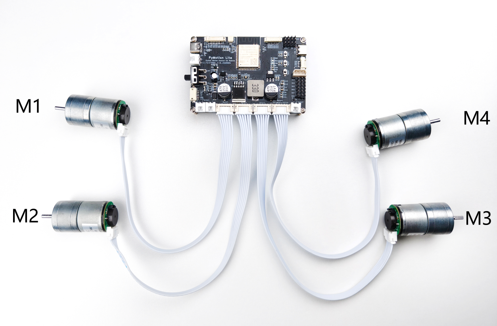

PyMotion Lite 提供 4 路直流电机接口，板上标记为 MOTOR1～MOTOR4。闭环速度、位置控制和里程计需要有效编码器反馈。



<div style={{ color: '#475569', fontSize: '0.92rem', margin: '0.35rem 0 1rem', textAlign: 'center' }}>图 3-1 直流电机连接示意图</div>

### 3.1.1 获取电机对象

可调用以下 API 获取 MOTOR1～MOTOR4 中的一路电机对象：

<div style={{ background: '#eff6ff', border: '1px solid #93c5fd', borderRadius: '4px', color: '#1d4ed8', display: 'inline-block', fontFamily: 'ui-monospace, SFMono-Regular, Menlo, monospace', fontSize: '0.78rem', fontWeight: 700, lineHeight: 1.2, margin: '0.7rem 0 0.25rem', padding: '0.22rem 0.45rem' }}>API 签名</div>

```python
lite.motor(port)
```

<div style={{ margin: '1.5rem 0', overflowX: 'auto', textAlign: 'center', width: '100%' }}>
  <div style={{ color: '#475569', fontSize: '0.92rem', fontWeight: 600, marginBottom: '0.15rem' }}>
    表 3-2 <code>lite.motor()</code> 参数说明
  </div>

  <table width="100%" style={{ borderCollapse: 'collapse', margin: '0 auto', width: '100%', minWidth: '100%', textAlign: 'left' }}>
    <thead>
      <tr>
        <th style={{ background: '#e2e8f0', border: '1px solid #cbd5e1', padding: '0.55rem 0.7rem' }}>参数</th>
        <th style={{ background: '#e2e8f0', border: '1px solid #cbd5e1', padding: '0.55rem 0.7rem' }}>类型</th>
        <th style={{ background: '#e2e8f0', border: '1px solid #cbd5e1', padding: '0.55rem 0.7rem' }}>默认值或范围</th>
        <th style={{ background: '#e2e8f0', border: '1px solid #cbd5e1', padding: '0.55rem 0.7rem' }}>说明</th>
      </tr>
    </thead>

    <tbody>
      <tr>
        <td style={{ border: '1px solid #cbd5e1', padding: '0.5rem 0.7rem', verticalAlign: 'top' }}>port</td>
        <td style={{ border: '1px solid #cbd5e1', padding: '0.5rem 0.7rem', verticalAlign: 'top' }}>int</td>
        <td style={{ border: '1px solid #cbd5e1', padding: '0.5rem 0.7rem', verticalAlign: 'top' }}>1～4</td>
        <td style={{ border: '1px solid #cbd5e1', padding: '0.5rem 0.7rem', verticalAlign: 'top' }}>电机端口号</td>
      </tr>
    </tbody>
  </table>
</div>

`lite.motor()` 返回指定端口的 Motor 对象。

<div style={{ margin: '1.5rem 0', overflowX: 'auto', textAlign: 'center', width: '100%' }}>
  <div style={{ color: '#475569', fontSize: '0.92rem', fontWeight: 600, marginBottom: '0.15rem' }}>
    表 3-3 电机对象字段说明
  </div>

  <table width="100%" style={{ borderCollapse: 'collapse', margin: '0 auto', width: '100%', minWidth: '100%', textAlign: 'left' }}>
    <thead>
      <tr>
        <th style={{ background: '#e2e8f0', border: '1px solid #cbd5e1', padding: '0.55rem 0.7rem' }}>字段</th>
        <th style={{ background: '#e2e8f0', border: '1px solid #cbd5e1', padding: '0.55rem 0.7rem' }}>说明</th>
      </tr>
    </thead>

    <tbody>
      <tr>
        <td style={{ border: '1px solid #cbd5e1', padding: '0.5rem 0.7rem', verticalAlign: 'top' }}>port</td>
        <td style={{ border: '1px solid #cbd5e1', padding: '0.5rem 0.7rem', verticalAlign: 'top' }}>对象对应的电机端口号</td>
      </tr>
    </tbody>
  </table>
</div>

<div style={{ background: '#f0fdf4', border: '1px solid #86efac', borderRadius: '4px', color: '#166534', display: 'inline-block', fontFamily: 'ui-monospace, SFMono-Regular, Menlo, monospace', fontSize: '0.78rem', fontWeight: 700, lineHeight: 1.2, margin: '0.7rem 0 0.25rem', padding: '0.22rem 0.45rem' }}>完整例程 · Python</div>

```python
import pymotion as pm

with pm.lite.connect(transport="usb") as lite:
    motor = lite.motor(1)  # 获取 M1
    print(motor.port)
```

### 3.1.2 开环 PWM 控制

直流减速电机的开环控制可采用以下 API 实现。该接口按百分比设置电机输出，正负值表示相反的转动方向：

<div style={{ background: '#eff6ff', border: '1px solid #93c5fd', borderRadius: '4px', color: '#1d4ed8', display: 'inline-block', fontFamily: 'ui-monospace, SFMono-Regular, Menlo, monospace', fontSize: '0.78rem', fontWeight: 700, lineHeight: 1.2, margin: '0.7rem 0 0.25rem', padding: '0.22rem 0.45rem' }}>API 签名</div>

```python
motor.set_pwm(pwm, *, duration=None)
```

<div style={{ margin: '1.5rem 0', overflowX: 'auto', textAlign: 'center', width: '100%' }}>
  <div style={{ color: '#475569', fontSize: '0.92rem', fontWeight: 600, marginBottom: '0.15rem' }}>
    表 3-4 set_pwm() 参数说明
  </div>

  <table width="100%" style={{ borderCollapse: 'collapse', margin: '0 auto', width: '100%', minWidth: '100%', textAlign: 'left' }}>
    <thead>
      <tr>
        <th style={{ background: '#e2e8f0', border: '1px solid #cbd5e1', padding: '0.55rem 0.7rem' }}>参数</th>
        <th style={{ background: '#e2e8f0', border: '1px solid #cbd5e1', padding: '0.55rem 0.7rem' }}>类型</th>
        <th style={{ background: '#e2e8f0', border: '1px solid #cbd5e1', padding: '0.55rem 0.7rem' }}>默认值或范围</th>
        <th style={{ background: '#e2e8f0', border: '1px solid #cbd5e1', padding: '0.55rem 0.7rem' }}>说明</th>
      </tr>
    </thead>

    <tbody>
      <tr>
        <td style={{ border: '1px solid #cbd5e1', padding: '0.5rem 0.7rem', verticalAlign: 'top' }}>pwm</td>
        <td style={{ border: '1px solid #cbd5e1', padding: '0.5rem 0.7rem', verticalAlign: 'top' }}>float</td>
        <td style={{ border: '1px solid #cbd5e1', padding: '0.5rem 0.7rem', verticalAlign: 'top' }}>-100～100</td>
        <td style={{ border: '1px solid #cbd5e1', padding: '0.5rem 0.7rem', verticalAlign: 'top' }}>输出百分比；0 表示停止，调用后立即返回</td>
      </tr>

      <tr>
        <td style={{ border: '1px solid #cbd5e1', padding: '0.5rem 0.7rem', verticalAlign: 'top' }}>duration</td>
        <td style={{ border: '1px solid #cbd5e1', padding: '0.5rem 0.7rem', verticalAlign: 'top' }}>float | None</td>
        <td style={{ border: '1px solid #cbd5e1', padding: '0.5rem 0.7rem', verticalAlign: 'top' }}>None 或大于 0 秒</td>
        <td style={{ border: '1px solid #cbd5e1', padding: '0.5rem 0.7rem', verticalAlign: 'top' }}>pwm 非 0 时，指定后到期停止；pwm=0 时该参数被忽略</td>
      </tr>
    </tbody>
  </table>
</div>

当 `pwm=0` 时，`set_pwm()` 会立即执行停止并返回，传入的 `duration` 不参与本次调用。

<div style={{ background: '#f0fdf4', border: '1px solid #86efac', borderRadius: '4px', color: '#166534', display: 'inline-block', fontFamily: 'ui-monospace, SFMono-Regular, Menlo, monospace', fontSize: '0.78rem', fontWeight: 700, lineHeight: 1.2, margin: '0.7rem 0 0.25rem', padding: '0.22rem 0.45rem' }}>完整例程 · Python</div>

```python
import pymotion as pm

with pm.lite.connect() as lite:
    motor = lite.motor(1)
    with lite.control():
        motor.set_pwm(30, duration=2.0)   # 正转 2 秒
        motor.set_pwm(-30, duration=2.0)  # 反转 2 秒
        motor.stop()                      # 停止 M1
```

### 3.1.3 闭环速度控制

直流减速电机的闭环速度控制可采用以下 API 实现。该接口使用 RPM 设置目标转速：

<div style={{ background: '#eff6ff', border: '1px solid #93c5fd', borderRadius: '4px', color: '#1d4ed8', display: 'inline-block', fontFamily: 'ui-monospace, SFMono-Regular, Menlo, monospace', fontSize: '0.78rem', fontWeight: 700, lineHeight: 1.2, margin: '0.7rem 0 0.25rem', padding: '0.22rem 0.45rem' }}>API 签名</div>

```python
motor.set_speed(rpm, *, duration=None)
```

<div style={{ margin: '1.5rem 0', overflowX: 'auto', textAlign: 'center', width: '100%' }}>
  <div style={{ color: '#475569', fontSize: '0.92rem', fontWeight: 600, marginBottom: '0.15rem' }}>
    表 3-5 set_speed() 参数说明
  </div>

  <table width="100%" style={{ borderCollapse: 'collapse', margin: '0 auto', width: '100%', minWidth: '100%', textAlign: 'left' }}>
    <thead>
      <tr>
        <th style={{ background: '#e2e8f0', border: '1px solid #cbd5e1', padding: '0.55rem 0.7rem' }}>参数</th>
        <th style={{ background: '#e2e8f0', border: '1px solid #cbd5e1', padding: '0.55rem 0.7rem' }}>类型</th>
        <th style={{ background: '#e2e8f0', border: '1px solid #cbd5e1', padding: '0.55rem 0.7rem' }}>默认值或范围</th>
        <th style={{ background: '#e2e8f0', border: '1px solid #cbd5e1', padding: '0.55rem 0.7rem' }}>说明</th>
      </tr>
    </thead>

    <tbody>
      <tr>
        <td style={{ border: '1px solid #cbd5e1', padding: '0.5rem 0.7rem', verticalAlign: 'top' }}>rpm</td>
        <td style={{ border: '1px solid #cbd5e1', padding: '0.5rem 0.7rem', verticalAlign: 'top' }}>int</td>
        <td style={{ border: '1px solid #cbd5e1', padding: '0.5rem 0.7rem', verticalAlign: 'top' }}>-360～360</td>
        <td style={{ border: '1px solid #cbd5e1', padding: '0.5rem 0.7rem', verticalAlign: 'top' }}>目标转速，单位 RPM</td>
      </tr>

      <tr>
        <td style={{ border: '1px solid #cbd5e1', padding: '0.5rem 0.7rem', verticalAlign: 'top' }}>duration</td>
        <td style={{ border: '1px solid #cbd5e1', padding: '0.5rem 0.7rem', verticalAlign: 'top' }}>float | None</td>
        <td style={{ border: '1px solid #cbd5e1', padding: '0.5rem 0.7rem', verticalAlign: 'top' }}>None 或大于 0 秒</td>
        <td style={{ border: '1px solid #cbd5e1', padding: '0.5rem 0.7rem', verticalAlign: 'top' }}>指定后到期停止</td>
      </tr>
    </tbody>
  </table>
</div>

<div style={{ background: '#f0fdf4', border: '1px solid #86efac', borderRadius: '4px', color: '#166534', display: 'inline-block', fontFamily: 'ui-monospace, SFMono-Regular, Menlo, monospace', fontSize: '0.78rem', fontWeight: 700, lineHeight: 1.2, margin: '0.7rem 0 0.25rem', padding: '0.22rem 0.45rem' }}>完整例程 · Python</div>

```python
import pymotion as pm

with pm.lite.connect() as lite:
    motor = lite.motor(1)
    with lite.control():
        motor.set_speed(100, duration=2.0)  # 以 100 RPM 运行 2 秒
        motor.stop()
```

### 3.1.4 多电机批量控制

多路直流减速电机可批量控制。未列入 mapping 的端口不会被修改。批量设置开环 PWM 时使用以下 API：

<div style={{ background: '#eff6ff', border: '1px solid #93c5fd', borderRadius: '4px', color: '#1d4ed8', display: 'inline-block', fontFamily: 'ui-monospace, SFMono-Regular, Menlo, monospace', fontSize: '0.78rem', fontWeight: 700, lineHeight: 1.2, margin: '0.7rem 0 0.25rem', padding: '0.22rem 0.45rem' }}>API 签名</div>

```python
lite.motors.set_pwms(mapping, *, duration=None)
```

批量设置闭环目标转速时使用以下 API：

<div style={{ background: '#eff6ff', border: '1px solid #93c5fd', borderRadius: '4px', color: '#1d4ed8', display: 'inline-block', fontFamily: 'ui-monospace, SFMono-Regular, Menlo, monospace', fontSize: '0.78rem', fontWeight: 700, lineHeight: 1.2, margin: '0.7rem 0 0.25rem', padding: '0.22rem 0.45rem' }}>API 签名</div>

```python
lite.motors.set_speeds(mapping, *, duration=None)
```

停止全部直流减速电机时使用以下 API，该方法没有参数：

<div style={{ background: '#eff6ff', border: '1px solid #93c5fd', borderRadius: '4px', color: '#1d4ed8', display: 'inline-block', fontFamily: 'ui-monospace, SFMono-Regular, Menlo, monospace', fontSize: '0.78rem', fontWeight: 700, lineHeight: 1.2, margin: '0.7rem 0 0.25rem', padding: '0.22rem 0.45rem' }}>API 签名</div>

```python
lite.motors.stop()
```

<div style={{ margin: '1.5rem 0', overflowX: 'auto', textAlign: 'center', width: '100%' }}>
  <div style={{ color: '#475569', fontSize: '0.92rem', fontWeight: 600, marginBottom: '0.15rem' }}>
    表 3-6 多电机批量控制 API 参数说明
  </div>

  <table width="100%" style={{ borderCollapse: 'collapse', margin: '0 auto', width: '100%', minWidth: '100%', textAlign: 'left' }}>
    <thead>
      <tr>
        <th style={{ background: '#e2e8f0', border: '1px solid #cbd5e1', padding: '0.55rem 0.7rem' }}>参数</th>
        <th style={{ background: '#e2e8f0', border: '1px solid #cbd5e1', padding: '0.55rem 0.7rem' }}>类型</th>
        <th style={{ background: '#e2e8f0', border: '1px solid #cbd5e1', padding: '0.55rem 0.7rem' }}>默认值或范围</th>
        <th style={{ background: '#e2e8f0', border: '1px solid #cbd5e1', padding: '0.55rem 0.7rem' }}>说明</th>
      </tr>
    </thead>

    <tbody>
      <tr>
        <td style={{ border: '1px solid #cbd5e1', padding: '0.5rem 0.7rem', verticalAlign: 'top' }}>mapping</td>
        <td style={{ border: '1px solid #cbd5e1', padding: '0.5rem 0.7rem', verticalAlign: 'top' }}>dict\[int, number]</td>
        <td style={{ border: '1px solid #cbd5e1', padding: '0.5rem 0.7rem', verticalAlign: 'top' }}>1～4 路端口</td>
        <td style={{ border: '1px solid #cbd5e1', padding: '0.5rem 0.7rem', verticalAlign: 'top' }}>set_pwms 使用百分比；set_speeds 使用 RPM</td>
      </tr>

      <tr>
        <td style={{ border: '1px solid #cbd5e1', padding: '0.5rem 0.7rem', verticalAlign: 'top' }}>duration</td>
        <td style={{ border: '1px solid #cbd5e1', padding: '0.5rem 0.7rem', verticalAlign: 'top' }}>float | None</td>
        <td style={{ border: '1px solid #cbd5e1', padding: '0.5rem 0.7rem', verticalAlign: 'top' }}>None 或大于 0 秒</td>
        <td style={{ border: '1px solid #cbd5e1', padding: '0.5rem 0.7rem', verticalAlign: 'top' }}>指定后到期停止所列端口</td>
      </tr>
    </tbody>
  </table>
</div>

<div style={{ background: '#f0fdf4', border: '1px solid #86efac', borderRadius: '4px', color: '#166534', display: 'inline-block', fontFamily: 'ui-monospace, SFMono-Regular, Menlo, monospace', fontSize: '0.78rem', fontWeight: 700, lineHeight: 1.2, margin: '0.7rem 0 0.25rem', padding: '0.22rem 0.45rem' }}>完整例程 · Python</div>

```python
import time
import pymotion as pm

# 获取电机对象并发送控制命令
with pm.lite.connect(transport="usb") as lite:
    with lite.control():
        lite.motors.set_pwms({1: 30, 2: -30})
        lite.motors.set_speeds({3: 80, 4: 80})
        time.sleep(2.0)
        lite.motors.stop()
```

### 3.1.5 位置控制

位置控制前先调用以下 API，将电机当前静止位置设为软件零点。该方法没有参数：

<div style={{ background: '#eff6ff', border: '1px solid #93c5fd', borderRadius: '4px', color: '#1d4ed8', display: 'inline-block', fontFamily: 'ui-monospace, SFMono-Regular, Menlo, monospace', fontSize: '0.78rem', fontWeight: 700, lineHeight: 1.2, margin: '0.7rem 0 0.25rem', padding: '0.22rem 0.45rem' }}>API 签名</div>

```python
motor.zero_position()
```

建立软件零点后，可使用以下两个 API 按绝对角度或相对角度移动。二者的 speed、tolerance 和 `timeout` 参数含义相同，因此合并说明：

<div style={{ background: '#eff6ff', border: '1px solid #93c5fd', borderRadius: '4px', color: '#1d4ed8', display: 'inline-block', fontFamily: 'ui-monospace, SFMono-Regular, Menlo, monospace', fontSize: '0.78rem', fontWeight: 700, lineHeight: 1.2, margin: '0.7rem 0 0.25rem', padding: '0.22rem 0.45rem' }}>API 签名</div>

```python
motor.move_to(angle, *, speed=20.0, tolerance=2.0, timeout=8.0)
motor.move_by(angle, *, speed=20.0, tolerance=2.0, timeout=8.0)
```

<div style={{ margin: '1.5rem 0', overflowX: 'auto', textAlign: 'center', width: '100%' }}>
  <div style={{ color: '#475569', fontSize: '0.92rem', fontWeight: 600, marginBottom: '0.15rem' }}>
    表 3-7 电机位置控制 API 参数说明
  </div>

  <table width="100%" style={{ borderCollapse: 'collapse', margin: '0 auto', width: '100%', minWidth: '100%', textAlign: 'left' }}>
    <thead>
      <tr>
        <th style={{ background: '#e2e8f0', border: '1px solid #cbd5e1', padding: '0.55rem 0.7rem' }}>参数</th>
        <th style={{ background: '#e2e8f0', border: '1px solid #cbd5e1', padding: '0.55rem 0.7rem' }}>类型</th>
        <th style={{ background: '#e2e8f0', border: '1px solid #cbd5e1', padding: '0.55rem 0.7rem' }}>默认值或范围</th>
        <th style={{ background: '#e2e8f0', border: '1px solid #cbd5e1', padding: '0.55rem 0.7rem' }}>说明</th>
      </tr>
    </thead>

    <tbody>
      <tr>
        <td style={{ border: '1px solid #cbd5e1', padding: '0.5rem 0.7rem', verticalAlign: 'top' }}>angle</td>
        <td style={{ border: '1px solid #cbd5e1', padding: '0.5rem 0.7rem', verticalAlign: 'top' }}>float</td>
        <td style={{ border: '1px solid #cbd5e1', padding: '0.5rem 0.7rem', verticalAlign: 'top' }}>-3600～3600°</td>
        <td style={{ border: '1px solid #cbd5e1', padding: '0.5rem 0.7rem', verticalAlign: 'top' }}>move_to 为绝对角度；move_by 为相对角度</td>
      </tr>

      <tr>
        <td style={{ border: '1px solid #cbd5e1', padding: '0.5rem 0.7rem', verticalAlign: 'top' }}>speed</td>
        <td style={{ border: '1px solid #cbd5e1', padding: '0.5rem 0.7rem', verticalAlign: 'top' }}>float</td>
        <td style={{ border: '1px solid #cbd5e1', padding: '0.5rem 0.7rem', verticalAlign: 'top' }}>20.0；0 \< speed ≤ 100</td>
        <td style={{ border: '1px solid #cbd5e1', padding: '0.5rem 0.7rem', verticalAlign: 'top' }}>位置运动输出上限</td>
      </tr>

      <tr>
        <td style={{ border: '1px solid #cbd5e1', padding: '0.5rem 0.7rem', verticalAlign: 'top' }}>tolerance</td>
        <td style={{ border: '1px solid #cbd5e1', padding: '0.5rem 0.7rem', verticalAlign: 'top' }}>float</td>
        <td style={{ border: '1px solid #cbd5e1', padding: '0.5rem 0.7rem', verticalAlign: 'top' }}>2.0；0.1～30°</td>
        <td style={{ border: '1px solid #cbd5e1', padding: '0.5rem 0.7rem', verticalAlign: 'top' }}>允许误差</td>
      </tr>

      <tr>
        <td style={{ border: '1px solid #cbd5e1', padding: '0.5rem 0.7rem', verticalAlign: 'top' }}>timeout</td>
        <td style={{ border: '1px solid #cbd5e1', padding: '0.5rem 0.7rem', verticalAlign: 'top' }}>float</td>
        <td style={{ border: '1px solid #cbd5e1', padding: '0.5rem 0.7rem', verticalAlign: 'top' }}>8.0；0.1～60 秒</td>
        <td style={{ border: '1px solid #cbd5e1', padding: '0.5rem 0.7rem', verticalAlign: 'top' }}>等待动作完成的最长时间</td>
      </tr>
    </tbody>
  </table>
</div>

zero_position()、move_to() 和 move_by() 执行成功时均返回 None；位置动作失败或超时时会抛出异常。

<div style={{ background: '#f0fdf4', border: '1px solid #86efac', borderRadius: '4px', color: '#166534', display: 'inline-block', fontFamily: 'ui-monospace, SFMono-Regular, Menlo, monospace', fontSize: '0.78rem', fontWeight: 700, lineHeight: 1.2, margin: '0.7rem 0 0.25rem', padding: '0.22rem 0.45rem' }}>完整例程 · Python</div>

```python
import time
import pymotion as pm

# 读取当前设备或执行器状态
with pm.lite.connect(transport="usb") as lite:
    motor = lite.motor(1)
    with lite.control():
        motor.stop()
        time.sleep(0.5)
        if motor.status().running:
            raise RuntimeError("确认电机静止后再建立零点")
        motor.zero_position()
        motor.move_to(90)
        motor.move_by(-45)
```

### 3.1.6 获取电机状态

读取单路直流减速电机状态时使用以下 API：

<div style={{ background: '#eff6ff', border: '1px solid #93c5fd', borderRadius: '4px', color: '#1d4ed8', display: 'inline-block', fontFamily: 'ui-monospace, SFMono-Regular, Menlo, monospace', fontSize: '0.78rem', fontWeight: 700, lineHeight: 1.2, margin: '0.7rem 0 0.25rem', padding: '0.22rem 0.45rem' }}>API 签名</div>

```python
motor.status(*, max_age=0.5)
```

一次读取全部直流减速电机状态时使用以下 API：

<div style={{ background: '#eff6ff', border: '1px solid #93c5fd', borderRadius: '4px', color: '#1d4ed8', display: 'inline-block', fontFamily: 'ui-monospace, SFMono-Regular, Menlo, monospace', fontSize: '0.78rem', fontWeight: 700, lineHeight: 1.2, margin: '0.7rem 0 0.25rem', padding: '0.22rem 0.45rem' }}>API 签名</div>

```python
lite.motors.status(*, max_age=0.5)
```

<div style={{ margin: '1.5rem 0', overflowX: 'auto', textAlign: 'center', width: '100%' }}>
  <div style={{ color: '#475569', fontSize: '0.92rem', fontWeight: 600, marginBottom: '0.15rem' }}>
    表 3-8 电机状态读取 API 参数说明
  </div>

  <table width="100%" style={{ borderCollapse: 'collapse', margin: '0 auto', width: '100%', minWidth: '100%', textAlign: 'left' }}>
    <thead>
      <tr>
        <th style={{ background: '#e2e8f0', border: '1px solid #cbd5e1', padding: '0.55rem 0.7rem' }}>参数</th>
        <th style={{ background: '#e2e8f0', border: '1px solid #cbd5e1', padding: '0.55rem 0.7rem' }}>类型</th>
        <th style={{ background: '#e2e8f0', border: '1px solid #cbd5e1', padding: '0.55rem 0.7rem' }}>默认值或范围</th>
        <th style={{ background: '#e2e8f0', border: '1px solid #cbd5e1', padding: '0.55rem 0.7rem' }}>说明</th>
      </tr>
    </thead>

    <tbody>
      <tr>
        <td style={{ border: '1px solid #cbd5e1', padding: '0.5rem 0.7rem', verticalAlign: 'top' }}>max_age</td>
        <td style={{ border: '1px solid #cbd5e1', padding: '0.5rem 0.7rem', verticalAlign: 'top' }}>float</td>
        <td style={{ border: '1px solid #cbd5e1', padding: '0.5rem 0.7rem', verticalAlign: 'top' }}>0.5；0～10 秒</td>
        <td style={{ border: '1px solid #cbd5e1', padding: '0.5rem 0.7rem', verticalAlign: 'top' }}>允许的最大数据年龄</td>
      </tr>
    </tbody>
  </table>
</div>

`motor.status()` 返回 MotorState 对象；`lite.motors.status()` 返回以端口号为键、MotorState 为值的映射。

<div style={{ margin: '1.5rem 0', overflowX: 'auto', textAlign: 'center', width: '100%' }}>
  <div style={{ color: '#475569', fontSize: '0.92rem', fontWeight: 600, marginBottom: '0.15rem' }}>
    表 3-9 电机状态对象字段说明
  </div>

  <table width="100%" style={{ borderCollapse: 'collapse', margin: '0 auto', width: '100%', minWidth: '100%', textAlign: 'left' }}>
    <thead>
      <tr>
        <th style={{ background: '#e2e8f0', border: '1px solid #cbd5e1', padding: '0.55rem 0.7rem' }}>字段</th>
        <th style={{ background: '#e2e8f0', border: '1px solid #cbd5e1', padding: '0.55rem 0.7rem' }}>说明</th>
      </tr>
    </thead>

    <tbody>
      <tr>
        <td style={{ border: '1px solid #cbd5e1', padding: '0.5rem 0.7rem', verticalAlign: 'top' }}>control_mode</td>
        <td style={{ border: '1px solid #cbd5e1', padding: '0.5rem 0.7rem', verticalAlign: 'top' }}>"open_loop" 或 "closed_loop"</td>
      </tr>

      <tr>
        <td style={{ border: '1px solid #cbd5e1', padding: '0.5rem 0.7rem', verticalAlign: 'top' }}>commanded_pwm</td>
        <td style={{ border: '1px solid #cbd5e1', padding: '0.5rem 0.7rem', verticalAlign: 'top' }}>开环输出百分比</td>
      </tr>

      <tr>
        <td style={{ border: '1px solid #cbd5e1', padding: '0.5rem 0.7rem', verticalAlign: 'top' }}>target_rpm</td>
        <td style={{ border: '1px solid #cbd5e1', padding: '0.5rem 0.7rem', verticalAlign: 'top' }}>闭环目标转速</td>
      </tr>

      <tr>
        <td style={{ border: '1px solid #cbd5e1', padding: '0.5rem 0.7rem', verticalAlign: 'top' }}>measured_rpm</td>
        <td style={{ border: '1px solid #cbd5e1', padding: '0.5rem 0.7rem', verticalAlign: 'top' }}>实测转速</td>
      </tr>

      <tr>
        <td style={{ border: '1px solid #cbd5e1', padding: '0.5rem 0.7rem', verticalAlign: 'top' }}>encoder_count</td>
        <td style={{ border: '1px solid #cbd5e1', padding: '0.5rem 0.7rem', verticalAlign: 'top' }}>编码器计数</td>
      </tr>

      <tr>
        <td style={{ border: '1px solid #cbd5e1', padding: '0.5rem 0.7rem', verticalAlign: 'top' }}>running</td>
        <td style={{ border: '1px solid #cbd5e1', padding: '0.5rem 0.7rem', verticalAlign: 'top' }}>是否正在运动</td>
      </tr>

      <tr>
        <td style={{ border: '1px solid #cbd5e1', padding: '0.5rem 0.7rem', verticalAlign: 'top' }}>age</td>
        <td style={{ border: '1px solid #cbd5e1', padding: '0.5rem 0.7rem', verticalAlign: 'top' }}>状态年龄，单位秒</td>
      </tr>

      <tr>
        <td style={{ border: '1px solid #cbd5e1', padding: '0.5rem 0.7rem', verticalAlign: 'top' }}>port</td>
        <td style={{ border: '1px solid #cbd5e1', padding: '0.5rem 0.7rem', verticalAlign: 'top' }}>电机端口号</td>
      </tr>

      <tr>
        <td style={{ border: '1px solid #cbd5e1', padding: '0.5rem 0.7rem', verticalAlign: 'top' }}>has_encoder</td>
        <td style={{ border: '1px solid #cbd5e1', padding: '0.5rem 0.7rem', verticalAlign: 'top' }}>当前端口是否支持编码器反馈</td>
      </tr>

      <tr>
        <td style={{ border: '1px solid #cbd5e1', padding: '0.5rem 0.7rem', verticalAlign: 'top' }}>controller_enabled</td>
        <td style={{ border: '1px solid #cbd5e1', padding: '0.5rem 0.7rem', verticalAlign: 'top' }}>闭环控制器是否启用</td>
      </tr>

      <tr>
        <td style={{ border: '1px solid #cbd5e1', padding: '0.5rem 0.7rem', verticalAlign: 'top' }}>output_saturated</td>
        <td style={{ border: '1px solid #cbd5e1', padding: '0.5rem 0.7rem', verticalAlign: 'top' }}>控制输出是否达到上限</td>
      </tr>

      <tr>
        <td style={{ border: '1px solid #cbd5e1', padding: '0.5rem 0.7rem', verticalAlign: 'top' }}>feedback_valid</td>
        <td style={{ border: '1px solid #cbd5e1', padding: '0.5rem 0.7rem', verticalAlign: 'top' }}>位置反馈当前是否可用于位置控制</td>
      </tr>

      <tr>
        <td style={{ border: '1px solid #cbd5e1', padding: '0.5rem 0.7rem', verticalAlign: 'top' }}>measured_angle</td>
        <td style={{ border: '1px solid #cbd5e1', padding: '0.5rem 0.7rem', verticalAlign: 'top' }}>相对软件零点的累计角度；不可用时为 None</td>
      </tr>

      <tr>
        <td style={{ border: '1px solid #cbd5e1', padding: '0.5rem 0.7rem', verticalAlign: 'top' }}>fault</td>
        <td style={{ border: '1px solid #cbd5e1', padding: '0.5rem 0.7rem', verticalAlign: 'top' }}>位置控制故障名称；无故障时为 None</td>
      </tr>

      <tr>
        <td style={{ border: '1px solid #cbd5e1', padding: '0.5rem 0.7rem', verticalAlign: 'top' }}>zeroed</td>
        <td style={{ border: '1px solid #cbd5e1', padding: '0.5rem 0.7rem', verticalAlign: 'top' }}>是否已建立软件零点</td>
      </tr>

      <tr>
        <td style={{ border: '1px solid #cbd5e1', padding: '0.5rem 0.7rem', verticalAlign: 'top' }}>position_active</td>
        <td style={{ border: '1px solid #cbd5e1', padding: '0.5rem 0.7rem', verticalAlign: 'top' }}>位置控制是否正在执行</td>
      </tr>
    </tbody>
  </table>
</div>

<div style={{ background: '#f0fdf4', border: '1px solid #86efac', borderRadius: '4px', color: '#166534', display: 'inline-block', fontFamily: 'ui-monospace, SFMono-Regular, Menlo, monospace', fontSize: '0.78rem', fontWeight: 700, lineHeight: 1.2, margin: '0.7rem 0 0.25rem', padding: '0.22rem 0.45rem' }}>完整例程 · Python</div>

```python
import pymotion as pm

with pm.lite.connect(transport="usb") as lite:
    state = lite.motor(1).status()
    print(state.control_mode)   # 当前控制方式
    print(state.measured_rpm)   # 实测转速
```
