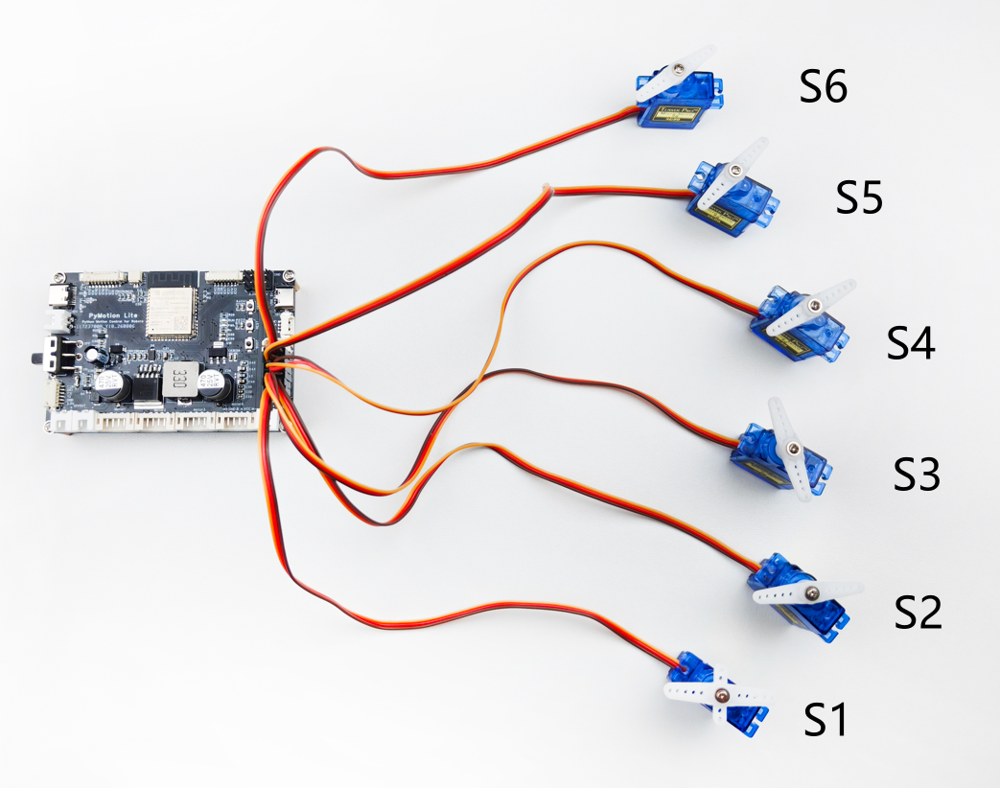

PyMotion Lite 提供 6 路 PWM 舵机接口（S1～S6）。程序端口号为 1～6，分别对应 S1～S6；下图的 S1～S6 为接线示意编号。mode 必须与舵机硬件类型匹配，设置模式不能把位置舵机变成连续旋转舵机。



<div style={{ color: '#475569', fontSize: '0.92rem', margin: '0.35rem 0 1rem', textAlign: 'center' }}>图 3-2 PWM 舵机连接示意图</div>

### 3.2.1 获取舵机对象与配置模式

通过以下 API 获取指定端口的 PWM 舵机对象。mode 用于选择连续旋转模式或位置模式：

<div style={{ background: '#eff6ff', border: '1px solid #93c5fd', borderRadius: '4px', color: '#1d4ed8', display: 'inline-block', fontFamily: 'ui-monospace, SFMono-Regular, Menlo, monospace', fontSize: '0.78rem', fontWeight: 700, lineHeight: 1.2, margin: '0.7rem 0 0.25rem', padding: '0.22rem 0.45rem' }}>API 签名</div>

```python
lite.pwm_servo(port, *, mode)
```

<div style={{ margin: '1.5rem 0', overflowX: 'auto', textAlign: 'center', width: '100%' }}>
  <div style={{ color: '#475569', fontSize: '0.92rem', fontWeight: 600, marginBottom: '0.15rem' }}>
    表 3-10 PWM 舵机对象 API 参数说明
  </div>

  <table width="100%" style={{ borderCollapse: 'collapse', margin: '0 auto', width: '100%', minWidth: '100%', textAlign: 'left' }}>
    <thead>
      <tr>
        <th style={{ background: '#e2e8f0', border: '1px solid #cbd5e1', padding: '0.55rem 0.7rem' }}>参数</th>
        <th style={{ background: '#e2e8f0', border: '1px solid #cbd5e1', padding: '0.55rem 0.7rem' }}>类型</th>
        <th style={{ background: '#e2e8f0', border: '1px solid #cbd5e1', padding: '0.55rem 0.7rem' }}>默认值或范围</th>
        <th style={{ background: '#e2e8f0', border: '1px solid #cbd5e1', padding: '0.55rem 0.7rem' }}>说明</th>
      </tr>
    </thead>

    <tbody>
      <tr>
        <td style={{ border: '1px solid #cbd5e1', padding: '0.5rem 0.7rem', verticalAlign: 'top' }}>port</td>
        <td style={{ border: '1px solid #cbd5e1', padding: '0.5rem 0.7rem', verticalAlign: 'top' }}>int</td>
        <td style={{ border: '1px solid #cbd5e1', padding: '0.5rem 0.7rem', verticalAlign: 'top' }}>1～6</td>
        <td style={{ border: '1px solid #cbd5e1', padding: '0.5rem 0.7rem', verticalAlign: 'top' }}>PWM 舵机端口号；1 对应 S1，依次至 6 对应 S6</td>
      </tr>

      <tr>
        <td style={{ border: '1px solid #cbd5e1', padding: '0.5rem 0.7rem', verticalAlign: 'top' }}>mode</td>
        <td style={{ border: '1px solid #cbd5e1', padding: '0.5rem 0.7rem', verticalAlign: 'top' }}>str</td>
        <td style={{ border: '1px solid #cbd5e1', padding: '0.5rem 0.7rem', verticalAlign: 'top' }}>显式指定</td>
        <td style={{ border: '1px solid #cbd5e1', padding: '0.5rem 0.7rem', verticalAlign: 'top' }}>speed：连续旋转；position：位置</td>
      </tr>
    </tbody>
  </table>
</div>

<div style={{ background: '#f0fdf4', border: '1px solid #86efac', borderRadius: '4px', color: '#166534', display: 'inline-block', fontFamily: 'ui-monospace, SFMono-Regular, Menlo, monospace', fontSize: '0.78rem', fontWeight: 700, lineHeight: 1.2, margin: '0.7rem 0 0.25rem', padding: '0.22rem 0.45rem' }}>完整例程 · Python</div>

```python
import pymotion as pm

# 获取指定 S1～S6 端口的 PWM 舵机对象
with pm.lite.connect(transport="usb") as lite:
    continuous = lite.pwm_servo(1, mode="speed")
    position = lite.pwm_servo(2, mode="position")
```

### 3.2.2 连续旋转舵机

连续旋转 PWM 舵机使用 speed 模式，通过以下 API 设置旋转速度。speed 的正负号表示方向；speed 非 0 且指定 duration 时，会在到期后自动关闭该端口。speed=0 时，调用后立即返回，duration 参数被忽略：

<div style={{ background: '#eff6ff', border: '1px solid #93c5fd', borderRadius: '4px', color: '#1d4ed8', display: 'inline-block', fontFamily: 'ui-monospace, SFMono-Regular, Menlo, monospace', fontSize: '0.78rem', fontWeight: 700, lineHeight: 1.2, margin: '0.7rem 0 0.25rem', padding: '0.22rem 0.45rem' }}>API 签名</div>

```python
servo.set_speed(speed, *, duration=None)
```

<div style={{ margin: '1.5rem 0', overflowX: 'auto', textAlign: 'center', width: '100%' }}>
  <div style={{ color: '#475569', fontSize: '0.92rem', fontWeight: 600, marginBottom: '0.15rem' }}>
    表 3-11 连续旋转 PWM 舵机 API 参数说明
  </div>

  <table width="100%" style={{ borderCollapse: 'collapse', margin: '0 auto', width: '100%', minWidth: '100%', textAlign: 'left' }}>
    <thead>
      <tr>
        <th style={{ background: '#e2e8f0', border: '1px solid #cbd5e1', padding: '0.55rem 0.7rem' }}>参数</th>
        <th style={{ background: '#e2e8f0', border: '1px solid #cbd5e1', padding: '0.55rem 0.7rem' }}>类型</th>
        <th style={{ background: '#e2e8f0', border: '1px solid #cbd5e1', padding: '0.55rem 0.7rem' }}>默认值或范围</th>
        <th style={{ background: '#e2e8f0', border: '1px solid #cbd5e1', padding: '0.55rem 0.7rem' }}>说明</th>
      </tr>
    </thead>

    <tbody>
      <tr>
        <td style={{ border: '1px solid #cbd5e1', padding: '0.5rem 0.7rem', verticalAlign: 'top' }}>speed</td>
        <td style={{ border: '1px solid #cbd5e1', padding: '0.5rem 0.7rem', verticalAlign: 'top' }}>float</td>
        <td style={{ border: '1px solid #cbd5e1', padding: '0.5rem 0.7rem', verticalAlign: 'top' }}>-100～100</td>
        <td style={{ border: '1px solid #cbd5e1', padding: '0.5rem 0.7rem', verticalAlign: 'top' }}>速度指令百分比；正负号表示方向；0 表示关闭输出并立即返回</td>
      </tr>

      <tr>
        <td style={{ border: '1px solid #cbd5e1', padding: '0.5rem 0.7rem', verticalAlign: 'top' }}>duration</td>
        <td style={{ border: '1px solid #cbd5e1', padding: '0.5rem 0.7rem', verticalAlign: 'top' }}>float | None</td>
        <td style={{ border: '1px solid #cbd5e1', padding: '0.5rem 0.7rem', verticalAlign: 'top' }}>None 或大于 0 秒</td>
        <td style={{ border: '1px solid #cbd5e1', padding: '0.5rem 0.7rem', verticalAlign: 'top' }}>speed 非 0 时，指定后到期关闭输出；speed=0 时该参数被忽略</td>
      </tr>
    </tbody>
  </table>
</div>

当 `speed=0` 时，`PwmServo.set_speed()` 会立即关闭输出并返回，传入的 `duration` 不参与本次调用。

<div style={{ background: '#f0fdf4', border: '1px solid #86efac', borderRadius: '4px', color: '#166534', display: 'inline-block', fontFamily: 'ui-monospace, SFMono-Regular, Menlo, monospace', fontSize: '0.78rem', fontWeight: 700, lineHeight: 1.2, margin: '0.7rem 0 0.25rem', padding: '0.22rem 0.45rem' }}>完整例程 · Python</div>

```python
import pymotion as pm

with pm.lite.connect(transport="usb") as lite:
    servo = lite.pwm_servo(1, mode="speed")
    with lite.control():
        servo.set_speed(40, duration=1.0)  # 正转 1 秒
        servo.stop()                       # 关闭输出
```

### 3.2.3 位置舵机

位置 PWM 舵机使用 position 模式，通过以下 API 设置目标角度：

<div style={{ background: '#eff6ff', border: '1px solid #93c5fd', borderRadius: '4px', color: '#1d4ed8', display: 'inline-block', fontFamily: 'ui-monospace, SFMono-Regular, Menlo, monospace', fontSize: '0.78rem', fontWeight: 700, lineHeight: 1.2, margin: '0.7rem 0 0.25rem', padding: '0.22rem 0.45rem' }}>API 签名</div>

```python
servo.move_to(angle)
```

<div style={{ margin: '1.5rem 0', overflowX: 'auto', textAlign: 'center', width: '100%' }}>
  <div style={{ color: '#475569', fontSize: '0.92rem', fontWeight: 600, marginBottom: '0.15rem' }}>
    表 3-12 位置 PWM 舵机 API 参数说明
  </div>

  <table width="100%" style={{ borderCollapse: 'collapse', margin: '0 auto', width: '100%', minWidth: '100%', textAlign: 'left' }}>
    <thead>
      <tr>
        <th style={{ background: '#e2e8f0', border: '1px solid #cbd5e1', padding: '0.55rem 0.7rem' }}>参数</th>
        <th style={{ background: '#e2e8f0', border: '1px solid #cbd5e1', padding: '0.55rem 0.7rem' }}>类型</th>
        <th style={{ background: '#e2e8f0', border: '1px solid #cbd5e1', padding: '0.55rem 0.7rem' }}>默认值或范围</th>
        <th style={{ background: '#e2e8f0', border: '1px solid #cbd5e1', padding: '0.55rem 0.7rem' }}>说明</th>
      </tr>
    </thead>

    <tbody>
      <tr>
        <td style={{ border: '1px solid #cbd5e1', padding: '0.5rem 0.7rem', verticalAlign: 'top' }}>angle</td>
        <td style={{ border: '1px solid #cbd5e1', padding: '0.5rem 0.7rem', verticalAlign: 'top' }}>float</td>
        <td style={{ border: '1px solid #cbd5e1', padding: '0.5rem 0.7rem', verticalAlign: 'top' }}>0～180°</td>
        <td style={{ border: '1px solid #cbd5e1', padding: '0.5rem 0.7rem', verticalAlign: 'top' }}>目标角度</td>
      </tr>
    </tbody>
  </table>
</div>

<div style={{ background: '#f0fdf4', border: '1px solid #86efac', borderRadius: '4px', color: '#166534', display: 'inline-block', fontFamily: 'ui-monospace, SFMono-Regular, Menlo, monospace', fontSize: '0.78rem', fontWeight: 700, lineHeight: 1.2, margin: '0.7rem 0 0.25rem', padding: '0.22rem 0.45rem' }}>完整例程 · Python</div>

```python
import time
import pymotion as pm

with pm.lite.connect(transport="usb") as lite:
    servo = lite.pwm_servo(2, mode="position")
    with lite.control():
        servo.move_to(90)  # 设置为 90°
        time.sleep(1.0)    # 保持输出 1 秒
        servo.stop()       # 关闭输出
```

例程向端口 2 写入 90° 目标，保持输出 1 秒后关闭。PWM 接口不提供实际角度反馈；命令成功不代表机构已经到位。

### 3.2.4 多路控制

批量设置连续旋转 PWM 舵机速度时使用以下 API。mapping 只需包含本次要修改的端口：

<div style={{ background: '#eff6ff', border: '1px solid #93c5fd', borderRadius: '4px', color: '#1d4ed8', display: 'inline-block', fontFamily: 'ui-monospace, SFMono-Regular, Menlo, monospace', fontSize: '0.78rem', fontWeight: 700, lineHeight: 1.2, margin: '0.7rem 0 0.25rem', padding: '0.22rem 0.45rem' }}>API 签名</div>

```python
lite.pwm_servos.set_speeds(mapping, *, duration=None)
```

批量设置位置 PWM 舵机目标角度时使用以下 API：

<div style={{ background: '#eff6ff', border: '1px solid #93c5fd', borderRadius: '4px', color: '#1d4ed8', display: 'inline-block', fontFamily: 'ui-monospace, SFMono-Regular, Menlo, monospace', fontSize: '0.78rem', fontWeight: 700, lineHeight: 1.2, margin: '0.7rem 0 0.25rem', padding: '0.22rem 0.45rem' }}>API 签名</div>

```python
lite.pwm_servos.move_to(mapping)
```

关闭全部 PWM 舵机端口输出时调用 `lite.pwm_servos.stop()`，该方法没有参数。

<div style={{ margin: '1.5rem 0', overflowX: 'auto', textAlign: 'center', width: '100%' }}>
  <div style={{ color: '#475569', fontSize: '0.92rem', fontWeight: 600, marginBottom: '0.15rem' }}>
    表 3-13 PWM 舵机多路控制 API 参数说明
  </div>

  <table width="100%" style={{ borderCollapse: 'collapse', margin: '0 auto', width: '100%', minWidth: '100%', textAlign: 'left' }}>
    <thead>
      <tr>
        <th style={{ background: '#e2e8f0', border: '1px solid #cbd5e1', padding: '0.55rem 0.7rem' }}>参数</th>
        <th style={{ background: '#e2e8f0', border: '1px solid #cbd5e1', padding: '0.55rem 0.7rem' }}>类型</th>
        <th style={{ background: '#e2e8f0', border: '1px solid #cbd5e1', padding: '0.55rem 0.7rem' }}>默认值或范围</th>
        <th style={{ background: '#e2e8f0', border: '1px solid #cbd5e1', padding: '0.55rem 0.7rem' }}>说明</th>
      </tr>
    </thead>

    <tbody>
      <tr>
        <td style={{ border: '1px solid #cbd5e1', padding: '0.5rem 0.7rem', verticalAlign: 'top' }}>mapping</td>
        <td style={{ border: '1px solid #cbd5e1', padding: '0.5rem 0.7rem', verticalAlign: 'top' }}>dict\[int, number]</td>
        <td style={{ border: '1px solid #cbd5e1', padding: '0.5rem 0.7rem', verticalAlign: 'top' }}>端口 1～6</td>
        <td style={{ border: '1px solid #cbd5e1', padding: '0.5rem 0.7rem', verticalAlign: 'top' }}>速度映射或角度映射</td>
      </tr>

      <tr>
        <td style={{ border: '1px solid #cbd5e1', padding: '0.5rem 0.7rem', verticalAlign: 'top' }}>duration</td>
        <td style={{ border: '1px solid #cbd5e1', padding: '0.5rem 0.7rem', verticalAlign: 'top' }}>float | None</td>
        <td style={{ border: '1px solid #cbd5e1', padding: '0.5rem 0.7rem', verticalAlign: 'top' }}>None 或大于 0 秒</td>
        <td style={{ border: '1px solid #cbd5e1', padding: '0.5rem 0.7rem', verticalAlign: 'top' }}>连续旋转舵机的运行时长</td>
      </tr>
    </tbody>
  </table>
</div>

<div style={{ background: '#f0fdf4', border: '1px solid #86efac', borderRadius: '4px', color: '#166534', display: 'inline-block', fontFamily: 'ui-monospace, SFMono-Regular, Menlo, monospace', fontSize: '0.78rem', fontWeight: 700, lineHeight: 1.2, margin: '0.7rem 0 0.25rem', padding: '0.22rem 0.45rem' }}>完整例程 · Python</div>

```python
import time
import pymotion as pm

# 连接设备并在 with 结束时自动关闭
with pm.lite.connect(transport="usb") as lite:
    with lite.control():
        lite.pwm_servos.set_speeds({1: 30, 2: -30})
        lite.pwm_servos.move_to({3: 60, 4: 120})
        time.sleep(2.0)
        lite.pwm_servos.stop()
```

### 3.2.5 获取 PWM 舵机状态

读取六路 PWM 舵机命令状态时使用以下 API：

<div style={{ background: '#eff6ff', border: '1px solid #93c5fd', borderRadius: '4px', color: '#1d4ed8', display: 'inline-block', fontFamily: 'ui-monospace, SFMono-Regular, Menlo, monospace', fontSize: '0.78rem', fontWeight: 700, lineHeight: 1.2, margin: '0.7rem 0 0.25rem', padding: '0.22rem 0.45rem' }}>API 签名</div>

```python
lite.pwm_servos.status(*, max_age=0.5)
```

<div style={{ margin: '1.5rem 0', overflowX: 'auto', textAlign: 'center', width: '100%' }}>
  <div style={{ color: '#475569', fontSize: '0.92rem', fontWeight: 600, marginBottom: '0.15rem' }}>
    表 3-14 PWM 舵机状态 API 参数说明
  </div>

  <table width="100%" style={{ borderCollapse: 'collapse', margin: '0 auto', width: '100%', minWidth: '100%', textAlign: 'left' }}>
    <thead>
      <tr>
        <th style={{ background: '#e2e8f0', border: '1px solid #cbd5e1', padding: '0.55rem 0.7rem' }}>参数</th>
        <th style={{ background: '#e2e8f0', border: '1px solid #cbd5e1', padding: '0.55rem 0.7rem' }}>类型</th>
        <th style={{ background: '#e2e8f0', border: '1px solid #cbd5e1', padding: '0.55rem 0.7rem' }}>默认值或范围</th>
        <th style={{ background: '#e2e8f0', border: '1px solid #cbd5e1', padding: '0.55rem 0.7rem' }}>说明</th>
      </tr>
    </thead>

    <tbody>
      <tr>
        <td style={{ border: '1px solid #cbd5e1', padding: '0.5rem 0.7rem', verticalAlign: 'top' }}>max_age</td>
        <td style={{ border: '1px solid #cbd5e1', padding: '0.5rem 0.7rem', verticalAlign: 'top' }}>float</td>
        <td style={{ border: '1px solid #cbd5e1', padding: '0.5rem 0.7rem', verticalAlign: 'top' }}>0.5；0～10 秒</td>
        <td style={{ border: '1px solid #cbd5e1', padding: '0.5rem 0.7rem', verticalAlign: 'top' }}>允许的最大状态年龄</td>
      </tr>
    </tbody>
  </table>
</div>

status() 返回以端口号为键、PwmServoState 为值的映射。

<div style={{ margin: '1.5rem 0', overflowX: 'auto', textAlign: 'center', width: '100%' }}>
  <div style={{ color: '#475569', fontSize: '0.92rem', fontWeight: 600, marginBottom: '0.15rem' }}>
    表 3-15 PWM 舵机状态对象字段说明
  </div>

  <table width="100%" style={{ borderCollapse: 'collapse', margin: '0 auto', width: '100%', minWidth: '100%', textAlign: 'left' }}>
    <thead>
      <tr>
        <th style={{ background: '#e2e8f0', border: '1px solid #cbd5e1', padding: '0.55rem 0.7rem' }}>字段</th>
        <th style={{ background: '#e2e8f0', border: '1px solid #cbd5e1', padding: '0.55rem 0.7rem' }}>说明</th>
      </tr>
    </thead>

    <tbody>
      <tr>
        <td style={{ border: '1px solid #cbd5e1', padding: '0.5rem 0.7rem', verticalAlign: 'top' }}>port</td>
        <td style={{ border: '1px solid #cbd5e1', padding: '0.5rem 0.7rem', verticalAlign: 'top' }}>端口号</td>
      </tr>

      <tr>
        <td style={{ border: '1px solid #cbd5e1', padding: '0.5rem 0.7rem', verticalAlign: 'top' }}>mode</td>
        <td style={{ border: '1px solid #cbd5e1', padding: '0.5rem 0.7rem', verticalAlign: 'top' }}>"speed" 或 "position"</td>
      </tr>

      <tr>
        <td style={{ border: '1px solid #cbd5e1', padding: '0.5rem 0.7rem', verticalAlign: 'top' }}>commanded_angle</td>
        <td style={{ border: '1px solid #cbd5e1', padding: '0.5rem 0.7rem', verticalAlign: 'top' }}>命令角度</td>
      </tr>

      <tr>
        <td style={{ border: '1px solid #cbd5e1', padding: '0.5rem 0.7rem', verticalAlign: 'top' }}>commanded_speed</td>
        <td style={{ border: '1px solid #cbd5e1', padding: '0.5rem 0.7rem', verticalAlign: 'top' }}>命令速度</td>
      </tr>

      <tr>
        <td style={{ border: '1px solid #cbd5e1', padding: '0.5rem 0.7rem', verticalAlign: 'top' }}>output_enabled</td>
        <td style={{ border: '1px solid #cbd5e1', padding: '0.5rem 0.7rem', verticalAlign: 'top' }}>端口是否正在输出</td>
      </tr>
    </tbody>
  </table>
</div>

<div style={{ background: '#f0fdf4', border: '1px solid #86efac', borderRadius: '4px', color: '#166534', display: 'inline-block', fontFamily: 'ui-monospace, SFMono-Regular, Menlo, monospace', fontSize: '0.78rem', fontWeight: 700, lineHeight: 1.2, margin: '0.7rem 0 0.25rem', padding: '0.22rem 0.45rem' }}>完整例程 · Python</div>

```python
import pymotion as pm

# 读取当前设备或执行器状态
with pm.lite.connect(transport="usb") as lite:
    states = lite.pwm_servos.status()
    for port, state in states.items():
        print(port, state.mode, state.output_enabled)
```

该示例读取各 PWM 舵机端口的模式和输出状态。
