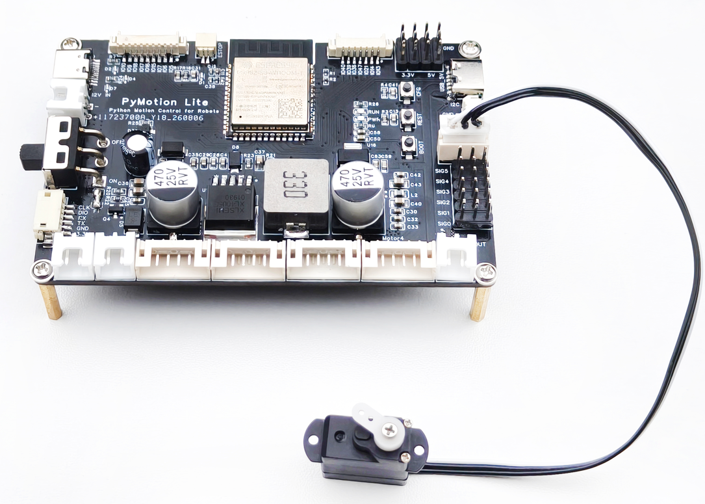

PyMotion Lite 提供 1 路 TTL 总线舵机接口，最多接入 8 只配套舵机。接入多只舵机前，应逐只设置不同的 ID；不得带电插拔。



<div style={{ color: '#475569', fontSize: '0.92rem', margin: '0.35rem 0 1rem', textAlign: 'center' }}>图 3-3 TTL 总线舵机连接示意图</div>

### 3.3.1 首次配置

总线上只连接一只待配置舵机时，可调用以下 API 修改该舵机的 ID。返回 TtlServoIdResult 对象，其中包含写入后读回的舵机信息。

<div style={{ background: '#eff6ff', border: '1px solid #93c5fd', borderRadius: '4px', color: '#1d4ed8', display: 'inline-block', fontFamily: 'ui-monospace, SFMono-Regular, Menlo, monospace', fontSize: '0.78rem', fontWeight: 700, lineHeight: 1.2, margin: '0.7rem 0 0.25rem', padding: '0.22rem 0.45rem' }}>API 签名</div>

```python
lite.ttl_servo.set_id(*, new_id)
```

<div style={{ margin: '1.5rem 0', overflowX: 'auto', textAlign: 'center', width: '100%' }}>
  <div style={{ color: '#475569', fontSize: '0.92rem', fontWeight: 600, marginBottom: '0.15rem' }}>
    表 3-16 set_id() 参数说明
  </div>

  <table width="100%" style={{ borderCollapse: 'collapse', margin: '0 auto', width: '100%', minWidth: '100%', textAlign: 'left' }}>
    <thead>
      <tr>
        <th style={{ background: '#e2e8f0', border: '1px solid #cbd5e1', padding: '0.55rem 0.7rem' }}>参数</th>
        <th style={{ background: '#e2e8f0', border: '1px solid #cbd5e1', padding: '0.55rem 0.7rem' }}>类型</th>
        <th style={{ background: '#e2e8f0', border: '1px solid #cbd5e1', padding: '0.55rem 0.7rem' }}>默认值或范围</th>
        <th style={{ background: '#e2e8f0', border: '1px solid #cbd5e1', padding: '0.55rem 0.7rem' }}>说明</th>
      </tr>
    </thead>

    <tbody>
      <tr>
        <td style={{ border: '1px solid #cbd5e1', padding: '0.5rem 0.7rem', verticalAlign: 'top' }}>new_id</td>
        <td style={{ border: '1px solid #cbd5e1', padding: '0.5rem 0.7rem', verticalAlign: 'top' }}>int</td>
        <td style={{ border: '1px solid #cbd5e1', padding: '0.5rem 0.7rem', verticalAlign: 'top' }}>1～253</td>
        <td style={{ border: '1px solid #cbd5e1', padding: '0.5rem 0.7rem', verticalAlign: 'top' }}>要写入的新舵机 ID</td>
      </tr>
    </tbody>
  </table>
</div>

<div style={{ margin: '1.5rem 0', overflowX: 'auto', textAlign: 'center', width: '100%' }}>
  <div style={{ color: '#475569', fontSize: '0.92rem', fontWeight: 600, marginBottom: '0.15rem' }}>
    表 3-17 TTL 舵机配置结果字段说明
  </div>

  <table width="100%" style={{ borderCollapse: 'collapse', margin: '0 auto', width: '100%', minWidth: '100%', textAlign: 'left' }}>
    <thead>
      <tr>
        <th style={{ background: '#e2e8f0', border: '1px solid #cbd5e1', padding: '0.55rem 0.7rem' }}>字段</th>
        <th style={{ background: '#e2e8f0', border: '1px solid #cbd5e1', padding: '0.55rem 0.7rem' }}>说明</th>
      </tr>
    </thead>

    <tbody>
      <tr>
        <td style={{ border: '1px solid #cbd5e1', padding: '0.5rem 0.7rem', verticalAlign: 'top' }}>old_id</td>
        <td style={{ border: '1px solid #cbd5e1', padding: '0.5rem 0.7rem', verticalAlign: 'top' }}>修改前的舵机 ID</td>
      </tr>

      <tr>
        <td style={{ border: '1px solid #cbd5e1', padding: '0.5rem 0.7rem', verticalAlign: 'top' }}>id</td>
        <td style={{ border: '1px solid #cbd5e1', padding: '0.5rem 0.7rem', verticalAlign: 'top' }}>修改后的舵机 ID</td>
      </tr>

      <tr>
        <td style={{ border: '1px solid #cbd5e1', padding: '0.5rem 0.7rem', verticalAlign: 'top' }}>max_angle</td>
        <td style={{ border: '1px solid #cbd5e1', padding: '0.5rem 0.7rem', verticalAlign: 'top' }}>舵机支持的最大角度</td>
      </tr>
    </tbody>
  </table>
</div>

<div style={{ background: '#f0fdf4', border: '1px solid #86efac', borderRadius: '4px', color: '#166534', display: 'inline-block', fontFamily: 'ui-monospace, SFMono-Regular, Menlo, monospace', fontSize: '0.78rem', fontWeight: 700, lineHeight: 1.2, margin: '0.7rem 0 0.25rem', padding: '0.22rem 0.45rem' }}>完整例程 · Python</div>

```python
import pymotion as pm

with pm.lite.connect(transport="usb") as lite:
    with lite.control():
        result = lite.ttl_servo.set_id(new_id=1)  # 设置 ID
    print(result.id, result.max_angle)
```

### 3.3.2 位置模式

位置模式 TTL 总线舵机先通过以下 API 创建对象：

<div style={{ background: '#eff6ff', border: '1px solid #93c5fd', borderRadius: '4px', color: '#1d4ed8', display: 'inline-block', fontFamily: 'ui-monospace, SFMono-Regular, Menlo, monospace', fontSize: '0.78rem', fontWeight: 700, lineHeight: 1.2, margin: '0.7rem 0 0.25rem', padding: '0.22rem 0.45rem' }}>API 签名</div>

```python
lite.ttl_servo(id, *, mode="position")
```

创建对象后，使用以下 API 设置目标角度和可选运动时间：

<div style={{ background: '#eff6ff', border: '1px solid #93c5fd', borderRadius: '4px', color: '#1d4ed8', display: 'inline-block', fontFamily: 'ui-monospace, SFMono-Regular, Menlo, monospace', fontSize: '0.78rem', fontWeight: 700, lineHeight: 1.2, margin: '0.7rem 0 0.25rem', padding: '0.22rem 0.45rem' }}>API 签名</div>

```python
servo.move_to(angle, *, duration=None)
```

<div style={{ margin: '1.5rem 0', overflowX: 'auto', textAlign: 'center', width: '100%' }}>
  <div style={{ color: '#475569', fontSize: '0.92rem', fontWeight: 600, marginBottom: '0.15rem' }}>
    表 3-18 TTL 舵机位置模式 API 参数说明
  </div>

  <table width="100%" style={{ borderCollapse: 'collapse', margin: '0 auto', width: '100%', minWidth: '100%', textAlign: 'left' }}>
    <thead>
      <tr>
        <th style={{ background: '#e2e8f0', border: '1px solid #cbd5e1', padding: '0.55rem 0.7rem' }}>参数</th>
        <th style={{ background: '#e2e8f0', border: '1px solid #cbd5e1', padding: '0.55rem 0.7rem' }}>类型</th>
        <th style={{ background: '#e2e8f0', border: '1px solid #cbd5e1', padding: '0.55rem 0.7rem' }}>默认值或范围</th>
        <th style={{ background: '#e2e8f0', border: '1px solid #cbd5e1', padding: '0.55rem 0.7rem' }}>说明</th>
      </tr>
    </thead>

    <tbody>
      <tr>
        <td style={{ border: '1px solid #cbd5e1', padding: '0.5rem 0.7rem', verticalAlign: 'top' }}>id</td>
        <td style={{ border: '1px solid #cbd5e1', padding: '0.5rem 0.7rem', verticalAlign: 'top' }}>int</td>
        <td style={{ border: '1px solid #cbd5e1', padding: '0.5rem 0.7rem', verticalAlign: 'top' }}>1～253</td>
        <td style={{ border: '1px solid #cbd5e1', padding: '0.5rem 0.7rem', verticalAlign: 'top' }}>舵机 ID</td>
      </tr>

      <tr>
        <td style={{ border: '1px solid #cbd5e1', padding: '0.5rem 0.7rem', verticalAlign: 'top' }}>angle</td>
        <td style={{ border: '1px solid #cbd5e1', padding: '0.5rem 0.7rem', verticalAlign: 'top' }}>float</td>
        <td style={{ border: '1px solid #cbd5e1', padding: '0.5rem 0.7rem', verticalAlign: 'top' }}>0～servo.max_angle</td>
        <td style={{ border: '1px solid #cbd5e1', padding: '0.5rem 0.7rem', verticalAlign: 'top' }}>目标角度</td>
      </tr>

      <tr>
        <td style={{ border: '1px solid #cbd5e1', padding: '0.5rem 0.7rem', verticalAlign: 'top' }}>duration</td>
        <td style={{ border: '1px solid #cbd5e1', padding: '0.5rem 0.7rem', verticalAlign: 'top' }}>float | None</td>
        <td style={{ border: '1px solid #cbd5e1', padding: '0.5rem 0.7rem', verticalAlign: 'top' }}>None 或 0.001～65.535 秒</td>
        <td style={{ border: '1px solid #cbd5e1', padding: '0.5rem 0.7rem', verticalAlign: 'top' }}>完成位置变化的目标时间</td>
      </tr>
    </tbody>
  </table>
</div>

<div style={{ background: '#f0fdf4', border: '1px solid #86efac', borderRadius: '4px', color: '#166534', display: 'inline-block', fontFamily: 'ui-monospace, SFMono-Regular, Menlo, monospace', fontSize: '0.78rem', fontWeight: 700, lineHeight: 1.2, margin: '0.7rem 0 0.25rem', padding: '0.22rem 0.45rem' }}>完整例程 · Python</div>

```python
import time
import pymotion as pm

# 读取当前设备或执行器状态
with pm.lite.connect(transport="usb") as lite:
    with lite.control():
        servo = lite.ttl_servo(1, mode="position")
        servo.move_to(min(90, servo.max_angle), duration=2.0)
        time.sleep(2.5)
        status = servo.status()
        if status.online:
            print(status.angle, status.moving)
        servo.stop()
```

例程设置 ID 为 1 的舵机目标角度和 2 秒目标运动时间，并预留观察时间后停止。实际位置应通过状态反馈确认，不能只依据计时判断到位。

### 3.3.3 速度模式

速度模式 TTL 总线舵机先通过以下 API 创建对象：

<div style={{ background: '#eff6ff', border: '1px solid #93c5fd', borderRadius: '4px', color: '#1d4ed8', display: 'inline-block', fontFamily: 'ui-monospace, SFMono-Regular, Menlo, monospace', fontSize: '0.78rem', fontWeight: 700, lineHeight: 1.2, margin: '0.7rem 0 0.25rem', padding: '0.22rem 0.45rem' }}>API 签名</div>

```python
lite.ttl_servo(id, *, mode="speed")
```

创建对象后，使用以下 API 设置旋转速度和可选运行时间：

<div style={{ background: '#eff6ff', border: '1px solid #93c5fd', borderRadius: '4px', color: '#1d4ed8', display: 'inline-block', fontFamily: 'ui-monospace, SFMono-Regular, Menlo, monospace', fontSize: '0.78rem', fontWeight: 700, lineHeight: 1.2, margin: '0.7rem 0 0.25rem', padding: '0.22rem 0.45rem' }}>API 签名</div>

```python
servo.set_speed(speed, *, duration=None)
```

停止该 TTL 舵机时使用以下 API。该方法没有参数：

<div style={{ background: '#eff6ff', border: '1px solid #93c5fd', borderRadius: '4px', color: '#1d4ed8', display: 'inline-block', fontFamily: 'ui-monospace, SFMono-Regular, Menlo, monospace', fontSize: '0.78rem', fontWeight: 700, lineHeight: 1.2, margin: '0.7rem 0 0.25rem', padding: '0.22rem 0.45rem' }}>API 签名</div>

```python
servo.stop()
```

<div style={{ margin: '1.5rem 0', overflowX: 'auto', textAlign: 'center', width: '100%' }}>
  <div style={{ color: '#475569', fontSize: '0.92rem', fontWeight: 600, marginBottom: '0.15rem' }}>
    表 3-19 TTL 舵机速度模式 API 参数说明
  </div>

  <table width="100%" style={{ borderCollapse: 'collapse', margin: '0 auto', width: '100%', minWidth: '100%', textAlign: 'left' }}>
    <thead>
      <tr>
        <th style={{ background: '#e2e8f0', border: '1px solid #cbd5e1', padding: '0.55rem 0.7rem' }}>参数</th>
        <th style={{ background: '#e2e8f0', border: '1px solid #cbd5e1', padding: '0.55rem 0.7rem' }}>类型</th>
        <th style={{ background: '#e2e8f0', border: '1px solid #cbd5e1', padding: '0.55rem 0.7rem' }}>默认值或范围</th>
        <th style={{ background: '#e2e8f0', border: '1px solid #cbd5e1', padding: '0.55rem 0.7rem' }}>说明</th>
      </tr>
    </thead>

    <tbody>
      <tr>
        <td style={{ border: '1px solid #cbd5e1', padding: '0.5rem 0.7rem', verticalAlign: 'top' }}>id</td>
        <td style={{ border: '1px solid #cbd5e1', padding: '0.5rem 0.7rem', verticalAlign: 'top' }}>int</td>
        <td style={{ border: '1px solid #cbd5e1', padding: '0.5rem 0.7rem', verticalAlign: 'top' }}>1～253</td>
        <td style={{ border: '1px solid #cbd5e1', padding: '0.5rem 0.7rem', verticalAlign: 'top' }}>舵机 ID</td>
      </tr>

      <tr>
        <td style={{ border: '1px solid #cbd5e1', padding: '0.5rem 0.7rem', verticalAlign: 'top' }}>speed</td>
        <td style={{ border: '1px solid #cbd5e1', padding: '0.5rem 0.7rem', verticalAlign: 'top' }}>float</td>
        <td style={{ border: '1px solid #cbd5e1', padding: '0.5rem 0.7rem', verticalAlign: 'top' }}>-100～100</td>
        <td style={{ border: '1px solid #cbd5e1', padding: '0.5rem 0.7rem', verticalAlign: 'top' }}>速度指令百分比</td>
      </tr>

      <tr>
        <td style={{ border: '1px solid #cbd5e1', padding: '0.5rem 0.7rem', verticalAlign: 'top' }}>duration</td>
        <td style={{ border: '1px solid #cbd5e1', padding: '0.5rem 0.7rem', verticalAlign: 'top' }}>float | None</td>
        <td style={{ border: '1px solid #cbd5e1', padding: '0.5rem 0.7rem', verticalAlign: 'top' }}>None 或大于 0 秒</td>
        <td style={{ border: '1px solid #cbd5e1', padding: '0.5rem 0.7rem', verticalAlign: 'top' }}>指定后到期停止</td>
      </tr>
    </tbody>
  </table>
</div>

<div style={{ background: '#f0fdf4', border: '1px solid #86efac', borderRadius: '4px', color: '#166534', display: 'inline-block', fontFamily: 'ui-monospace, SFMono-Regular, Menlo, monospace', fontSize: '0.78rem', fontWeight: 700, lineHeight: 1.2, margin: '0.7rem 0 0.25rem', padding: '0.22rem 0.45rem' }}>完整例程 · Python</div>

```python
import pymotion as pm

with pm.lite.connect(transport="usb") as lite:
    with lite.control():
        servo = lite.ttl_servo(2, mode="speed")
        servo.set_speed(30, duration=2.0)  # 运行 2 秒
```

该示例创建 ID 为 2 的速度模式舵机，并以 30% 速度运行 2 秒。

### 3.3.4 模式与状态

读取创建对象时声明的模式字符串可使用以下属性：

<div style={{ background: '#eff6ff', border: '1px solid #93c5fd', borderRadius: '4px', color: '#1d4ed8', display: 'inline-block', fontFamily: 'ui-monospace, SFMono-Regular, Menlo, monospace', fontSize: '0.78rem', fontWeight: 700, lineHeight: 1.2, margin: '0.7rem 0 0.25rem', padding: '0.22rem 0.45rem' }}>API 签名</div>

```python
servo.mode
```

读取舵机反馈状态时使用以下 API：

<div style={{ background: '#eff6ff', border: '1px solid #93c5fd', borderRadius: '4px', color: '#1d4ed8', display: 'inline-block', fontFamily: 'ui-monospace, SFMono-Regular, Menlo, monospace', fontSize: '0.78rem', fontWeight: 700, lineHeight: 1.2, margin: '0.7rem 0 0.25rem', padding: '0.22rem 0.45rem' }}>API 签名</div>

```python
servo.status()
```

`servo.mode` 返回当前连接为该舵机设置的模式字符串，即 `"position"` 或 `"speed"`；`servo.status()` 返回 `BusServoStatus`。创建 TTL 对象会设置实际模式，必须在控制上下文中执行。

<div style={{ margin: '1.5rem 0', overflowX: 'auto', textAlign: 'center', width: '100%' }}>
  <div style={{ color: '#475569', fontSize: '0.92rem', fontWeight: 600, marginBottom: '0.15rem' }}>
    表 3-20 TTL 舵机状态对象字段说明
  </div>

  <table width="100%" style={{ borderCollapse: 'collapse', margin: '0 auto', width: '100%', minWidth: '100%', textAlign: 'left' }}>
    <thead>
      <tr>
        <th style={{ background: '#e2e8f0', border: '1px solid #cbd5e1', padding: '0.55rem 0.7rem' }}>字段</th>
        <th style={{ background: '#e2e8f0', border: '1px solid #cbd5e1', padding: '0.55rem 0.7rem' }}>说明</th>
      </tr>
    </thead>

    <tbody>
      <tr>
        <td style={{ border: '1px solid #cbd5e1', padding: '0.5rem 0.7rem', verticalAlign: 'top' }}>online</td>
        <td style={{ border: '1px solid #cbd5e1', padding: '0.5rem 0.7rem', verticalAlign: 'top' }}>舵机是否在线</td>
      </tr>

      <tr>
        <td style={{ border: '1px solid #cbd5e1', padding: '0.5rem 0.7rem', verticalAlign: 'top' }}>id</td>
        <td style={{ border: '1px solid #cbd5e1', padding: '0.5rem 0.7rem', verticalAlign: 'top' }}>舵机 ID</td>
      </tr>

      <tr>
        <td style={{ border: '1px solid #cbd5e1', padding: '0.5rem 0.7rem', verticalAlign: 'top' }}>angle</td>
        <td style={{ border: '1px solid #cbd5e1', padding: '0.5rem 0.7rem', verticalAlign: 'top' }}>当前角度</td>
      </tr>

      <tr>
        <td style={{ border: '1px solid #cbd5e1', padding: '0.5rem 0.7rem', verticalAlign: 'top' }}>voltage</td>
        <td style={{ border: '1px solid #cbd5e1', padding: '0.5rem 0.7rem', verticalAlign: 'top' }}>电压，单位 V</td>
      </tr>

      <tr>
        <td style={{ border: '1px solid #cbd5e1', padding: '0.5rem 0.7rem', verticalAlign: 'top' }}>temperature</td>
        <td style={{ border: '1px solid #cbd5e1', padding: '0.5rem 0.7rem', verticalAlign: 'top' }}>温度，单位 °C</td>
      </tr>

      <tr>
        <td style={{ border: '1px solid #cbd5e1', padding: '0.5rem 0.7rem', verticalAlign: 'top' }}>moving</td>
        <td style={{ border: '1px solid #cbd5e1', padding: '0.5rem 0.7rem', verticalAlign: 'top' }}>是否正在运动</td>
      </tr>

      <tr>
        <td style={{ border: '1px solid #cbd5e1', padding: '0.5rem 0.7rem', verticalAlign: 'top' }}>fault_code</td>
        <td style={{ border: '1px solid #cbd5e1', padding: '0.5rem 0.7rem', verticalAlign: 'top' }}>故障码；0 表示无故障</td>
      </tr>

      <tr>
        <td style={{ border: '1px solid #cbd5e1', padding: '0.5rem 0.7rem', verticalAlign: 'top' }}>raw_position</td>
        <td style={{ border: '1px solid #cbd5e1', padding: '0.5rem 0.7rem', verticalAlign: 'top' }}>舵机位置的原始计数；不可用时为 None</td>
      </tr>

      <tr>
        <td style={{ border: '1px solid #cbd5e1', padding: '0.5rem 0.7rem', verticalAlign: 'top' }}>feedback_valid</td>
        <td style={{ border: '1px solid #cbd5e1', padding: '0.5rem 0.7rem', verticalAlign: 'top' }}>本次反馈中有效字段名称的集合</td>
      </tr>
    </tbody>
  </table>
</div>

<div style={{ background: '#f0fdf4', border: '1px solid #86efac', borderRadius: '4px', color: '#166534', display: 'inline-block', fontFamily: 'ui-monospace, SFMono-Regular, Menlo, monospace', fontSize: '0.78rem', fontWeight: 700, lineHeight: 1.2, margin: '0.7rem 0 0.25rem', padding: '0.22rem 0.45rem' }}>完整例程 · Python</div>

```python
import pymotion as pm

# 读取当前设备或执行器状态
with pm.lite.connect(transport="usb") as lite:
    with lite.control():
        servo = lite.ttl_servo(1, mode="position")
        print(servo.mode)
        status = servo.status()
        if status.online:
            print(status.angle, status.moving)
```

读取状态后先检查 online，再使用角度、运动状态等反馈。

### 3.3.5 多舵机控制

批量设置位置模式 TTL 舵机时使用以下 API：

<div style={{ background: '#eff6ff', border: '1px solid #93c5fd', borderRadius: '4px', color: '#1d4ed8', display: 'inline-block', fontFamily: 'ui-monospace, SFMono-Regular, Menlo, monospace', fontSize: '0.78rem', fontWeight: 700, lineHeight: 1.2, margin: '0.7rem 0 0.25rem', padding: '0.22rem 0.45rem' }}>API 签名</div>

```python
lite.ttl_servos.move_to(mapping, *, duration=None)
```

批量设置速度模式舵机时使用以下 API。两个控制接口的 mapping 都以 TtlServo 对象为键：

<div style={{ background: '#eff6ff', border: '1px solid #93c5fd', borderRadius: '4px', color: '#1d4ed8', display: 'inline-block', fontFamily: 'ui-monospace, SFMono-Regular, Menlo, monospace', fontSize: '0.78rem', fontWeight: 700, lineHeight: 1.2, margin: '0.7rem 0 0.25rem', padding: '0.22rem 0.45rem' }}>API 签名</div>

```python
lite.ttl_servos.set_speeds(mapping, *, duration=None)
```

读取当前程序中已创建 TTL 舵机的状态时使用以下 API：

<div style={{ background: '#eff6ff', border: '1px solid #93c5fd', borderRadius: '4px', color: '#1d4ed8', display: 'inline-block', fontFamily: 'ui-monospace, SFMono-Regular, Menlo, monospace', fontSize: '0.78rem', fontWeight: 700, lineHeight: 1.2, margin: '0.7rem 0 0.25rem', padding: '0.22rem 0.45rem' }}>API 签名</div>

```python
lite.ttl_servos.status()
```

停止当前程序中已创建的 TTL 舵机时使用以下 API：

<div style={{ background: '#eff6ff', border: '1px solid #93c5fd', borderRadius: '4px', color: '#1d4ed8', display: 'inline-block', fontFamily: 'ui-monospace, SFMono-Regular, Menlo, monospace', fontSize: '0.78rem', fontWeight: 700, lineHeight: 1.2, margin: '0.7rem 0 0.25rem', padding: '0.22rem 0.45rem' }}>API 签名</div>

```python
lite.ttl_servos.stop()
```

<div style={{ margin: '1.5rem 0', overflowX: 'auto', textAlign: 'center', width: '100%' }}>
  <div style={{ color: '#475569', fontSize: '0.92rem', fontWeight: 600, marginBottom: '0.15rem' }}>
    表 3-21 TTL 舵机批量控制 API 参数说明
  </div>

  <table width="100%" style={{ borderCollapse: 'collapse', margin: '0 auto', width: '100%', minWidth: '100%', textAlign: 'left' }}>
    <thead>
      <tr>
        <th style={{ background: '#e2e8f0', border: '1px solid #cbd5e1', padding: '0.55rem 0.7rem' }}>参数</th>
        <th style={{ background: '#e2e8f0', border: '1px solid #cbd5e1', padding: '0.55rem 0.7rem' }}>类型</th>
        <th style={{ background: '#e2e8f0', border: '1px solid #cbd5e1', padding: '0.55rem 0.7rem' }}>默认值或范围</th>
        <th style={{ background: '#e2e8f0', border: '1px solid #cbd5e1', padding: '0.55rem 0.7rem' }}>说明</th>
      </tr>
    </thead>

    <tbody>
      <tr>
        <td style={{ border: '1px solid #cbd5e1', padding: '0.5rem 0.7rem', verticalAlign: 'top' }}>mapping</td>
        <td style={{ border: '1px solid #cbd5e1', padding: '0.5rem 0.7rem', verticalAlign: 'top' }}>dict\[TtlServo, number]</td>
        <td style={{ border: '1px solid #cbd5e1', padding: '0.5rem 0.7rem', verticalAlign: 'top' }}>配套总线最多同时支持8个舵机</td>
        <td style={{ border: '1px solid #cbd5e1', padding: '0.5rem 0.7rem', verticalAlign: 'top' }}>键为 TtlServo 对象，值为角度或速度</td>
      </tr>

      <tr>
        <td style={{ border: '1px solid #cbd5e1', padding: '0.5rem 0.7rem', verticalAlign: 'top' }}>duration</td>
        <td style={{ border: '1px solid #cbd5e1', padding: '0.5rem 0.7rem', verticalAlign: 'top' }}>float | None</td>
        <td style={{ border: '1px solid #cbd5e1', padding: '0.5rem 0.7rem', verticalAlign: 'top' }}>位置：0.001～65.535 秒或 None；速度：大于 0 秒或 None</td>
        <td style={{ border: '1px solid #cbd5e1', padding: '0.5rem 0.7rem', verticalAlign: 'top' }}>位置为目标运动时间；速度为运行时长</td>
      </tr>
    </tbody>
  </table>
</div>

move_to()、set_speeds() 和 stop() 执行成功时均返回 None；status() 返回以舵机 ID 为键、`BusServoStatus` 为值的映射。

<div style={{ background: '#f0fdf4', border: '1px solid #86efac', borderRadius: '4px', color: '#166534', display: 'inline-block', fontFamily: 'ui-monospace, SFMono-Regular, Menlo, monospace', fontSize: '0.78rem', fontWeight: 700, lineHeight: 1.2, margin: '0.7rem 0 0.25rem', padding: '0.22rem 0.45rem' }}>完整例程 · Python</div>

```python
import time
import pymotion as pm

# 获取指定 ID 的 TTL 舵机对象
with pm.lite.connect(transport="usb") as lite:
    with lite.control():
        left = lite.ttl_servo(1, mode="position")
        right = lite.ttl_servo(2, mode="position")
        lite.ttl_servos.move_to({
            left: min(90, left.max_angle),
            right: min(180, right.max_angle),
        }, duration=2.0)
        time.sleep(2.5)
        lite.ttl_servos.stop()
```

例程为两只舵机设置不同的位置目标并等待后停止。目标必须分别位于各自 0～max_angle 范围内。
