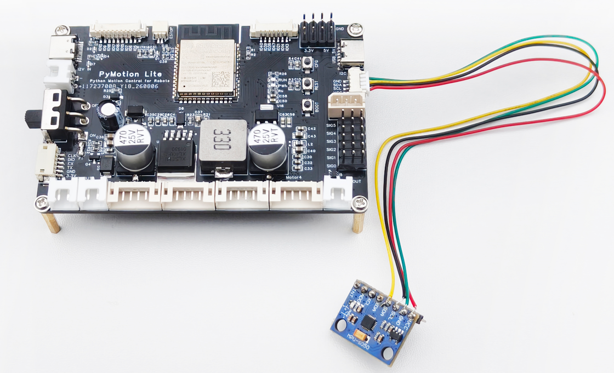
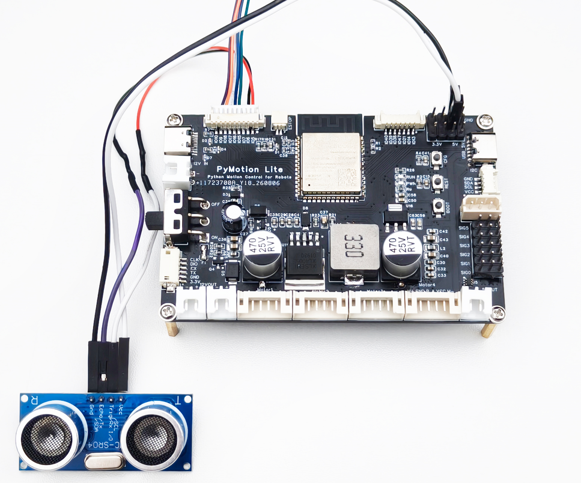
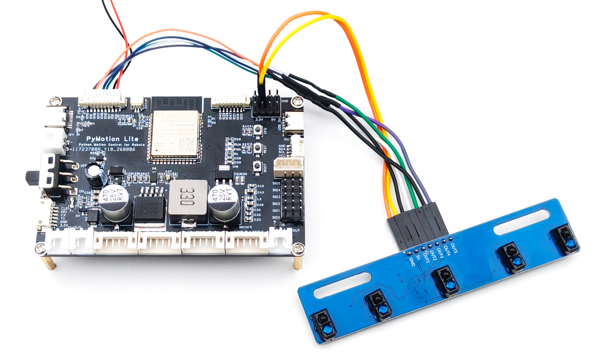
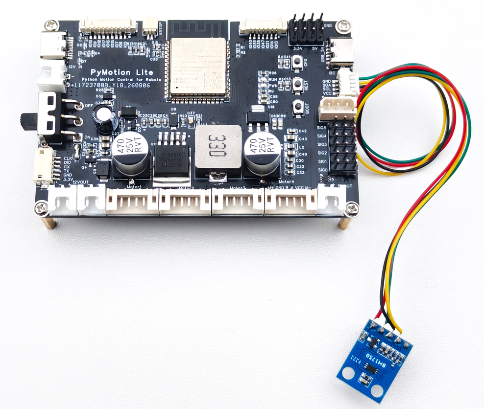
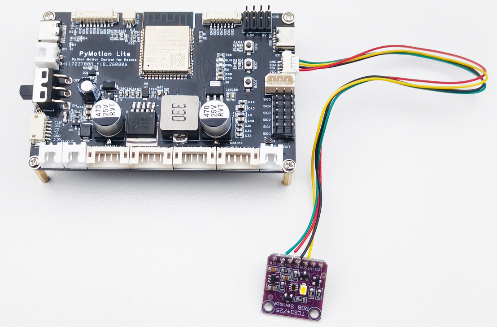

本节说明常用传感器的读取方法和返回字段。

### 3.4.1 综合读取与单项读取

一次读取常用传感器时使用以下综合接口：

<div style={{ background: '#eff6ff', border: '1px solid #93c5fd', borderRadius: '4px', color: '#1d4ed8', display: 'inline-block', fontFamily: 'ui-monospace, SFMono-Regular, Menlo, monospace', fontSize: '0.78rem', fontWeight: 700, lineHeight: 1.2, margin: '0.7rem 0 0.25rem', padding: '0.22rem 0.45rem' }}>API 签名</div>

```python
lite.sensors(*, max_age=0.5)
```

只需要某一类数据时，可调用以下单项读取 API。它们使用相同的 `max_age` 参数，因此集中列出：

<div style={{ background: '#eff6ff', border: '1px solid #93c5fd', borderRadius: '4px', color: '#1d4ed8', display: 'inline-block', fontFamily: 'ui-monospace, SFMono-Regular, Menlo, monospace', fontSize: '0.78rem', fontWeight: 700, lineHeight: 1.2, margin: '0.7rem 0 0.25rem', padding: '0.22rem 0.45rem' }}>API 签名</div>

```python
lite.imu(*, max_age=0.5)
lite.ultrasonic(*, max_age=0.5)
lite.line_tracker(*, max_age=0.5)
lite.ambient_light(*, max_age=0.5)
lite.color(*, max_age=0.5)
```

<div style={{ margin: '1.5rem 0', overflowX: 'auto', textAlign: 'center', width: '100%' }}>
  <div style={{ color: '#475569', fontSize: '0.92rem', fontWeight: 600, marginBottom: '0.15rem' }}>
    表 3-22 传感器读取 API 参数说明
  </div>

  <table width="100%" style={{ borderCollapse: 'collapse', margin: '0 auto', width: '100%', minWidth: '100%', textAlign: 'left' }}>
    <thead>
      <tr>
        <th style={{ background: '#e2e8f0', border: '1px solid #cbd5e1', padding: '0.55rem 0.7rem' }}>参数</th>
        <th style={{ background: '#e2e8f0', border: '1px solid #cbd5e1', padding: '0.55rem 0.7rem' }}>类型</th>
        <th style={{ background: '#e2e8f0', border: '1px solid #cbd5e1', padding: '0.55rem 0.7rem' }}>默认值或范围</th>
        <th style={{ background: '#e2e8f0', border: '1px solid #cbd5e1', padding: '0.55rem 0.7rem' }}>说明</th>
      </tr>
    </thead>

    <tbody>
      <tr>
        <td style={{ border: '1px solid #cbd5e1', padding: '0.5rem 0.7rem', verticalAlign: 'top' }}>max_age</td>
        <td style={{ border: '1px solid #cbd5e1', padding: '0.5rem 0.7rem', verticalAlign: 'top' }}>float</td>
        <td style={{ border: '1px solid #cbd5e1', padding: '0.5rem 0.7rem', verticalAlign: 'top' }}>0.5；0～10 秒</td>
        <td style={{ border: '1px solid #cbd5e1', padding: '0.5rem 0.7rem', verticalAlign: 'top' }}>允许的最大数据年龄</td>
      </tr>
    </tbody>
  </table>
</div>

sensors() 返回 SensorObservation；imu()、ultrasonic()、line_tracker()、ambient_light() 和 color() 分别返回对应传感器的读数对象。

<div style={{ background: '#f0fdf4', border: '1px solid #86efac', borderRadius: '4px', color: '#166534', display: 'inline-block', fontFamily: 'ui-monospace, SFMono-Regular, Menlo, monospace', fontSize: '0.78rem', fontWeight: 700, lineHeight: 1.2, margin: '0.7rem 0 0.25rem', padding: '0.22rem 0.45rem' }}>完整例程 · Python</div>

```python
import pymotion as pm

with pm.lite.connect(transport="usb") as lite:
    data = lite.sensors()
    print(data.imu)            # IMU
    print(data.ultrasonic)     # 超声波
    print(data.line_tracker)   # 五路循迹
```

### 3.4.2 有效性

使用数值前，先检查 valid；再结合 state 和 age 判断数据状态及新鲜程度。未接入、失效或过期的数据不能当作 0，也不能当作正常测量值参与控制。`max_age` 是程序允许的数据年龄上限，不是传感器采样周期。读取或通信异常应按第 5 章处理。

<div style={{ margin: '1.5rem 0', overflowX: 'auto', textAlign: 'center', width: '100%' }}>
  <div style={{ color: '#475569', fontSize: '0.92rem', fontWeight: 600, marginBottom: '0.15rem' }}>
    表 3-23 传感器有效性字段
  </div>

  <table width="100%" style={{ borderCollapse: 'collapse', margin: '0 auto', width: '100%', minWidth: '100%', textAlign: 'left' }}>
    <thead>
      <tr>
        <th style={{ background: '#e2e8f0', border: '1px solid #cbd5e1', padding: '0.55rem 0.7rem' }}>字段</th>
        <th style={{ background: '#e2e8f0', border: '1px solid #cbd5e1', padding: '0.55rem 0.7rem' }}>说明</th>
      </tr>
    </thead>

    <tbody>
      <tr>
        <td style={{ border: '1px solid #cbd5e1', padding: '0.5rem 0.7rem', verticalAlign: 'top' }}>valid</td>
        <td style={{ border: '1px solid #cbd5e1', padding: '0.5rem 0.7rem', verticalAlign: 'top' }}>读数是否可用</td>
      </tr>

      <tr>
        <td style={{ border: '1px solid #cbd5e1', padding: '0.5rem 0.7rem', verticalAlign: 'top' }}>state</td>
        <td style={{ border: '1px solid #cbd5e1', padding: '0.5rem 0.7rem', verticalAlign: 'top' }}>读数状态</td>
      </tr>

      <tr>
        <td style={{ border: '1px solid #cbd5e1', padding: '0.5rem 0.7rem', verticalAlign: 'top' }}>age</td>
        <td style={{ border: '1px solid #cbd5e1', padding: '0.5rem 0.7rem', verticalAlign: 'top' }}>数据年龄，单位秒</td>
      </tr>
    </tbody>
  </table>
</div>

<div style={{ background: '#f0fdf4', border: '1px solid #86efac', borderRadius: '4px', color: '#166534', display: 'inline-block', fontFamily: 'ui-monospace, SFMono-Regular, Menlo, monospace', fontSize: '0.78rem', fontWeight: 700, lineHeight: 1.2, margin: '0.7rem 0 0.25rem', padding: '0.22rem 0.45rem' }}>完整例程 · Python</div>

```python
import pymotion as pm

with pm.lite.connect(transport="usb") as lite:
    reading = lite.ultrasonic()
    if reading.valid:
        print(reading.distance)  # 仅在有效时使用数值
```

### 3.4.3 IMU

配套的 IMU 传感模块是 6 轴姿态传感器，其硬件连接如图 3-4 所示。



<div style={{ color: '#475569', fontSize: '0.92rem', margin: '0.35rem 0 1rem', textAlign: 'center' }}>图 3-4 IMU 模块连接示意图</div>

可调用以下 API 读取六轴 IMU 数据：

<div style={{ background: '#eff6ff', border: '1px solid #93c5fd', borderRadius: '4px', color: '#1d4ed8', display: 'inline-block', fontFamily: 'ui-monospace, SFMono-Regular, Menlo, monospace', fontSize: '0.78rem', fontWeight: 700, lineHeight: 1.2, margin: '0.7rem 0 0.25rem', padding: '0.22rem 0.45rem' }}>API 签名</div>

```python
lite.imu(*, max_age=0.5)
```

<div style={{ margin: '1.5rem 0', overflowX: 'auto', textAlign: 'center', width: '100%' }}>
  <div style={{ color: '#475569', fontSize: '0.92rem', fontWeight: 600, marginBottom: '0.15rem' }}>
    表 3-24 imu() 参数说明
  </div>

  <table width="100%" style={{ borderCollapse: 'collapse', margin: '0 auto', width: '100%', minWidth: '100%', textAlign: 'left' }}>
    <thead>
      <tr>
        <th style={{ background: '#e2e8f0', border: '1px solid #cbd5e1', padding: '0.55rem 0.7rem' }}>参数</th>
        <th style={{ background: '#e2e8f0', border: '1px solid #cbd5e1', padding: '0.55rem 0.7rem' }}>类型</th>
        <th style={{ background: '#e2e8f0', border: '1px solid #cbd5e1', padding: '0.55rem 0.7rem' }}>默认值或范围</th>
        <th style={{ background: '#e2e8f0', border: '1px solid #cbd5e1', padding: '0.55rem 0.7rem' }}>说明</th>
      </tr>
    </thead>

    <tbody>
      <tr>
        <td style={{ border: '1px solid #cbd5e1', padding: '0.5rem 0.7rem', verticalAlign: 'top' }}>max_age</td>
        <td style={{ border: '1px solid #cbd5e1', padding: '0.5rem 0.7rem', verticalAlign: 'top' }}>float</td>
        <td style={{ border: '1px solid #cbd5e1', padding: '0.5rem 0.7rem', verticalAlign: 'top' }}>0.5；0～10 秒</td>
        <td style={{ border: '1px solid #cbd5e1', padding: '0.5rem 0.7rem', verticalAlign: 'top' }}>允许的最大数据年龄</td>
      </tr>
    </tbody>
  </table>
</div>

imu() 返回 `ImuReading` 对象。

<div style={{ margin: '1.5rem 0', overflowX: 'auto', textAlign: 'center', width: '100%' }}>
  <div style={{ color: '#475569', fontSize: '0.92rem', fontWeight: 600, marginBottom: '0.15rem' }}>
    表 3-25 IMU 数据字段说明
  </div>

  <table width="100%" style={{ borderCollapse: 'collapse', margin: '0 auto', width: '100%', minWidth: '100%', textAlign: 'left' }}>
    <thead>
      <tr>
        <th style={{ background: '#e2e8f0', border: '1px solid #cbd5e1', padding: '0.55rem 0.7rem' }}>字段</th>
        <th style={{ background: '#e2e8f0', border: '1px solid #cbd5e1', padding: '0.55rem 0.7rem' }}>说明</th>
      </tr>
    </thead>

    <tbody>
      <tr>
        <td style={{ border: '1px solid #cbd5e1', padding: '0.5rem 0.7rem', verticalAlign: 'top' }}>acceleration</td>
        <td style={{ border: '1px solid #cbd5e1', padding: '0.5rem 0.7rem', verticalAlign: 'top' }}>x、y、z 加速度，单位 mm/s²</td>
      </tr>

      <tr>
        <td style={{ border: '1px solid #cbd5e1', padding: '0.5rem 0.7rem', verticalAlign: 'top' }}>angular_velocity</td>
        <td style={{ border: '1px solid #cbd5e1', padding: '0.5rem 0.7rem', verticalAlign: 'top' }}>x、y、z 角速度，单位 rad/s</td>
      </tr>

      <tr>
        <td style={{ border: '1px solid #cbd5e1', padding: '0.5rem 0.7rem', verticalAlign: 'top' }}>orientation</td>
        <td style={{ border: '1px solid #cbd5e1', padding: '0.5rem 0.7rem', verticalAlign: 'top' }}>roll 和 pitch，单位度</td>
      </tr>

      <tr>
        <td style={{ border: '1px solid #cbd5e1', padding: '0.5rem 0.7rem', verticalAlign: 'top' }}>valid</td>
        <td style={{ border: '1px solid #cbd5e1', padding: '0.5rem 0.7rem', verticalAlign: 'top' }}>读数是否有效；仅 True 时数据字段可用于控制</td>
      </tr>

      <tr>
        <td style={{ border: '1px solid #cbd5e1', padding: '0.5rem 0.7rem', verticalAlign: 'top' }}>state</td>
        <td style={{ border: '1px solid #cbd5e1', padding: '0.5rem 0.7rem', verticalAlign: 'top' }}>"valid"、"stale"、"unavailable" 或 "error"</td>
      </tr>

      <tr>
        <td style={{ border: '1px solid #cbd5e1', padding: '0.5rem 0.7rem', verticalAlign: 'top' }}>age</td>
        <td style={{ border: '1px solid #cbd5e1', padding: '0.5rem 0.7rem', verticalAlign: 'top' }}>样本年龄，单位秒；未知时为 None</td>
      </tr>
    </tbody>
  </table>
</div>

<div style={{ background: '#f0fdf4', border: '1px solid #86efac', borderRadius: '4px', color: '#166534', display: 'inline-block', fontFamily: 'ui-monospace, SFMono-Regular, Menlo, monospace', fontSize: '0.78rem', fontWeight: 700, lineHeight: 1.2, margin: '0.7rem 0 0.25rem', padding: '0.22rem 0.45rem' }}>完整例程 · Python</div>

```python
import pymotion as pm

with pm.lite.connect(transport="usb") as lite:
    imu = lite.imu()
    if imu.valid:
        print(imu.acceleration.x)      # X 轴加速度
        print(imu.orientation.roll)    # 横滚角
```

### 3.4.4 超声波

配套的超声波传感模块可以测量模块到物体的距离，其硬件连接如图 3-5 所示。



<div style={{ color: '#475569', fontSize: '0.92rem', margin: '0.35rem 0 1rem', textAlign: 'center' }}>图 3-5 超声波模块接线示意图</div>

可调用以下 API 读取超声波传感器测得的距离：

<div style={{ background: '#eff6ff', border: '1px solid #93c5fd', borderRadius: '4px', color: '#1d4ed8', display: 'inline-block', fontFamily: 'ui-monospace, SFMono-Regular, Menlo, monospace', fontSize: '0.78rem', fontWeight: 700, lineHeight: 1.2, margin: '0.7rem 0 0.25rem', padding: '0.22rem 0.45rem' }}>API 签名</div>

```python
lite.ultrasonic(*, max_age=0.5)
```

<div style={{ margin: '1.5rem 0', overflowX: 'auto', textAlign: 'center', width: '100%' }}>
  <div style={{ color: '#475569', fontSize: '0.92rem', fontWeight: 600, marginBottom: '0.15rem' }}>
    表 3-26 ultrasonic() 参数说明
  </div>

  <table width="100%" style={{ borderCollapse: 'collapse', margin: '0 auto', width: '100%', minWidth: '100%', textAlign: 'left' }}>
    <thead>
      <tr>
        <th style={{ background: '#e2e8f0', border: '1px solid #cbd5e1', padding: '0.55rem 0.7rem' }}>参数</th>
        <th style={{ background: '#e2e8f0', border: '1px solid #cbd5e1', padding: '0.55rem 0.7rem' }}>类型</th>
        <th style={{ background: '#e2e8f0', border: '1px solid #cbd5e1', padding: '0.55rem 0.7rem' }}>默认值或范围</th>
        <th style={{ background: '#e2e8f0', border: '1px solid #cbd5e1', padding: '0.55rem 0.7rem' }}>说明</th>
      </tr>
    </thead>

    <tbody>
      <tr>
        <td style={{ border: '1px solid #cbd5e1', padding: '0.5rem 0.7rem', verticalAlign: 'top' }}>max_age</td>
        <td style={{ border: '1px solid #cbd5e1', padding: '0.5rem 0.7rem', verticalAlign: 'top' }}>float</td>
        <td style={{ border: '1px solid #cbd5e1', padding: '0.5rem 0.7rem', verticalAlign: 'top' }}>0.5；0～10 秒</td>
        <td style={{ border: '1px solid #cbd5e1', padding: '0.5rem 0.7rem', verticalAlign: 'top' }}>允许的最大数据年龄</td>
      </tr>
    </tbody>
  </table>
</div>

ultrasonic() 返回 `UltrasonicReading` 对象。

<div style={{ margin: '1.5rem 0', overflowX: 'auto', textAlign: 'center', width: '100%' }}>
  <div style={{ color: '#475569', fontSize: '0.92rem', fontWeight: 600, marginBottom: '0.15rem' }}>
    表 3-27 超声波数据字段说明
  </div>

  <table width="100%" style={{ borderCollapse: 'collapse', margin: '0 auto', width: '100%', minWidth: '100%', textAlign: 'left' }}>
    <thead>
      <tr>
        <th style={{ background: '#e2e8f0', border: '1px solid #cbd5e1', padding: '0.55rem 0.7rem' }}>字段</th>
        <th style={{ background: '#e2e8f0', border: '1px solid #cbd5e1', padding: '0.55rem 0.7rem' }}>说明</th>
      </tr>
    </thead>

    <tbody>
      <tr>
        <td style={{ border: '1px solid #cbd5e1', padding: '0.5rem 0.7rem', verticalAlign: 'top' }}>distance</td>
        <td style={{ border: '1px solid #cbd5e1', padding: '0.5rem 0.7rem', verticalAlign: 'top' }}>距离，单位 mm</td>
      </tr>

      <tr>
        <td style={{ border: '1px solid #cbd5e1', padding: '0.5rem 0.7rem', verticalAlign: 'top' }}>valid</td>
        <td style={{ border: '1px solid #cbd5e1', padding: '0.5rem 0.7rem', verticalAlign: 'top' }}>读数是否有效；仅 True 时数据字段可用于控制</td>
      </tr>

      <tr>
        <td style={{ border: '1px solid #cbd5e1', padding: '0.5rem 0.7rem', verticalAlign: 'top' }}>state</td>
        <td style={{ border: '1px solid #cbd5e1', padding: '0.5rem 0.7rem', verticalAlign: 'top' }}>"valid"、"no_echo"、"stale"、"unavailable" 或 "error"；"no_echo" 表示未收到有效回波</td>
      </tr>

      <tr>
        <td style={{ border: '1px solid #cbd5e1', padding: '0.5rem 0.7rem', verticalAlign: 'top' }}>age</td>
        <td style={{ border: '1px solid #cbd5e1', padding: '0.5rem 0.7rem', verticalAlign: 'top' }}>样本年龄，单位秒；未知时为 None</td>
      </tr>
    </tbody>
  </table>
</div>

<div style={{ background: '#f0fdf4', border: '1px solid #86efac', borderRadius: '4px', color: '#166534', display: 'inline-block', fontFamily: 'ui-monospace, SFMono-Regular, Menlo, monospace', fontSize: '0.78rem', fontWeight: 700, lineHeight: 1.2, margin: '0.7rem 0 0.25rem', padding: '0.22rem 0.45rem' }}>完整例程 · Python</div>

```python
import pymotion as pm

with pm.lite.connect(transport="usb") as lite:
    reading = lite.ultrasonic()
    if reading.valid:
        print(reading.distance, "mm")  # 输出距离
```

### 3.4.5 五路循迹

配套五路循迹模块的 OUT1～OUT5 依次连接至 PyMotion Lite 的 GPIO14、15、16、17、18，其硬件连接如图 3-6 所示。



<div style={{ color: '#475569', fontSize: '0.92rem', margin: '0.35rem 0 1rem', textAlign: 'center' }}>图 3-6 五路循迹模块接线示意图</div>

可调用以下普通 API 读取五路循迹传感器的黑线检测结果。五路结果中的每一路均为布尔值（`bool`）：

<div style={{ background: '#eff6ff', border: '1px solid #93c5fd', borderRadius: '4px', color: '#1d4ed8', display: 'inline-block', fontFamily: 'ui-monospace, SFMono-Regular, Menlo, monospace', fontSize: '0.78rem', fontWeight: 700, lineHeight: 1.2, margin: '0.7rem 0 0.25rem', padding: '0.22rem 0.45rem' }}>API 签名</div>

```python
lite.line_tracker(*, max_age=0.5)
```

<div style={{ margin: '1.5rem 0', overflowX: 'auto', textAlign: 'center', width: '100%' }}>
  <div style={{ color: '#475569', fontSize: '0.92rem', fontWeight: 600, marginBottom: '0.15rem' }}>
    表 3-28 line_tracker() 参数说明
  </div>

  <table width="100%" style={{ borderCollapse: 'collapse', margin: '0 auto', width: '100%', minWidth: '100%', textAlign: 'left' }}>
    <thead>
      <tr>
        <th style={{ background: '#e2e8f0', border: '1px solid #cbd5e1', padding: '0.55rem 0.7rem' }}>参数</th>
        <th style={{ background: '#e2e8f0', border: '1px solid #cbd5e1', padding: '0.55rem 0.7rem' }}>类型</th>
        <th style={{ background: '#e2e8f0', border: '1px solid #cbd5e1', padding: '0.55rem 0.7rem' }}>默认值或范围</th>
        <th style={{ background: '#e2e8f0', border: '1px solid #cbd5e1', padding: '0.55rem 0.7rem' }}>说明</th>
      </tr>
    </thead>

    <tbody>
      <tr>
        <td style={{ border: '1px solid #cbd5e1', padding: '0.5rem 0.7rem', verticalAlign: 'top' }}>max_age</td>
        <td style={{ border: '1px solid #cbd5e1', padding: '0.5rem 0.7rem', verticalAlign: 'top' }}>float</td>
        <td style={{ border: '1px solid #cbd5e1', padding: '0.5rem 0.7rem', verticalAlign: 'top' }}>0.5；0～10 秒</td>
        <td style={{ border: '1px solid #cbd5e1', padding: '0.5rem 0.7rem', verticalAlign: 'top' }}>允许的最大数据年龄</td>
      </tr>
    </tbody>
  </table>
</div>

line_tracker() 返回 `LineTrackerReading` 对象；其中 `is_detected` 包含从左到右的五路检测结果，每一路均为 `bool`。

<div style={{ margin: '1.5rem 0', overflowX: 'auto', textAlign: 'center', width: '100%' }}>
  <div style={{ color: '#475569', fontSize: '0.92rem', fontWeight: 600, marginBottom: '0.15rem' }}>
    表 3-29 五路循迹数据字段说明
  </div>

  <table width="100%" style={{ borderCollapse: 'collapse', margin: '0 auto', width: '100%', minWidth: '100%', textAlign: 'left' }}>
    <thead>
      <tr>
        <th style={{ background: '#e2e8f0', border: '1px solid #cbd5e1', padding: '0.55rem 0.7rem' }}>字段</th>
        <th style={{ background: '#e2e8f0', border: '1px solid #cbd5e1', padding: '0.55rem 0.7rem' }}>说明</th>
      </tr>
    </thead>

    <tbody>
      <tr>
        <td style={{ border: '1px solid #cbd5e1', padding: '0.5rem 0.7rem', verticalAlign: 'top' }}>is_detected</td>
        <td style={{ border: '1px solid #cbd5e1', padding: '0.5rem 0.7rem', verticalAlign: 'top' }}>从左到右五路黑线检测结果；每一路均为 bool，True 表示检测到黑线，False 表示未检测到黑线</td>
      </tr>

      <tr>
        <td style={{ border: '1px solid #cbd5e1', padding: '0.5rem 0.7rem', verticalAlign: 'top' }}>valid</td>
        <td style={{ border: '1px solid #cbd5e1', padding: '0.5rem 0.7rem', verticalAlign: 'top' }}>读数是否有效；仅 True 时数据字段可用于控制</td>
      </tr>

      <tr>
        <td style={{ border: '1px solid #cbd5e1', padding: '0.5rem 0.7rem', verticalAlign: 'top' }}>state</td>
        <td style={{ border: '1px solid #cbd5e1', padding: '0.5rem 0.7rem', verticalAlign: 'top' }}>"valid"、"stale"、"unavailable" 或 "error"</td>
      </tr>

      <tr>
        <td style={{ border: '1px solid #cbd5e1', padding: '0.5rem 0.7rem', verticalAlign: 'top' }}>age</td>
        <td style={{ border: '1px solid #cbd5e1', padding: '0.5rem 0.7rem', verticalAlign: 'top' }}>样本年龄，单位秒；未知时为 None</td>
      </tr>
    </tbody>
  </table>
</div>

<div style={{ background: '#f0fdf4', border: '1px solid #86efac', borderRadius: '4px', color: '#166534', display: 'inline-block', fontFamily: 'ui-monospace, SFMono-Regular, Menlo, monospace', fontSize: '0.78rem', fontWeight: 700, lineHeight: 1.2, margin: '0.7rem 0 0.25rem', padding: '0.22rem 0.45rem' }}>完整例程 · Python</div>

```python
import pymotion as pm

with pm.lite.connect(transport="usb") as lite:
    line = lite.line_tracker()
    if line.valid:

        print(line.is_detected)  # 从左到右五路 bool 检测结果
```

### 3.4.6 环境光与颜色

配套的环境光与颜色模块，其硬件连接如图 3-7 和图 3-8 所示。



<div style={{ color: '#475569', fontSize: '0.92rem', margin: '0.35rem 0 1rem', textAlign: 'center' }}>图 3-7 环境光传感模块接线示意图</div>



<div style={{ color: '#475569', fontSize: '0.92rem', margin: '0.35rem 0 1rem', textAlign: 'center' }}>图 3-8 颜色传感器接线示意图</div>

<div style={{ background: '#eff6ff', border: '1px solid #93c5fd', borderRadius: '4px', color: '#1d4ed8', display: 'inline-block', fontFamily: 'ui-monospace, SFMono-Regular, Menlo, monospace', fontSize: '0.78rem', fontWeight: 700, lineHeight: 1.2, margin: '0.7rem 0 0.25rem', padding: '0.22rem 0.45rem' }}>API 签名</div>

```python
lite.ambient_light(*, max_age=0.5)
lite.color(*, max_age=0.5)
```

<div style={{ margin: '1.5rem 0', overflowX: 'auto', textAlign: 'center', width: '100%' }}>
  <div style={{ color: '#475569', fontSize: '0.92rem', fontWeight: 600, marginBottom: '0.15rem' }}>
    表 3-30 环境光与颜色传感器 API 参数说明
  </div>

  <table width="100%" style={{ borderCollapse: 'collapse', margin: '0 auto', width: '100%', minWidth: '100%', textAlign: 'left' }}>
    <thead>
      <tr>
        <th style={{ background: '#e2e8f0', border: '1px solid #cbd5e1', padding: '0.55rem 0.7rem' }}>参数</th>
        <th style={{ background: '#e2e8f0', border: '1px solid #cbd5e1', padding: '0.55rem 0.7rem' }}>类型</th>
        <th style={{ background: '#e2e8f0', border: '1px solid #cbd5e1', padding: '0.55rem 0.7rem' }}>默认值或范围</th>
        <th style={{ background: '#e2e8f0', border: '1px solid #cbd5e1', padding: '0.55rem 0.7rem' }}>说明</th>
      </tr>
    </thead>

    <tbody>
      <tr>
        <td style={{ border: '1px solid #cbd5e1', padding: '0.5rem 0.7rem', verticalAlign: 'top' }}>max_age</td>
        <td style={{ border: '1px solid #cbd5e1', padding: '0.5rem 0.7rem', verticalAlign: 'top' }}>float</td>
        <td style={{ border: '1px solid #cbd5e1', padding: '0.5rem 0.7rem', verticalAlign: 'top' }}>0.5；0～10 秒</td>
        <td style={{ border: '1px solid #cbd5e1', padding: '0.5rem 0.7rem', verticalAlign: 'top' }}>允许的最大数据年龄</td>
      </tr>
    </tbody>
  </table>
</div>

ambient_light() 返回 `AmbientLightReading` 对象；color() 返回 `ColorReading` 对象。

环境光传感器 `AmbientLightReading` 返回字段

<div style={{ margin: '1.5rem 0', overflowX: 'auto', textAlign: 'center', width: '100%' }}>
  <table width="100%" style={{ borderCollapse: 'collapse', margin: '0 auto', width: '100%', minWidth: '100%', textAlign: 'left' }}>
    <thead>
      <tr>
        <th style={{ background: '#e2e8f0', border: '1px solid #cbd5e1', padding: '0.55rem 0.7rem' }}>字段</th>
        <th style={{ background: '#e2e8f0', border: '1px solid #cbd5e1', padding: '0.55rem 0.7rem' }}>说明</th>
      </tr>
    </thead>

    <tbody>
      <tr>
        <td style={{ border: '1px solid #cbd5e1', padding: '0.5rem 0.7rem', verticalAlign: 'top' }}>illuminance</td>
        <td style={{ border: '1px solid #cbd5e1', padding: '0.5rem 0.7rem', verticalAlign: 'top' }}>照度，单位 lux</td>
      </tr>

      <tr>
        <td style={{ border: '1px solid #cbd5e1', padding: '0.5rem 0.7rem', verticalAlign: 'top' }}>valid</td>
        <td style={{ border: '1px solid #cbd5e1', padding: '0.5rem 0.7rem', verticalAlign: 'top' }}>读数是否有效；仅 True 时数据字段可用于控制</td>
      </tr>

      <tr>
        <td style={{ border: '1px solid #cbd5e1', padding: '0.5rem 0.7rem', verticalAlign: 'top' }}>state</td>
        <td style={{ border: '1px solid #cbd5e1', padding: '0.5rem 0.7rem', verticalAlign: 'top' }}>"valid"、"stale"、"unavailable" 或 "error"</td>
      </tr>

      <tr>
        <td style={{ border: '1px solid #cbd5e1', padding: '0.5rem 0.7rem', verticalAlign: 'top' }}>age</td>
        <td style={{ border: '1px solid #cbd5e1', padding: '0.5rem 0.7rem', verticalAlign: 'top' }}>样本年龄，单位秒；未知时为 None</td>
      </tr>
    </tbody>
  </table>
</div>

颜色传感器 `ColorReading` 返回字段

<div style={{ margin: '1.5rem 0', overflowX: 'auto', textAlign: 'center', width: '100%' }}>
  <table width="100%" style={{ borderCollapse: 'collapse', margin: '0 auto', width: '100%', minWidth: '100%', textAlign: 'left' }}>
    <thead>
      <tr>
        <th style={{ background: '#e2e8f0', border: '1px solid #cbd5e1', padding: '0.55rem 0.7rem' }}>字段</th>
        <th style={{ background: '#e2e8f0', border: '1px solid #cbd5e1', padding: '0.55rem 0.7rem' }}>说明</th>
      </tr>
    </thead>

    <tbody>
      <tr>
        <td style={{ border: '1px solid #cbd5e1', padding: '0.5rem 0.7rem', verticalAlign: 'top' }}>clear</td>
        <td style={{ border: '1px solid #cbd5e1', padding: '0.5rem 0.7rem', verticalAlign: 'top' }}>无滤色通道原始值</td>
      </tr>

      <tr>
        <td style={{ border: '1px solid #cbd5e1', padding: '0.5rem 0.7rem', verticalAlign: 'top' }}>red / green / blue</td>
        <td style={{ border: '1px solid #cbd5e1', padding: '0.5rem 0.7rem', verticalAlign: 'top' }}>颜色通道原始值</td>
      </tr>

      <tr>
        <td style={{ border: '1px solid #cbd5e1', padding: '0.5rem 0.7rem', verticalAlign: 'top' }}>valid</td>
        <td style={{ border: '1px solid #cbd5e1', padding: '0.5rem 0.7rem', verticalAlign: 'top' }}>读数是否有效；仅 True 时数据字段可用于控制</td>
      </tr>

      <tr>
        <td style={{ border: '1px solid #cbd5e1', padding: '0.5rem 0.7rem', verticalAlign: 'top' }}>state</td>
        <td style={{ border: '1px solid #cbd5e1', padding: '0.5rem 0.7rem', verticalAlign: 'top' }}>"valid"、"stale"、"unavailable" 或 "error"</td>
      </tr>

      <tr>
        <td style={{ border: '1px solid #cbd5e1', padding: '0.5rem 0.7rem', verticalAlign: 'top' }}>age</td>
        <td style={{ border: '1px solid #cbd5e1', padding: '0.5rem 0.7rem', verticalAlign: 'top' }}>样本年龄，单位秒；未知时为 None</td>
      </tr>
    </tbody>
  </table>
</div>

<div style={{ background: '#f0fdf4', border: '1px solid #86efac', borderRadius: '4px', color: '#166534', display: 'inline-block', fontFamily: 'ui-monospace, SFMono-Regular, Menlo, monospace', fontSize: '0.78rem', fontWeight: 700, lineHeight: 1.2, margin: '0.7rem 0 0.25rem', padding: '0.22rem 0.45rem' }}>完整例程 · Python</div>

```python
import pymotion as pm

# 读取环境光与颜色数据
with pm.lite.connect(transport="usb") as lite:
    light = lite.ambient_light()
    color = lite.color()
    if light.valid:
        print(light.illuminance, "lux")
    if color.valid:
        print(color.red, color.green, color.blue)
```

### 3.4.7 电源测量

读取电池输入电压和三组负载电流快照时使用以下 API：

<div style={{ background: '#eff6ff', border: '1px solid #93c5fd', borderRadius: '4px', color: '#1d4ed8', display: 'inline-block', fontFamily: 'ui-monospace, SFMono-Regular, Menlo, monospace', fontSize: '0.78rem', fontWeight: 700, lineHeight: 1.2, margin: '0.7rem 0 0.25rem', padding: '0.22rem 0.45rem' }}>API 签名</div>

```python
lite.power(*, max_age=1.0)
```

从 `PowerReading` 对象读取指定负载组电流时使用以下方法：

<div style={{ background: '#eff6ff', border: '1px solid #93c5fd', borderRadius: '4px', color: '#1d4ed8', display: 'inline-block', fontFamily: 'ui-monospace, SFMono-Regular, Menlo, monospace', fontSize: '0.78rem', fontWeight: 700, lineHeight: 1.2, margin: '0.7rem 0 0.25rem', padding: '0.22rem 0.45rem' }}>API 签名</div>

```python
power.current(group)
```

<div style={{ margin: '1.5rem 0', overflowX: 'auto', textAlign: 'center', width: '100%' }}>
  <div style={{ color: '#475569', fontSize: '0.92rem', fontWeight: 600, marginBottom: '0.15rem' }}>
    表 3-32 电源测量 API 参数说明
  </div>

  <table width="100%" style={{ borderCollapse: 'collapse', margin: '0 auto', width: '100%', minWidth: '100%', textAlign: 'left' }}>
    <thead>
      <tr>
        <th style={{ background: '#e2e8f0', border: '1px solid #cbd5e1', padding: '0.55rem 0.7rem' }}>参数</th>
        <th style={{ background: '#e2e8f0', border: '1px solid #cbd5e1', padding: '0.55rem 0.7rem' }}>类型</th>
        <th style={{ background: '#e2e8f0', border: '1px solid #cbd5e1', padding: '0.55rem 0.7rem' }}>默认值或范围</th>
        <th style={{ background: '#e2e8f0', border: '1px solid #cbd5e1', padding: '0.55rem 0.7rem' }}>说明</th>
      </tr>
    </thead>

    <tbody>
      <tr>
        <td style={{ border: '1px solid #cbd5e1', padding: '0.5rem 0.7rem', verticalAlign: 'top' }}>max_age</td>
        <td style={{ border: '1px solid #cbd5e1', padding: '0.5rem 0.7rem', verticalAlign: 'top' }}>float</td>
        <td style={{ border: '1px solid #cbd5e1', padding: '0.5rem 0.7rem', verticalAlign: 'top' }}>1.0；0～10 秒</td>
        <td style={{ border: '1px solid #cbd5e1', padding: '0.5rem 0.7rem', verticalAlign: 'top' }}>允许的最大数据年龄</td>
      </tr>

      <tr>
        <td style={{ border: '1px solid #cbd5e1', padding: '0.5rem 0.7rem', verticalAlign: 'top' }}>group</td>
        <td style={{ border: '1px solid #cbd5e1', padding: '0.5rem 0.7rem', verticalAlign: 'top' }}>int</td>
        <td style={{ border: '1px solid #cbd5e1', padding: '0.5rem 0.7rem', verticalAlign: 'top' }}>1～3</td>
        <td style={{ border: '1px solid #cbd5e1', padding: '0.5rem 0.7rem', verticalAlign: 'top' }}>1=M1/M2，2=M3/M4，3=PWM 舵机组</td>
      </tr>
    </tbody>
  </table>
</div>

<div style={{ margin: '1.5rem 0', overflowX: 'auto', textAlign: 'center', width: '100%' }}>
  <div style={{ color: '#475569', fontSize: '0.92rem', fontWeight: 600, marginBottom: '0.15rem' }}>
    表 3-33 电源数据字段说明
  </div>

  <table width="100%" style={{ borderCollapse: 'collapse', margin: '0 auto', width: '100%', minWidth: '100%', textAlign: 'left' }}>
    <thead>
      <tr>
        <th style={{ background: '#e2e8f0', border: '1px solid #cbd5e1', padding: '0.55rem 0.7rem' }}>字段</th>
        <th style={{ background: '#e2e8f0', border: '1px solid #cbd5e1', padding: '0.55rem 0.7rem' }}>说明</th>
      </tr>
    </thead>

    <tbody>
      <tr>
        <td style={{ border: '1px solid #cbd5e1', padding: '0.5rem 0.7rem', verticalAlign: 'top' }}>voltage</td>
        <td style={{ border: '1px solid #cbd5e1', padding: '0.5rem 0.7rem', verticalAlign: 'top' }}>电池输入电压，单位 V</td>
      </tr>
    </tbody>
  </table>
</div>

<div style={{ background: '#f0fdf4', border: '1px solid #86efac', borderRadius: '4px', color: '#166534', display: 'inline-block', fontFamily: 'ui-monospace, SFMono-Regular, Menlo, monospace', fontSize: '0.78rem', fontWeight: 700, lineHeight: 1.2, margin: '0.7rem 0 0.25rem', padding: '0.22rem 0.45rem' }}>完整例程 · Python</div>

```python
import pymotion as pm

# 读取电压与分组电流
with pm.lite.connect(transport="usb") as lite:
    power = lite.power()
    if power.voltage is not None:
        print(power.voltage, "V")
    current = power.current(1)
    if current is not None:
        print(current, "A")
```
